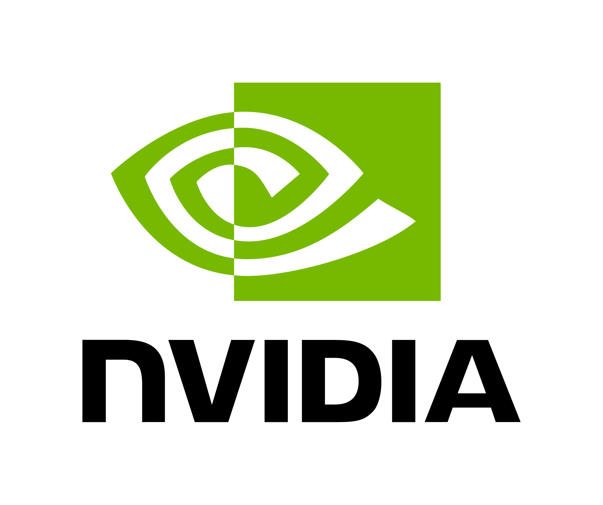
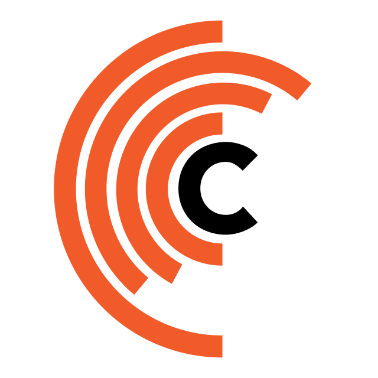
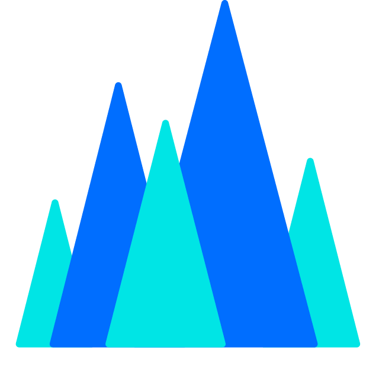

# 無料で使える LLM API・クラウドモデル一覧

[English](./readme.md) | [简体中文](./README.zh-CN.md) | [**日本語**](./README.ja.md) | [Português (Brasil)](./README.pt-BR.md)

> **情報の基準日：2026年11月2日。** 英語版 README の内容を日本語で整理したものです。モデルの提供状況・無料枠・キャンペーンは変更されるため、利用時には各サービスの公式サイトとアカウント画面を確認してください。

LLM をクラウド経由で試せるサービスをまとめました。**無料で何度も使えるAPI、毎日補充される枠、初回だけのトライアル、月額0ドルでも従量課金のサービス**は別物です。登録条件、利用回数、モデル、APIエンドポイントを比較できます。

**この日本語版では中国本土向けサービスの章を掲載していません。** 中国向けサービスも含む一覧は[中国語版](./README.zh-CN.md)または[英語版](./readme.md)を参照してください。

<table align="center">
  <tr>
    <td align="center"></td>
    <td align="center"></td>
    <td align="center"></td>
    <td align="center"></td>
    <td align="center"></td>
    <td align="center"></td>
  </tr>
  <tr>
    <td align="center"></td>
    <td align="center"></td>
    <td align="center"></td>
    <td align="center"></td>
    <td align="center"></td>
    <td align="center"></td>
  </tr>
</table>

**関連プロジェクト：** [翻訳向けLLMの選び方](https://github.com/CYBIRD-D/How-to-Choose-your-LLM-Model-for-translation/tree/main) · [ローカル翻訳モデル集](https://github.com/CYBIRD-D/Local-LLMs-Collection-For-Translation) · [LLMリリース年表](https://github.com/CYBIRD-D/AI-Model-LLM-Timeline) · [公式API料金トラッカー](https://github.com/CYBIRD-D/LLM-API-Official-Pricing-Tracker)

**使い方の基本：** 使いたいサービスに登録してAPIキーと接続先URLを取得し、対応するアプリに設定します。無料枠の期限・本人確認・課金への自動移行には注意してください。

## 目次

- [AMD AI Developer Program](#amd-ai-developer-program)
- [Google Gemini / Gemma 4](#google-gemini--gemma-4)
- [NVIDIA NIM](#nvidia-nim)
- [Ollama](#ollama)
- [Groq](#groq)
- [Cerebras（無料利用の実用性が低い）](#cerebras無料利用の実用性が低い)
- [OpenRouter](#openrouter)
- [Cloudflare Workers AI](#cloudflare-workers-ai)
- [Cohere](#cohere)
- [Z.ai](#zai)
- [GitHub Models（サービス終了）](#github-modelsサービス終了)
- [Mistral](#mistral)
- [SambaNova](#sambanova)
- [AionLabs](#aionlabs)
- [SKT](#skt)
- [IBM watsonx.ai](#ibm-watsonxai)
- [Scaleway](#scaleway)
- [Together AI（無料枠終了）](#together-ai無料枠終了)
- [LLM API料金比較表](#llm-api料金比較表)

---

## 海外・国際向けサービス

### AMD AI Developer Program

> 確認日：**2026年11月2日**。**一度限りの開発者向け特典であり、毎日補充される無料LLM APIではありません。**

**公式情報：** [プログラムへの参加](https://developer.amd.com/ai-developer-program/) · [特典・申請条件](https://developer.amd.com/resources/)

- 承認された開発者は無料で参加できます。特典の申請では、以下の**どちらか一つを選ぶ**形式です。両方もらえるとは限りません。
- **AMD Developer Cloud：100米ドル分**。AMDのクラウドGPU計算資源に利用でき、モデルを自分で展開・実行できます。交換リンクから有効化した後、**30日で失効**します。
- **Fireworks AI：50米ドル分**。外部サービスのFireworks AIで利用できる特典です。コードは発行から**90日以内**に引き換える必要があり、引換後は原則として使い切るまで有効です（Fireworks側の規約が適用されます）。
- **注意：** GPU利用クレジットはホスト済みLLMのAPI無料枠とは異なります。中国向けの **AMD Radeon Cloud Token Factory** の日次ptsとも別制度です。

---

### Google Gemini / Gemma 4

> 確認日：**2026年10月30日**

**公式情報：** [モデル別料金・無料枠](https://ai.google.dev/gemini-api/docs/pricing) · [レート制限](https://ai.google.dev/gemini-api/docs/rate-limits) · [AI Studioで利用枠を確認](https://aistudio.google.com/rate-limit)

**エンドポイント：** `https://generativelanguage.googleapis.com`

- 元の料金表で無料枠が確認できた例は、**Gemini 3.8 Flash、Gemini 3.5 Flash-Lite、Gemma 4**です。他のモデルは公式ページの「Free Tier」欄を確認してください。
- **Gemini 4 Argon と Gemini 3.1 Pro Preview** は無料枠対象外です。その他のProモデルも個別に確認が必要です。
- 無料アカウントすべてに共通する確定的なRPM・TPM・RPDはありません。実際の上限は**モデル・プロジェクト・アカウントの利用レベル**で変わります。
- 上限はAPIキー単位ではなく**プロジェクト単位**。1日のリクエスト枠は**米国太平洋時間の午前0時**にリセットされます。
- 無料枠で入力したデータは、Google製品の改善に利用される可能性があります。
- **非公式の方法：** [AI Studio to API Adapter](https://github.com/iBUHub/AIStudioToAPI/blob/main/README_EN.md)。利用前にセキュリティと利用規約を確認してください。

過去の上限値の例（現在の全ユーザー共通枠ではありません）

| モデル | RPM | TPM | RPD |
|---|---:|---:|---:|
| Gemini 2.5～3.8 Flash | 5 | 250K | 20 |
| Gemini 2.5 Flash-Lite | 10 | 250K | 20 |
| Gemini 3.1/3.5 Flash-Lite | 15 | 250K | 500 |
| Gemma 4 26B/31B | 30 | 16K | 14,400 |

上記は旧READMEに載っていた参考値で、現在のアカウントに保証された上限ではありません。

---

### NVIDIA NIM

> 確認日：**2026年10月30日**

**モデル一覧：** https://build.nvidia.com/models

**OpenAI互換エンドポイント：** `https://integrate.api.nvidia.com/v1`

- 無料試用エンドポイントは一般的に**最大約40 RPM**ですが、モデルや利用者の集中によって制限されることがあります。
- 試用・検証用の共有サービスです。安定した商用運用には、専用環境へのNIMの展開を検討してください。
- 以下は**一部のモデルを挙げた参考一覧**です。現在無料で試せるかどうかは、公式カタログの **Free Endpoint** 表示で確認してください。
- 機密情報を送る前にデータの取扱条件も確認してください。

モデル一覧を開く

#### DeepSeek
deepseek-ai/deepseek-v4-flash  
deepseek-ai/deepseek-v4-flash-0731  
deepseek-ai/deepseek-v4-pro  
deepseek-ai/deepseek-v4.1-flash  

#### Google
google/codegemma-7b  
google/gemma-7b  

#### Meta
meta/llama2-70b  
meta/llama-3.1-8b-instruct  
meta/llama-3.1-70b-instruct  
meta/llama-3.2-1b-instruct  
meta/llama-3.2-3b-instruct  
meta/llama-3.3-70b-instruct  
meta/muse-glimmer-30b  

#### Microsoft
microsoft/phi-4-mini-instruct  
microsoft/phi-4-mini-flash-reasoning  

#### MiniMax
minimaxai/minimax-m2.5  
minimaxai/minimax-m2.7  
minimaxai/minimax-m3.1-flash  

#### Mistral
mistralai/mistral-nemotron  
mistralai/mixtral-8x7b-instruct  
mistralai/mixtral-8x22b-instruct  
mistralai/mistral-large-4-1t-a52b  

#### Moonshot AI / Kimi
moonshotai/kimi-k2-instruct  
moonshotai/kimi-k2-thinking  
moonshotai/kimi-k3  

#### NVIDIA
nvidia/gliner-pii  
nvidia/llama-3.1-nemoguard-8b-content-safety  
nvidia/llama-3.1-nemoguard-8b-topic-control  
nvidia/llama-3.1-nemotron-safety-guard-8b-v3  
nvidia/llama-3.3-nemotron-super-49b-v1  
nvidia/llama-3.3-nemotron-super-49b-v1.5  
nvidia/llama-3.1-nemotron-ultra-253b-v1  
nvidia/nemotron-3-ultra-550b-a55b  
nvidia/nemotron-3.5-lightning-30b-a3b  
nvidia/nemotron-3.5-super-vl-120b-a12b  
nvidia/nemoguard-jailbreak-detect  
nvidia/nemotron-3-nano-30b-a3b  
nvidia/nemotron-3-super-120b-a12b  
nvidia/nemotron-content-safety-reasoning-4b  
nvidia/nvidia-nemotron-nano-9b-v2  
nvidia/riva-translate-4b-instruct-v1.1  
nvidia/riva-translate-4b-instruct-v2  
nvidia/usdcode  

#### OpenAI
openai/gpt-oss-20b  
openai/gpt-oss-120b  

#### Poolside
poolside/laguna-xs-2-1  

#### Qwen
qwen/qwen2.5-coder-32b-instruct  
qwen/qwen3-next-80b-a3b-instruct  
qwen/qwen3-next-80b-a3b-thinking  
qwen/qwq-32b  

#### Sarvam AI
sarvamai/sarvam-m  

#### StepFun
stepfun-ai/step-3.5-flash  
stepfun-ai/step-5-preview  

#### Stockmark
stockmark/stockmark-2-100b-instruct  

#### Thinking Machines
thinking-machines/inkling  

#### Upstage
upstage/solar-10.7b-instruct  

#### Z.ai / GLM
z-ai/glm4.7  
z-ai/glm5.1  
z-ai/glm-5.2  
z-ai/glm-5.3  
z-ai/glm-5.3-flash

---

### Ollama

> 確認日：**2026年10月30日**。**Ollama Cloudの利用料金はトークン従量制です。「月額0ドル」は「推論が無料」という意味ではありません。**

**公式情報：** [料金とプラン](https://ollama.com/pricing) · [クラウドモデル](https://ollama.com/search?c=cloud) · [2026年8月31日の料金制度変更](https://ollama.com/blog/transparent-pricing)

- **Pay as you go（月額0ドル）**では、クラウドの推論利用量に応じて購入済みクレジットが消費されます。従来の「無料モデル一覧」「3時間ごとの枠リセット」を現行の共通特典として扱わないでください。
- 自分のPCでモデルをローカル実行する場合は、Ollamaのクラウド推論料金は発生しません。
- 同時実行数はPay as you go・Proで**3件**、Max・Teamで**10件**が目安です。旧契約のアカウントでは条件が異なる場合があります。

| プラン | 月額など | 含まれるクラウド利用クレジット |
|---|---:|---:|
| Pay as you go | 月額 $0 | 付与額なし。利用分の購入が必要 |
| Pro | 月額 $20（年払い $200） | 月額 $60 |
| Max | 月額 $100 | 月額 $300 |
| Team | 月額 $500 | 月額 $1,000（チーム共有） |
| Enterprise | 個別見積もり | 個別契約 |

Ollama Cloudのモデル別料金（米ドル／100万トークン）

合計は**入力100万＋出力100万トークン**の費用です。

| モデル | 入力 | 出力 | 合計 |
|---|---:|---:|---:|
| deepseek-v4.1-flash （オフピーク） | $0.15 | $0.60 | $0.75 |
| deepseek-v4.1-flash （通常） | $0.30 | $1.20 | $1.50 |
| deepseek-v4-pro （オフピーク） | $0.66 | $1.98 | $2.64 |
| deepseek-v4-pro （通常） | $1.32 | $3.96 | $5.28 |
| gemma4 | $0.14 | $0.40 | $0.54 |
| glm-5.3 / glm-5.2 | $1.40 | $4.40 | $5.80 |
| glm-5.3-flash | $0.15 | $0.50 | $0.65 |
| gpt-oss:120b | $0.15 | $0.60 | $0.75 |
| gpt-oss:20b | $0.07 | $0.30 | $0.37 |
| kimi-k3 | $3.00 | $15.00 | $18.00 |
| kimi-k2.7-code / kimi-k2.6 | $0.95 | $4.00 | $4.95 |
| minimax-m3.1-flash | $0.15 | $0.60 | $0.75 |
| minimax-m3 | $0.60 | $2.40 | $3.00 |
| minimax-m2.7 | $0.30 | $1.20 | $1.50 |
| mistral-large-4 | $0.70 | $2.10 | $2.80 |
| mistral-large-3 | $0.50 | $1.50 | $2.00 |
| muse-spark-open | $1.25 | $4.25 | $5.50 |
| nemotron-3-nano | $0.06 | $0.24 | $0.30 |
| nemotron-3-super | $0.015 | $0.60 | $0.615 |
| nemotron-3-ultra | $0.10 | $3.00 | $3.10 |

対象モデルのオフピーク料金は、平日**UTC 12:00～18:00以外**および週末全体に適用されます。キャッシュ入力の料金は[公式表](https://ollama.com/pricing)を参照してください。**ここにあるのは有料クラウドの料金です。**

---

### Groq

> 確認日：**2026年10月30日**

**公式制限：** https://console.groq.com/docs/rate-limits

**OpenAI互換エンドポイント：** `https://api.groq.com/openai/v1`

無料プランの公開された制限表には、**GPT-OSS 20B／120B、Qwen3.8 27B**などが掲載されています。組織ごとに上限が変わることがあります。

無料モデルと制限を表示

| モデル | リクエスト/分 | リクエスト/日 | トークン/分 | トークン/日 |
| --- | ---: | ---: | ---: | ---: |
| openai/gpt-oss-120b | 30 | 1K | 8K | 200K |
| openai/gpt-oss-20b | 30 | 1K | 8K | 200K |
| qwen/qwen3.8-27b | 30 | 1K | 8K | 200K |

---

### Cerebras（無料利用の実用性が低い）

> 確認日：**2026年10月30日**

**公式情報：** https://inference-docs.cerebras.ai/support/rate-limits

**API：** `https://api.cerebras.ai`

元のREADMEでは無料枠の制限が厳しく、実用上の選択肢から外しています。過去に**アカウントあたり約5米ドルの試用枠**が記載されていましたが、現在の適用条件は管理画面で確認してください。

| モデル | リクエスト/分 | トークン/分 | トークン/時 | トークン/日 |
|--------------------------------------|-----------------|---------------|-------------|------------|
| gpt-oss-120b                         | 5               |  30k          | 1M          | 1M         |
| gemma-4-31b                          | 5               |  30k          | 1M          | 1M         |

---

### OpenRouter

> 確認日：**2026年10月30日**

**公式情報：** [無料モデル一覧](https://openrouter.ai/collections/free-models) · [料金](https://openrouter.ai/pricing) · [制限](https://openrouter.ai/docs/api-reference/limits)

**OpenAI互換エンドポイント：** `https://openrouter.ai/api/v1`

- 無料モデルの顔ぶれは変わります。`openrouter/free` を指定すると、対応する無料モデルに自動で振り分けられます。
- IDが `:free` で終わるモデルは一般的に**20 RPM**まで。
- 購入済みクレジットが**10米ドル未満**のアカウントは**1日50リクエスト**、累計**10米ドル以上**で**1日1,000リクエスト**が目安です。
- **失敗したリクエストもカウント対象**です。料金表示が $0 でも `:free` が付かないモデルには、別途支払い条件がある場合があります。

| モデルの種類（ID） | 購入済みクレジット | リクエスト/分 | リクエスト/日 |
| --- | ---: | ---: | ---: |
| *:free | < $10 相当の購入済みクレジット | 20 | 50 |
| *:free | ≥ $10 相当の購入済みクレジット | 20 | 1000 |

---

### Cloudflare Workers AI

> 料金ページの更新日：**2026年10月20日**

**公式情報：** [Workers AI モデル別料金](https://developers.cloudflare.com/workers-ai/platform/pricing/#llm-model-pricing) · [Workersプラン](https://developers.cloudflare.com/workers/platform/pricing/)

- 無料プランには毎日**10,000 Neurons**が含まれ、**UTC 00:00**にリセットされます。Neuronは計算資源に基づく独自の計量単位で、トークン数やドルとは異なります。
- 無料枠を超えて有料利用する場合は**1,000 Neuronsあたり $0.011**です。
- **注意：** Kimi、DeepSeek V4/V4.1、GLM-5.xなど一部のモデルは、無料Neuronが残っていても**Workers PaidまたはAI Gatewayへの入金**が必要です。下表に載っていても支払い設定なしで使えるとは限りません。
- Llama、Qwen、Mistral、Gemma、DeepSeek、GLM、Nemotron、Kimi、Graniteなど多数のモデルを提供していますが、利用可能なモデルと料金は公式サイトで確認してください。

モデル料金と1日あたりのトークン数の概算

- 料金単位：米ドル／100万トークン。合計は入力料金＋出力料金。
- 1日の推定トークン数は**入力:出力＝1:1.3**を仮定し、Neuron消費率から計算しています。
- **有料設定が必須のモデルでは、ここにあるトークン数は比較用の試算であり、実際に無料で付与される量ではありません。**
- キャッシュ入力料金は推定から除外し、条件が同一の同系列モデルだけまとめています。

| 順位 | 提供元 | モデル | 入力 | 出力 | 合計 | 1万 Neurons で使える推定トークン数/日（入力:出力＝1:1.3） | 備考 |
|---:|---|---|---:|---:|---:|---:|---|
| 1 | IBM | Granite 4.0 H Micro | $0.017 | $0.112 | **$0.129** | **~1.560M** | — |
| 2 | Meta | Llama 3.2 1B Instruct | $0.027 | $0.201 | **$0.228** | **~878K** | — |
| 3 | Mistral | Mistral 7B Instruct v0.1 | $0.110 | $0.190 | **$0.300** | **~708K** | — |
| 4 | Meta | Llama 3.2 3B Instruct | $0.051 | $0.335 | **$0.386** | **~520K** | — |
| 5 | Qwen | Qwen3 30B-A3B FP8 | $0.051 | $0.335 | **$0.386** | **~520K** | — |
| 6 | Meta | Llama 3/3.1 8B Instruct AWQ | $0.123 | $0.266 | **$0.389** | **~539K** | 同一料金のため統合 |
| 7 | Google | Gemma 4 26B-A4B IT | $0.100 | $0.300 | **$0.400** | **~516K** | — |
| 8 | Meta | Llama 3.1 8B Instruct FP8 Fast | $0.045 | $0.384 | **$0.429** | **~465K** | — |
| 9 | Meta | Llama 3.1 8B Instruct FP8 | $0.152 | $0.287 | **$0.439** | **~482K** | — |
| 10 | Z.AI | GLM-4.7 Flash | $0.060 | $0.400 | **$0.460** | **~435K** | — |
| 11 | OpenAI | GPT-OSS 20B | $0.200 | $0.300 | **$0.500** | **~429K** | — |
| 12 | Meta | Llama Guard 3 8B | $0.484 | $0.030 | **$0.514** | **~484K** | 安全性判定用。通常のチャット向けではない |
| 13 | Meta | Llama 3.2 11B Vision Instruct | $0.049 | $0.676 | **$0.725** | **~273K** | 画像入力に対応 |
| 14 | Google | Gemma 3 12B IT | $0.345 | $0.556 | **$0.901** | **~237K** | — |
| 15 | AI Singapore | Gemma SEA-LION v4 27B IT | $0.351 | $0.555 | **$0.906** | **~236K** | — |
| 16 | Mistral | Mistral Small 3.1 24B Instruct | $0.351 | $0.555 | **$0.906** | **~236K** | — |
| 17 | OpenAI | GPT-OSS 120B | $0.350 | $0.750 | **$1.100** | **~191K** | — |
| 18 | Meta | Llama 3/3.1 8B Instruct | $0.282 | $0.827 | **$1.109** | **~187K** | 同一料金のため統合 |
| 19 | Meta | Llama 4 Scout 17B-16E Instruct | $0.270 | $0.850 | **$1.120** | **~184K** | — |
| 20 | Qwen | QwQ 32B | $0.660 | $1.000 | **$1.660** | **~129K** | — |
| 21 | Qwen | Qwen2.5 Coder 32B Instruct | $0.660 | $1.000 | **$1.660** | **~129K** | — |
| 22 | DeepSeek | DeepSeek V4 Flash 0731 | $0.440 | $1.320 | **$1.760** | **~117K** | キャッシュ入力 $0.014; 有料決済の設定が必要 |
| 23 | NVIDIA | Nemotron 3 120B-A12B | $0.500 | $1.500 | **$2.000** | **~103K** | — |
| 24 | Meta | Llama 3.1/3.3 70B Instruct FP8 Fast | $0.293 | $2.253 | **$2.546** | **~78.5K** | 同一料金のため統合 |
| 25 | Moonshot AI | Kimi K2.5 | $0.600 | $3.000 | **$3.600** | **~56.2K** | キャッシュ入力 $0.100 |
| 26 | Qwen | Qwen3.8 27B | $0.450 | $3.200 | **$3.650** | **~54.9K** | — |
| 27 | Moonshot AI | Kimi K2.6 | $0.950 | $4.000 | **$4.950** | **~41.1K** | キャッシュ入力 $0.160; 有料決済の設定が必要 |
| 28 | Moonshot AI | Kimi K2.7 Code | $0.950 | $4.000 | **$4.950** | **~41.1K** | キャッシュ入力 $0.190; 有料決済の設定が必要 |
| 29 | DeepSeek | DeepSeek V4 Pro 0813 | $1.320 | $3.960 | **$5.280** | **~39.1K** | キャッシュ入力 $0.044; 有料決済の設定が必要 |
| 30 | DeepSeek | DeepSeek R1 Distill Qwen 32B | $0.497 | $4.881 | **$5.378** | **~37.0K** | — |
| 31 | Z.AI | GLM-5.2 | $1.400 | $4.400 | **$5.800** | **~35.5K** | キャッシュ入力 $0.260; 有料決済の設定が必要 |
| 32 | Meta | Llama 2 7B Chat FP16 | $0.556 | $6.667 | **$7.223** | **~27.4K** | — |

---

### Cohere

> 確認日：**2026年10月30日**

**公式情報：** https://docs.cohere.com/docs/rate-limits

**API：** `https://api.cohere.ai/compatibility`

試用キーのChat APIは**モデルあたり20リクエスト/分、全エンドポイント合計で月1,000回**が目安です。対象の例：Command A+、Command A Reasoning、Command A Translate、Command A Vision、Command A、Command R+、Command R、Command R7B、North Mini Code。実際の利用可否は管理画面で確認してください。

| API | 試用時の上限（リクエスト/分） | 月間上限（リクエスト/月） |
|---------------------|----------------------------------|----------------------------------|
| チャット API            | 20/min （モデルごと）               | 1000/month                       |

---

### Z.ai

> 確認日：**2026年10月30日**

**公式料金：** https://docs.z.ai/guides/overview/pricing

**API：** `https://api.z.ai/api/paas/v4`

元の料金表で無料と掲載されていたモデル：

- GLM-4.5-Flash
- GLM-4.7-Flash
- GLM-4.6V-Flash

**全アカウントに共通する公式のRPM・TPM上限は確認できません。** 実際の利用制限はアカウントで確認してください。

---

### GitHub Models（サービス終了）

**GitHub Modelsは2026年7月30日に終了**しました。Playground、モデル一覧、推論API、持ち込みAPIキー機能（BYOK）は利用できません。GitHub Copilotとは別のサービスです。

**参考：** https://docs.github.com/en/github-models/use-github-models/prototyping-with-ai-models#rate-limits

---

### Mistral

> 確認日：**2026年10月30日**

**公式情報：** [使用状況と制限](https://docs.mistral.ai/admin/billing-usage/usage-limits) · [制限の説明](https://help.mistral.ai/en/articles/698531-why-am-i-hitting-api-rate-limits-and-how-do-i-increase-them)

**API：** `https://api.mistral.ai`

無料モードは試用・開発向けです。**RPS、TPM、月間トークン数は組織・モデルによって異なります**。管理画面の **Admin Panel → API → Limits** を確認してください。以下の数値は過去のコミュニティ報告であり、現在すべてのアカウントに保証されるものではありません。

過去の参考制限を表示

| プラン | リクエスト/秒（RPS） | トークン/分（TPM） | 月間トークン |
| --- | ---: | ---: | ---: |
| Mistral API 無料プラン | 1/sec | 500k | 10億 |

---

### SambaNova

> 確認日：**2026年10月30日**

**公式の無料プラン制限：** https://docs.sambanova.ai/docs/en/models/rate-limits#free-tier

| モデル | リクエスト/分 | リクエスト/日 | トークン/日 |
| --- | ---: | ---: | ---: |
| DeepSeek-V3.1 | 20 | 20 | 200k |
| Meta-Llama-3.3-70B-Instruct | 20 | 20 | 200k |
| gpt-oss-120b | 20 | 20 | 200k |
| DeepSeek-V3.2 | 20 | 20 | 200k |
| gemma-4-31B-it | 20 | 20 | 200k |

---

### AionLabs

> 確認日：**2026年10月30日**

**公式情報：** [制限](https://www.aionlabs.ai/docs/rate-limits/) · [モデル一覧](https://www.aionlabs.ai/docs/models/)

**API：** `https://api.aionlabs.ai/v1`

無料枠は全モデルで共有され、**15 RPM、20,000 TPM、1日20,000トークン**が上限です。モデルごとに別々の1日枠が配られるわけではありません。

| モデル | リクエスト/分 | トークン/日 |
| --- | ---: | ---: |
| Aion-2.0 (DeepSeek V3.2 微調整版) | 15 | 20k |
| Aion-2.5 (改良版 Aion-2.0) | 15 | 20k |
| Aion-3.0 (GLM) | 15 | 20k |
| Aion-3.0 Mini (Deepseek) | 15 | 20k |
| Aion-3.5 (GLM) | 15 | 20k |
| Aion-3.5 Mini (GLM) | 15 | 20k |
| Aion-RP 1.0 (8B) (llama-3.1-8b 微調整済み・重み公開) | 15 | 20k |

---

### SKT

**無料API：** A.X 4.0（Qwen2.5ベースの7B／72B）。主に**韓国語と英語**の処理・翻訳向けです。

**公式案内：** https://github.com/SKT-AI/A.X-4.0/blob/main/apis/README.md

---

### IBM watsonx.ai

> 確認日：**2026年10月8日**

**公式料金：** https://www.ibm.com/products/watsonx-ai/pricing

基盤モデルの無料枠の参考値は**2 RPS、月30万トークン**です。アカウントに付与された最新の条件を確認してください。

| プラン | リクエスト/秒（RPS） | 月間トークン |
| --- | ---: | ---: |
| watsonx.ai 無料プラン（基盤モデル） | 2/sec | 300k |

---

### Scaleway

**無料枠：** アカウントあたり**初回100万トークン**。使い切っても自動補充されません。

**公式案内：** https://www.scaleway.com/en/docs/generative-apis/faq/#how-does-the-free-tier-work

---

### Together AI（無料枠終了）

**現在の状態：** 以前の無料LLM推論プランは終了しています。Llama 3.3 70BやDeepSeek R1 Distill Llama 70Bの旧無料エンドポイントは、現行の無料サービスとして扱えません。

**公式告知：** https://support.together.ai/articles/1862638756-changes-to-free-tier-and-billing-july-2025

---

## LLM API料金比較表

> **データ更新日：2026年10月30日。** [LLM API Official Pricing Tracker](https://github.com/CYBIRD-D/LLM-API-Official-Pricing-Tracker)から同期した参考情報であり、リアルタイム価格ではありません。利用前に各行の出典から最新料金を確認してください。

料金単位は**米ドル／100万トークン**です。**合計＝入力100万トークンの料金＋出力100万トークンの料金**で、合計100万トークンを使った費用ではありません。キャッシュ入力が `—` の場合は**料金不明または記載なし**で、無料を意味しません。

合計料金の安い順に並べ、同額の場合は比較できるキャッシュ入力料金が安いモデルを優先しています。プロモーションと通常料金、ピークとオフピーク、別料金の高速プランは個別の行です。コンテキスト長によって料金が変わるモデルは最安・基本の区間を採用しています。QwenはAlibaba Cloud Model Studioのシンガポール／国際版料金です。開放ウェイトの有無やパラメータ数は[元の料金トラッカー](https://github.com/CYBIRD-D/LLM-API-Official-Pricing-Tracker#price-leaderboard)を参照してください。

| 順位 | プロバイダー | モデル | 入力 | キャッシュ入力 | 出力 | 合計 | 備考 | 料金の出典 |
|---:|---|---|---:|---:|---:|---:|---|---|
| 1 | Qwen | Qwen3.7 Flash | $0.03 | — | $0.13 | **$0.16** | 入力が32K以下の場合の基本料金。32K～256Kは入力 $0.10／出力 $0.40、256K～1Mは入力 $0.20／出力 $0.80 | [出典](https://www.alibabacloud.com/help/en/model-studio/model-pricing) |
| 2 | Meta / OpenRouter | Muse Spark 1.2/1.3 Contributor | $0.10 | $0.002 | $0.20 | **$0.30** | コンテキスト長100万トークン。入力内容や出力がMeta製品の改善に利用される可能性あり | [出典](https://openrouter.ai/meta/muse-spark-1.3-contributor) |
| 3 | Qwen | Qwen3.5 Flash | $0.10 | — | $0.40 | **$0.50** | 国際版の料金 | [出典](https://www.alibabacloud.com/help/en/model-studio/model-pricing) |
| 4 | Anthropic | Claude Haiku 5.5 | $0.10 | $0.01 | $0.50 | **$0.60** | 入力100K以下。100K超の場合は入力 $0.50／キャッシュ入力 $0.05／出力 $2.50 | [出典](https://platform.claude.com/docs/en/models/haiku-5-5/overview) |
| 5 | OpenAI | GPT-6 Luna | $0.10 | $0.01 | $0.50 | **$0.60** | コンテキスト長105万トークン。272K超の入力は $0.20／出力 $0.75 | [出典](https://developers.openai.com/api/docs/pricing) |
| 6 | Qwen | Qwen3.8 Flash | $0.15 | — | $0.47 | **$0.62** | 国際版。コンテキスト長100万トークン | [出典](https://www.alibabacloud.com/help/en/model-studio/model-pricing) |
| 7 | GLM / Z.AI | GLM-5.3-Flash | $0.15 | $0.03 | $0.50 | **$0.65** | 通常料金 | [出典](https://docs.z.ai/guides/overview/pricing) |
| 8 | DeepSeek | DeepSeek V4.1 Flash 1017 — オフピーク | $0.15 | $0.003 | $0.60 | **$0.75** | コンテキスト長100万トークン。1017版でもAPI料金は変更なし。オフピーク料金 | [出典](https://api-docs.deepseek.com/quick_start/pricing/) |
| 9 | MiniMax | MiniMax M3.1 Flash | $0.15 | $0.015 | $0.60 | **$0.75** | コンテキスト長100万トークン。モデルの重みを公開済み。マルチモーダル入力に対応 | [出典](https://www.minimax.io/blog/minimax-m31f) |
| 10 | Mistral | Mistral Small 4 | $0.15 | $0.015 | $0.60 | **$0.75** | コンテキスト長256K | [出典](https://docs.mistral.ai/models/mistral-small-4-0-26-03) |
| 11 | OpenAI | GPT-5.6 Luna | $0.20 | $0.02 | $1.20 | **$1.40** | 272K超の入力は $0.40／出力 $1.80 | [出典](https://developers.openai.com/api/docs/pricing) |
| 12 | Meta / OpenRouter | Muse Glimmer 30B | $0.30 | $0.04 | $1.10 | **$1.40** | コンテキスト長131K | [出典](https://openrouter.ai/meta/muse-glimmer-30b) |
| 13 | OpenAI | GPT-5.4 nano | $0.20 | $0.02 | $1.25 | **$1.45** | — | [出典](https://developers.openai.com/api/docs/pricing) |
| 14 | DeepSeek | DeepSeek V4.1 Flash 1017 — ピーク | $0.30 | $0.006 | $1.20 | **$1.50** | コンテキスト長100万トークン。1017版でもAPI料金は変更なし。ピーク料金 | [出典](https://api-docs.deepseek.com/quick_start/pricing/) |
| 15 | MiniMax | MiniMax M2.7 | $0.30 | $0.06 | $1.20 | **$1.50** | コンテキスト長約205K。キャッシュ書き込みは100万トークンあたり $0.375 | [出典](https://platform.minimax.io/docs/guides/pricing-paygo) |
| 16 | MiniMax | MiniMax M3 | $0.30 | $0.06 | $1.20 | **$1.50** | 入力512K以下。512K超は入力 $0.60／キャッシュ入力 $0.12／出力 $2.40。継続的な50%割引 | [出典](https://platform.minimax.io/docs/guides/pricing-paygo) |
| 17 | Qwen | Qwen3.7 Plus（割引料金） | $0.32 | — | $1.28 | **$1.60** | 国際版の別名。20%割引。通常料金は入力 $0.40／出力 $1.60 | [出典](https://www.alibabacloud.com/help/en/model-studio/model-pricing) |
| 18 | Google | Gemini 3.1 Flash-Lite | $0.25 | $0.025 | $1.50 | **$1.75** | — | [出典](https://ai.google.dev/gemini-api/docs/pricing) |
| 19 | Qwen | Qwen3.6 Flash | $0.25 | — | $1.50 | **$1.75** | 入力256K以下。国際版 | [出典](https://www.alibabacloud.com/help/en/model-studio/model-pricing) |
| 20 | Qwen | Qwen3.7 Plus（通常料金） | $0.40 | — | $1.60 | **$2.00** | 入力256K以下 | [出典](https://www.alibabacloud.com/help/en/model-studio/model-pricing) |
| 21 | MiniMax | MiniMax M3 — Priority | $0.45 | $0.09 | $1.80 | **$2.25** | 入力512K以下。優先処理による高速提供。512K超は入力 $0.90／キャッシュ入力 $0.18／出力 $3.60。継続的な50%割引 | [出典](https://platform.minimax.io/docs/guides/pricing-paygo) |
| 22 | DeepSeek | DeepSeek V4 Pro — オフピーク | $0.66 | $0.022 | $1.98 | **$2.64** | オフピーク料金 | [出典](https://api-docs.deepseek.com/quick_start/pricing/) |
| 23 | Google | Gemini 3.5 Flash-Lite | $0.30 | $0.03 | $2.50 | **$2.80** | — | [出典](https://ai.google.dev/gemini-api/docs/pricing) |
| 24 | Mistral | Mistral Large 4 | $0.70 | $0.07 | $2.10 | **$2.80** | コンテキスト長100万トークン。10月29日に重みを公開。公式APIの通常料金 | [出典](https://docs.mistral.ai/models/mistral-large-4-0) |
| 25 | Qwen | Qwen3.5 Plus | $0.40 | — | $2.40 | **$2.80** | 入力256K以下。国際版 | [出典](https://www.alibabacloud.com/help/en/model-studio/model-pricing) |
| 26 | MiniMax | MiniMax M2.7 Highspeed | $0.60 | $0.06 | $2.40 | **$3.00** | 公開済みM2.7と同じモデルを高速提供。コンテキスト長約205K。キャッシュ書き込み $0.375／100万トークン | [出典](https://platform.minimax.io/docs/guides/pricing-paygo) |
| 27 | xAI | Grok Build 0.1 | $1.00 | $0.20 | $2.00 | **$3.00** | 入力200K未満。200K以上は入力 $2／出力 $4 | [出典](https://docs.x.ai/developers/pricing) |
| 28 | Qwen | Qwen3.6 Plus | $0.50 | — | $3.00 | **$3.50** | 入力256K以下。国際版 | [出典](https://www.alibabacloud.com/help/en/model-studio/model-pricing) |
| 29 | xAI | Grok 4.20/4.3 | $1.25 | $0.20 | $2.50 | **$3.75** | 入力200K未満。200K以上は入力 $2.50／出力 $5 | [出典](https://docs.x.ai/developers/pricing) |
| 30 | GLM / Z.AI | GLM-5 | $1.00 | $0.20 | $3.20 | **$4.20** | — | [出典](https://docs.z.ai/guides/overview/pricing) |
| 31 | Google | Gemini 3.6/3.8 Flash（割引料金） | $0.75 | $0.075 | $3.75 | **$4.50** | 割引価格は2026年12月31日まで。旧3.7へのリクエストは3.8へ転送 | [出典](https://ai.google.dev/gemini-api/docs/pricing) |
| 32 | Kimi | Kimi K2.6 | $0.95 | $0.16 | $4.00 | **$4.95** | コンテキスト長約262K | [出典](https://www.kimi.com/) |
| 33 | Kimi | Kimi K2.7 Code | $0.95 | $0.19 | $4.00 | **$4.95** | コンテキスト長約262K | [出典](https://www.kimi.com/) |
| 34 | GLM / Z.AI | GLM-5-Turbo | $1.20 | $0.24 | $4.00 | **$5.20** | コンテキスト長200K。エージェント向けに最適化されたTurbo版 | [出典](https://docs.z.ai/guides/overview/pricing) |
| 35 | OpenAI | GPT-5.4 mini | $0.75 | $0.075 | $4.50 | **$5.25** | — | [出典](https://developers.openai.com/api/docs/pricing) |
| 36 | DeepSeek | DeepSeek V4 Pro — ピーク | $1.32 | $0.044 | $3.96 | **$5.28** | ピーク料金 | [出典](https://api-docs.deepseek.com/quick_start/pricing/) |
| 37 | Meta / OpenRouter | Muse Spark 1.1/1.2/1.3 | $1.25 | $0.15 | $4.25 | **$5.50** | コンテキスト長100万トークン。標準のデータ取扱規定が適用 | [出典](https://openrouter.ai/meta/muse-spark-1.3) |
| 38 | Meta / OpenRouter | Muse Spark Open | $1.25 | $0.15 | $4.25 | **$5.50** | コンテキスト長100万トークン。10月15日に重みを公開。Muse Spark 1.3と同じ基盤モデルを使用し、安全性向上の追加学習を実施 | [出典](https://openrouter.ai/meta/muse-spark-open) |
| 39 | GLM / Z.AI | GLM-5.1 | $1.40 | $0.26 | $4.40 | **$5.80** | コンテキスト長200K | [出典](https://docs.z.ai/guides/overview/pricing) |
| 40 | GLM / Z.AI | GLM-5.2/5.3 | $1.40 | $0.26 | $4.40 | **$5.80** | コンテキスト長100万トークン | [出典](https://docs.z.ai/guides/overview/pricing) |
| 41 | OpenAI | GPT-6.1 Terra | $1.00 | $0.05 | $5.00 | **$6.00** | コンテキスト長105万トークン。入力272K超は入力 $2／キャッシュ入力 $0.10／出力 $7.50。30分キャッシュ書き込み $1.25／100万トークン | [出典](https://developers.openai.com/api/docs/models/gpt-6.1-terra) |
| 42 | xAI | Grok 4.5 | $2.00 | $0.30 | $6.00 | **$8.00** | 入力200K未満。200K以上は入力 $4／出力 $12 | [出典](https://docs.x.ai/developers/pricing) |
| 43 | xAI | Grok 4.6 | $2.00 | $0.50 | $6.00 | **$8.00** | 入力200K未満。200K以上は入力 $4／出力 $12 | [出典](https://docs.x.ai/developers/pricing) |
| 44 | xAI | Grok 4.7 | $2.00 | $0.50 | $6.00 | **$8.00** | コンテキスト長500K。入力200K以上は入力 $4／出力 $12 | [出典](https://docs.x.ai/developers/pricing) |
| 45 | Qwen | Qwen3.8 Max | $2.00 | — | $6.00 | **$8.00** | 国際版。コンテキスト長100万トークン | [出典](https://www.alibabacloud.com/help/en/model-studio/model-pricing) |
| 46 | Google | Gemini 3.6/3.8 Flash（通常料金） | $1.50 | $0.15 | $7.50 | **$9.00** | 2027年1月1日からの通常料金。旧3.7へのリクエストは3.8へ転送 | [出典](https://ai.google.dev/gemini-api/docs/pricing) |
| 47 | Mistral | Mistral Medium 3.5 | $1.50 | $0.15 | $7.50 | **$9.00** | コンテキスト長256K | [出典](https://docs.mistral.ai/models/) |
| 48 | Kimi | Kimi K2.7 Code Highspeed | $1.90 | $0.38 | $8.00 | **$9.90** | コンテキスト長約262K。K2.7 Codeと同じモデルを高速提供 | [出典](https://www.kimi.com/) |
| 49 | Qwen | Qwen3.7 Max | $2.50 | — | $7.50 | **$10.00** | 国際版。コンテキスト長100万トークン | [出典](https://www.alibabacloud.com/help/en/model-studio/model-pricing) |
| 50 | Anthropic | Claude Sonnet 5.5 | $2.00 | $0.10 | $10.00 | **$12.00** | 10月7日からキャッシュ読み取り料金が $0.10 に値下げ | [出典](https://platform.claude.com/docs/en/about-claude/pricing) |
| 51 | Google | Gemini 4 Argon（割引料金） | $2.00 | $0.10 | $10.00 | **$12.00** | コンテキスト長100万トークン。暗黙的キャッシュのみ対応。割引は2026年11月30日まで | [出典](https://cloud.google.com/blog/products/ai-machine-learning/gemini-4-argon-available-on-google-cloud) |
| 52 | OpenAI | GPT-6.1 Sol | $2.00 | $0.10 | $10.00 | **$12.00** | コンテキスト長105万トークン。入力272K超は入力 $4／キャッシュ入力 $0.20／出力 $15 | [出典](https://developers.openai.com/api/docs/pricing) |
| 53 | Anthropic | Claude Sonnet 5 | $2.00 | $0.20 | $10.00 | **$12.00** | — | [出典](https://platform.claude.com/docs/en/about-claude/pricing) |
| 54 | OpenAI | GPT-6 Sol | $2.00 | $0.20 | $10.00 | **$12.00** | コンテキスト長105万トークン。入力272K超は入力 $4／キャッシュ入力 $0.40／出力 $15 | [出典](https://developers.openai.com/api/docs/pricing) |
| 55 | Kimi | Kimi K3.1 Pro | $2.00 | $0.20 | $10.00 | **$12.00** | コンテキスト長100万トークン。5分キャッシュ書き込み $2／100万トークン。元データの10月30日時点では重みの公開を11月4日に予定（当時未公開） | [出典](https://platform.kimi.ai/) |
| 56 | Google | Gemini 3.1 Pro Preview | $2.00 | $0.20 | $12.00 | **$14.00** | 入力200K以下。200K超は入力 $4／出力 $18 | [出典](https://ai.google.dev/gemini-api/docs/pricing) |
| 57 | OpenAI | GPT-5.6 Terra | $2.00 | $0.20 | $12.00 | **$14.00** | 入力272K超は入力 $4／出力 $18 | [出典](https://developers.openai.com/api/docs/pricing) |
| 58 | OpenAI | GPT-5.4 | $2.50 | $0.25 | $15.00 | **$17.50** | 入力272K超では長文コンテキスト追加料金あり | [出典](https://developers.openai.com/api/docs/pricing) |
| 59 | Anthropic | Claude Sonnet 4.6 | $3.00 | $0.30 | $15.00 | **$18.00** | — | [出典](https://platform.claude.com/docs/en/about-claude/pricing) |
| 60 | Kimi | Kimi K3 | $3.00 | $0.30 | $15.00 | **$18.00** | コンテキスト長100万トークン | [出典](https://www.kimi.com/) |
| 61 | Anthropic | Claude Opus 5.5 | $4.00 | $0.20 | $20.00 | **$24.00** | コンテキスト長100万トークン | [出典](https://platform.claude.com/docs/en/about-claude/pricing) |
| 62 | Google | Gemini 4 Argon（通常料金） | $4.00 | $0.20 | $20.00 | **$24.00** | コンテキスト長100万トークン。暗黙的キャッシュのみ対応。2026年12月1日からの通常料金 | [出典](https://cloud.google.com/blog/products/ai-machine-learning/gemini-4-argon-available-on-google-cloud) |
| 63 | Kimi | Kimi K3.1 Pro Highspeed | $4.00 | $0.20 | $20.00 | **$24.00** | K3.1 Proと同じモデルを約2～3倍の速度で提供。コンテキスト長100万トークン。5分キャッシュ書き込み $4／100万トークン | [出典](https://platform.kimi.ai/) |
| 64 | Meta | Muse Wonder | $4.00 | $0.20 | $20.00 | **$24.00** | コンテキスト長100万トークン。Meta Model API／OpenRouterで提供。Wonder Fullはサブスクリプション限定 | [出典](https://dev.meta.ai/models/muse-wonder) |
| 65 | OpenAI | GPT-5.6 Sol（割引料金） | $4.00 | $0.40 | $20.00 | **$24.00** | 割引は少なくとも2026年11月21日まで。通常料金は入力 $5／出力 $30 | [出典](https://developers.openai.com/api/docs/pricing) |
| 66 | Anthropic | Claude Opus 4.7/4.8/5 | $5.00 | $0.50 | $25.00 | **$30.00** | — | [出典](https://platform.claude.com/docs/en/about-claude/pricing) |
| 67 | OpenAI | GPT-5.5 | $5.00 | $0.50 | $30.00 | **$35.00** | — | [出典](https://developers.openai.com/api/docs/pricing) |
| 68 | OpenAI | GPT-5.6 Sol（通常料金） | $5.00 | $0.50 | $30.00 | **$35.00** | 通常料金。現在の割引は入力 $4／出力 $20 | [出典](https://developers.openai.com/api/docs/pricing) |
| 69 | Anthropic | Claude Fable 5.1 | $10.00 | $0.25 | $50.00 | **$60.00** | コンテキスト長100万トークン。キャッシュ読み取り料金は通常入力料金の2.5% | [出典](https://platform.claude.com/docs/en/about-claude/pricing) |
| 70 | Anthropic | Claude Fable 5 | $10.00 | $1.00 | $50.00 | **$60.00** | — | [出典](https://platform.claude.com/docs/en/about-claude/pricing) |
| 71 | OpenAI | GPT-6 Astra | $10.00 | $1.00 | $50.00 | **$60.00** | コンテキスト長105万トークン。入力272K超は入力 $20／キャッシュ入力 $2／出力 $75 | [出典](https://developers.openai.com/api/docs/pricing) |
| 72 | OpenAI | GPT-5.4/5.5 Pro | $30.00 | — | $180.00 | **$210.00** | 最大計算量のプラン | [出典](https://developers.openai.com/api/docs/pricing) |

> **DeepSeekの時間帯別料金：** ピークはUTC **01:00～04:00、06:00～10:00**、それ以外はオフピークです。V4.1 Flash 1017のオフピーク料金は入力 **$0.15／キャッシュ入力 $0.003／出力 $0.60**、ピーク料金は **$0.30／$0.006／$1.20**（いずれも100万トークン当たり）。V4 Proの料金は上表を参照してください。

---

[ページ先頭へ](#無料で使える-llm-apiクラウドモデル一覧) · [English](./readme.md) · [简体中文](./README.zh-CN.md) · [Português](./README.pt-BR.md)
