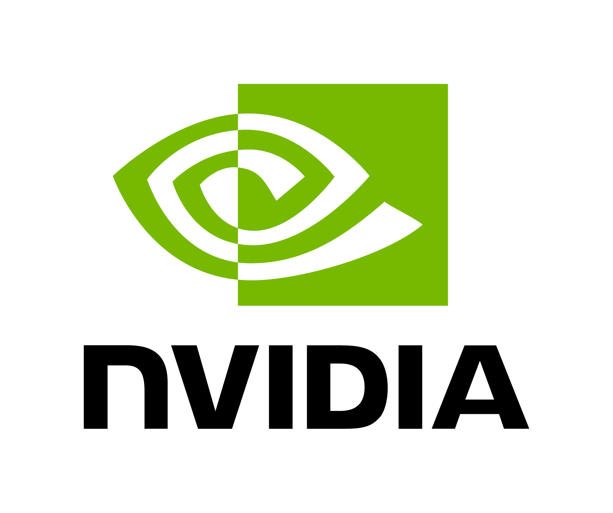
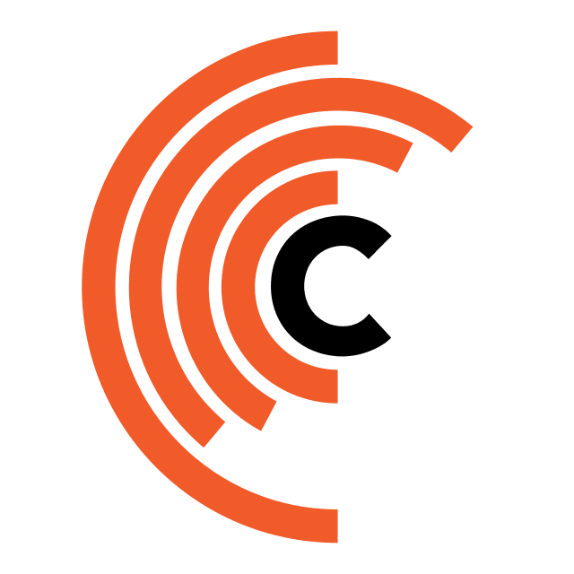
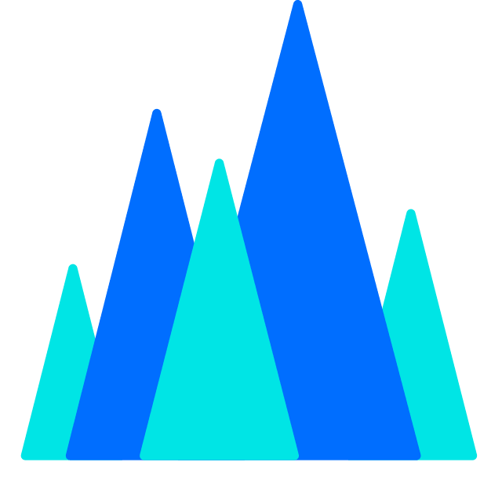

# Provedores de API de LLM grátis

[English](./readme.md) | [简体中文](./README.zh-CN.md) | [日本語](./README.ja.md) | [**Português (Brasil)**](./README.pt-BR.md)

> **Referência dos dados: 2 de novembro de 2026.** Esta versão traduz e organiza as informações do README em inglês. Modelos, cotas e campanhas podem mudar; consulte sempre a documentação oficial e os limites exibidos na sua conta.

Este repositório reúne serviços que oferecem **inferência de modelos de linguagem por API sem custo, cotas gratuitas ou créditos de teste**. Há uma diferença importante entre **modelos realmente gratuitos**, **cotas renovadas todos os dias**, **créditos oferecidos uma única vez** e **planos sem mensalidade que cobram por token**.

**Esta edição não inclui os provedores específicos da China continental.** Para eles, consulte a [versão em chinês](./README.zh-CN.md) ou a [versão em inglês](./readme.md).

<table align="center">
  <tr>
    <td align="center"></td>
    <td align="center"></td>
    <td align="center"></td>
    <td align="center"></td>
    <td align="center"></td>
    <td align="center"></td>
  </tr>
  <tr>
    <td align="center"></td>
    <td align="center"></td>
    <td align="center"></td>
    <td align="center"></td>
    <td align="center"></td>
    <td align="center"></td>
  </tr>
</table>

**Outros projetos:** [Como escolher um LLM para tradução](https://github.com/CYBIRD-D/How-to-Choose-your-LLM-Model-for-translation/tree/main) · [Coleção de LLMs locais para tradução](https://github.com/CYBIRD-D/Local-LLMs-Collection-For-Translation) · [Linha do tempo de lançamentos](https://github.com/CYBIRD-D/AI-Model-LLM-Timeline) · [Comparação de preços oficiais de API](https://github.com/CYBIRD-D/LLM-API-Official-Pricing-Tracker)

**Como começar:** cadastre-se na plataforma, gere sua chave de API, copie o endereço do endpoint e configure ambos no aplicativo compatível. Confira a validade dos créditos e se a cobrança começa automaticamente quando a cota terminar.

## Índice

- [AMD AI Developer Program](#amd-ai-developer-program)
- [Google Gemini / Gemma 4](#google-gemini--gemma-4)
- [NVIDIA NIM](#nvidia-nim)
- [Ollama](#ollama)
- [Groq](#groq)
- [Cerebras](#cerebras)
- [OpenRouter](#openrouter)
- [Cloudflare Workers AI](#cloudflare-workers-ai)
- [Cohere](#cohere)
- [Z.ai](#zai)
- [GitHub Models (encerrado)](#github-models-encerrado)
- [Mistral](#mistral)
- [SambaNova](#sambanova)
- [AionLabs](#aionlabs)
- [SKT](#skt)
- [IBM watsonx.ai](#ibm-watsonxai)
- [Scaleway](#scaleway)
- [Together AI (sem plano gratuito)](#together-ai-sem-plano-gratuito)
- [Comparação de preços de API](#comparação-de-preços-de-api)

---

## Plataformas internacionais

### AMD AI Developer Program

> Verificado em **2 de novembro de 2026**. São **créditos promocionais concedidos uma única vez**, não uma cota gratuita recorrente de API.

**Fontes oficiais:** [Programa para desenvolvedores](https://developer.amd.com/ai-developer-program/) · [Benefícios e requisitos](https://developer.amd.com/resources/)

- Desenvolvedores aprovados podem participar gratuitamente. Os benefícios são apresentados como uma **escolha entre duas opções**; não presuma que ambas possam ser acumuladas.
- **AMD Developer Cloud: US$ 100** para computação em GPUs da AMD. Pode servir para instalar e executar modelos próprios. Os créditos expiram **30 dias após a ativação** pelo link de resgate.
- **Fireworks AI: US$ 50** na plataforma de terceiros Fireworks AI. O código precisa ser resgatado **em até 90 dias após a emissão**; depois, normalmente o saldo pode ser utilizado até acabar, sujeito aos termos da Fireworks.
- **Atenção:** créditos de infraestrutura GPU não equivalem a acesso gratuito a uma API de LLM já hospedada. Também não são a cota diária em pontos do Radeon Cloud Token Factory, na China.

---

### Google Gemini / Gemma 4

> Verificado em **30 de outubro de 2026**

**Fontes oficiais:** [Preços e cota gratuita por modelo](https://ai.google.dev/gemini-api/docs/pricing) · [Limites de uso](https://ai.google.dev/gemini-api/docs/rate-limits) · [Cota real da sua conta no AI Studio](https://aistudio.google.com/rate-limit)

**Endpoint:** `https://generativelanguage.googleapis.com`

- Entre os modelos com nível gratuito documentado na data de referência estão **Gemini 3.8 Flash, Gemini 3.5 Flash-Lite e Gemma 4**. Para outros, confira a coluna **Free Tier** na página oficial.
- **Gemini 4 Argon e Gemini 3.1 Pro Preview não estão incluídos no nível gratuito**. Outros modelos Pro precisam ser avaliados separadamente.
- Não existe uma tabela única de RPM, TPM e RPD garantida a todos os usuários: os limites dependem do **projeto, do modelo e do nível da conta**.
- O limite é aplicado por **projeto**, não por chave de API. As cotas diárias são redefinidas à **meia-noite do horário do Pacífico**.
- Dados enviados pelo nível gratuito podem ser usados para melhorar produtos do Google.
- **Alternativa não oficial:** [AI Studio to API Adapter](https://github.com/iBUHub/AIStudioToAPI/blob/main/README_EN.md). Avalie os riscos de segurança e os termos de uso antes de utilizar.

Valores históricos de referência (não são cotas garantidas atualmente)

| Modelo | Requisições/min (RPM) | Tokens/min (TPM) | Requisições/dia (RPD) |
|---|---:|---:|---:|
| Gemini 2.5–3.8 Flash | 5 | 250K | 20 |
| Gemini 2.5 Flash-Lite | 10 | 250K | 20 |
| Gemini 3.1/3.5 Flash-Lite | 15 | 250K | 500 |
| Gemma 4 26B/31B | 30 | 16K | 14.400 |

Esses números foram registrados em versões anteriores do README e **não substituem a consulta à cota atual da sua conta**.

---

### NVIDIA NIM

> Verificado em **30 de outubro de 2026**

**Catálogo oficial:** https://build.nvidia.com/models

**Endpoint compatível com OpenAI:** `https://integrate.api.nvidia.com/v1`

- Os endpoints gratuitos de avaliação costumam permitir **até cerca de 40 RPM**, mas limites por modelo e congestionamento podem reduzir essa taxa.
- A hospedagem compartilhada destina-se a **testes e avaliação**, não a disponibilidade garantida em produção. Para uso dedicado, considere uma instalação própria do NVIDIA NIM.
- A lista abaixo é uma **amostra do catálogo**, não uma relação fixa ou completa. Confirme se o modelo ainda apresenta o selo **Free Endpoint** no site oficial.
- Consulte as condições de privacidade antes de enviar dados confidenciais.

Mostrar lista de modelos

#### DeepSeek
deepseek-ai/deepseek-v4-flash  
deepseek-ai/deepseek-v4-flash-0731  
deepseek-ai/deepseek-v4-pro  
deepseek-ai/deepseek-v4.1-flash  

#### Google
google/codegemma-7b  
google/gemma-7b  

#### Meta
meta/llama2-70b  
meta/llama-3.1-8b-instruct  
meta/llama-3.1-70b-instruct  
meta/llama-3.2-1b-instruct  
meta/llama-3.2-3b-instruct  
meta/llama-3.3-70b-instruct  
meta/muse-glimmer-30b  

#### Microsoft
microsoft/phi-4-mini-instruct  
microsoft/phi-4-mini-flash-reasoning  

#### MiniMax
minimaxai/minimax-m2.5  
minimaxai/minimax-m2.7  
minimaxai/minimax-m3.1-flash  

#### Mistral
mistralai/mistral-nemotron  
mistralai/mixtral-8x7b-instruct  
mistralai/mixtral-8x22b-instruct  
mistralai/mistral-large-4-1t-a52b  

#### Moonshot AI / Kimi
moonshotai/kimi-k2-instruct  
moonshotai/kimi-k2-thinking  
moonshotai/kimi-k3  

#### NVIDIA
nvidia/gliner-pii  
nvidia/llama-3.1-nemoguard-8b-content-safety  
nvidia/llama-3.1-nemoguard-8b-topic-control  
nvidia/llama-3.1-nemotron-safety-guard-8b-v3  
nvidia/llama-3.3-nemotron-super-49b-v1  
nvidia/llama-3.3-nemotron-super-49b-v1.5  
nvidia/llama-3.1-nemotron-ultra-253b-v1  
nvidia/nemotron-3-ultra-550b-a55b  
nvidia/nemotron-3.5-lightning-30b-a3b  
nvidia/nemotron-3.5-super-vl-120b-a12b  
nvidia/nemoguard-jailbreak-detect  
nvidia/nemotron-3-nano-30b-a3b  
nvidia/nemotron-3-super-120b-a12b  
nvidia/nemotron-content-safety-reasoning-4b  
nvidia/nvidia-nemotron-nano-9b-v2  
nvidia/riva-translate-4b-instruct-v1.1  
nvidia/riva-translate-4b-instruct-v2  
nvidia/usdcode  

#### OpenAI
openai/gpt-oss-20b  
openai/gpt-oss-120b  

#### Poolside
poolside/laguna-xs-2-1  

#### Qwen
qwen/qwen2.5-coder-32b-instruct  
qwen/qwen3-next-80b-a3b-instruct  
qwen/qwen3-next-80b-a3b-thinking  
qwen/qwq-32b  

#### Sarvam AI
sarvamai/sarvam-m  

#### StepFun
stepfun-ai/step-3.5-flash  
stepfun-ai/step-5-preview  

#### Stockmark
stockmark/stockmark-2-100b-instruct  

#### Thinking Machines
thinking-machines/inkling  

#### Upstage
upstage/solar-10.7b-instruct  

#### Z.ai / GLM
z-ai/glm4.7  
z-ai/glm5.1  
z-ai/glm-5.2  
z-ai/glm-5.3  
z-ai/glm-5.3-flash

---

### Ollama

> Verificado em **30 de outubro de 2026**. **O Ollama Cloud cobra pelos tokens consumidos. Mensalidade de US$ 0 não significa inferência grátis.**

**Fontes oficiais:** [Planos e preços](https://ollama.com/pricing) · [Modelos em nuvem](https://ollama.com/search?c=cloud) · [Mudança de cobrança em 31/08/2026](https://ollama.com/blog/transparent-pricing)

- No plano **Pay as you go**, não há assinatura mensal, mas a inferência na nuvem consome créditos comprados. A lista antiga de modelos gratuitos e o suposto reset a cada 3 horas não representam as regras atuais para todos.
- Executar modelos no próprio computador continua sem cobrança de tokens pelo Ollama Cloud.
- Concorrência de requisições: normalmente **3** em Pay as you go e Pro; **10** em Max e Team. Condições antigas podem variar.

| Plano | Assinatura | Créditos de uso incluídos |
|---|---:|---:|
| Pay as you go | US$ 0/mês | Sem crédito incluído; é necessário comprar créditos |
| Pro | US$ 20/mês (US$ 200/ano) | US$ 60/mês |
| Max | US$ 100/mês | US$ 300/mês |
| Team | US$ 500/mês | US$ 1.000/mês (compartilhados) |
| Enterprise | Sob consulta | Sob contrato |

Preços de modelos do Ollama Cloud (US$/1 milhão de tokens)

O total corresponde ao custo de **1 milhão de tokens de entrada + 1 milhão de saída**.

| Modelo | Entrada | Saída | Total |
|---|---:|---:|---:|
| deepseek-v4.1-flash (fora do pico) | $0.15 | $0.60 | $0.75 |
| deepseek-v4.1-flash (normal) | $0.30 | $1.20 | $1.50 |
| deepseek-v4-pro (fora do pico) | $0.66 | $1.98 | $2.64 |
| deepseek-v4-pro (normal) | $1.32 | $3.96 | $5.28 |
| gemma4 | $0.14 | $0.40 | $0.54 |
| glm-5.3 / glm-5.2 | $1.40 | $4.40 | $5.80 |
| glm-5.3-flash | $0.15 | $0.50 | $0.65 |
| gpt-oss:120b | $0.15 | $0.60 | $0.75 |
| gpt-oss:20b | $0.07 | $0.30 | $0.37 |
| kimi-k3 | $3.00 | $15.00 | $18.00 |
| kimi-k2.7-code / kimi-k2.6 | $0.95 | $4.00 | $4.95 |
| minimax-m3.1-flash | $0.15 | $0.60 | $0.75 |
| minimax-m3 | $0.60 | $2.40 | $3.00 |
| minimax-m2.7 | $0.30 | $1.20 | $1.50 |
| mistral-large-4 | $0.70 | $2.10 | $2.80 |
| mistral-large-3 | $0.50 | $1.50 | $2.00 |
| muse-spark-open | $1.25 | $4.25 | $5.50 |
| nemotron-3-nano | $0.06 | $0.24 | $0.30 |
| nemotron-3-super | $0.015 | $0.60 | $0.615 |
| nemotron-3-ultra | $0.10 | $3.00 | $3.10 |

Os preços fora de pico para modelos elegíveis são aplicados **fora das 12h–18h UTC nos dias úteis e durante todo o fim de semana**. Consulte o preço separado de entrada em cache no site oficial. **Esta é uma tabela de preços pagos, não uma lista de modelos gratuitos.**

---

### Groq

> Verificado em **30 de outubro de 2026**

**Limites oficiais:** https://console.groq.com/docs/rate-limits

**Endpoint compatível com OpenAI:** `https://api.groq.com/openai/v1`

A tabela pública do plano gratuito inclui **GPT-OSS 20B/120B e Qwen3.8 27B**. Os limites da sua organização podem ser diferentes.

Ver modelos e limites gratuitos

| Modelo | Requisições/min | Requisições/dia | Tokens/min | Tokens/dia |
| --- | ---: | ---: | ---: | ---: |
| openai/gpt-oss-120b | 30 | 1K | 8K | 200K |
| openai/gpt-oss-20b | 30 | 1K | 8K | 200K |
| qwen/qwen3.8-27b | 30 | 1K | 8K | 200K |

---

### Cerebras

> Verificado em **30 de outubro de 2026**

**Limites oficiais:** https://inference-docs.cerebras.ai/support/rate-limits

**Endpoint:** `https://api.cerebras.ai`

O README original retirou a Cerebras da lista de opções recomendadas porque os limites gratuitos eram pouco práticos. Foi registrado anteriormente um benefício de teste de **cerca de US$ 5 por conta**, mas a disponibilidade atual deve ser confirmada no painel.

| Modelo | Requisições/min | Tokens/min | Tokens/hora | Tokens/dia |
|--------------------------------------|-----------------|---------------|-------------|------------|
| gpt-oss-120b                         | 5               |  30k          | 1M          | 1M         |
| gemma-4-31b                          | 5               |  30k          | 1M          | 1M         |

---

### OpenRouter

> Verificado em **30 de outubro de 2026**

**Fontes oficiais:** [Modelos gratuitos](https://openrouter.ai/collections/free-models) · [Preços](https://openrouter.ai/pricing) · [Limites de API](https://openrouter.ai/docs/api-reference/limits)

**Endpoint compatível com OpenAI:** `https://openrouter.ai/api/v1`

- A lista de modelos gratuitos muda com frequência. O identificador `openrouter/free` encaminha a requisição para uma opção gratuita compatível.
- Os modelos cujo ID termina em **`:free`** normalmente têm limite de **20 requisições/min**.
- Contas com menos de **US$ 10 em créditos comprados** geralmente têm direito a **50 requisições gratuitas/dia**; com pelo menos **US$ 10 comprados**, o limite sobe para **1.000/dia**.
- **Tentativas com erro também podem consumir a cota.** Modelos com preço US$ 0, mas sem o sufixo `:free`, podem exigir condições de faturamento diferentes.

| Tipo de modelo (ID) | Créditos comprados | Limite/min | Limite/dia |
| --- | ---: | ---: | ---: |
| *:free | < $10 em créditos | 20 | 50 |
| *:free | ≥ $10 em créditos | 20 | 1000 |

---

### Cloudflare Workers AI

> Página oficial de preços atualizada em **20 de outubro de 2026**

**Fontes oficiais:** [Preços por modelo](https://developers.cloudflare.com/workers-ai/platform/pricing/#llm-model-pricing) · [Planos Workers](https://developers.cloudflare.com/workers/platform/pricing/)

- O plano gratuito oferece **10.000 Neurons por dia**, renovados à **00h UTC**. Neuron é uma unidade de medição de computação da Cloudflare — não é dólar nem token.
- Uso pago acima da cota custa **US$ 0,011 por 1.000 Neurons**.
- **Importante:** certos modelos Kimi, DeepSeek V4/V4.1 e GLM-5.x exigem **Workers Paid ou créditos pré-pagos do AI Gateway**, mesmo quando ainda há Neurons gratuitos. Estar listado abaixo não significa disponibilidade sem faturamento.
- O catálogo inclui famílias Llama, Qwen, Mistral, Gemma, DeepSeek, GLM, Nemotron, Kimi e Granite, entre outras. Consulte a disponibilidade atual no site oficial.

Ver preços e estimativa diária de tokens

- Unidade de preço: **US$ por milhão de tokens**. Total = entrada + saída.
- O cálculo assume **entrada:saída = 1:1,3**, usando a taxa de Neurons por token, e não o preço em dólares arredondado.
- **Para modelos que exigem faturamento, a estimativa é apenas matemática e não representa uma cota gratuita utilizável.**
- O custo de entrada em cache não entra no cálculo. Modelos da mesma família só são agrupados quando preços e condições coincidem.

| Posição | Provedor | Modelo | Entrada | Saída | Total | Tokens/dia estimados para 10K Neurons (E:S = 1:1,3) | Observações |
|---:|---|---|---:|---:|---:|---:|---|
| 1 | IBM | Granite 4.0 H Micro | $0.017 | $0.112 | **$0.129** | **~1.560M** | — |
| 2 | Meta | Llama 3.2 1B Instruct | $0.027 | $0.201 | **$0.228** | **~878K** | — |
| 3 | Mistral | Mistral 7B Instruct v0.1 | $0.110 | $0.190 | **$0.300** | **~708K** | — |
| 4 | Meta | Llama 3.2 3B Instruct | $0.051 | $0.335 | **$0.386** | **~520K** | — |
| 5 | Qwen | Qwen3 30B-A3B FP8 | $0.051 | $0.335 | **$0.386** | **~520K** | — |
| 6 | Meta | Llama 3/3.1 8B Instruct AWQ | $0.123 | $0.266 | **$0.389** | **~539K** | Preços idênticos; agrupados |
| 7 | Google | Gemma 4 26B-A4B IT | $0.100 | $0.300 | **$0.400** | **~516K** | — |
| 8 | Meta | Llama 3.1 8B Instruct FP8 Fast | $0.045 | $0.384 | **$0.429** | **~465K** | — |
| 9 | Meta | Llama 3.1 8B Instruct FP8 | $0.152 | $0.287 | **$0.439** | **~482K** | — |
| 10 | Z.AI | GLM-4.7 Flash | $0.060 | $0.400 | **$0.460** | **~435K** | — |
| 11 | OpenAI | GPT-OSS 20B | $0.200 | $0.300 | **$0.500** | **~429K** | — |
| 12 | Meta | Llama Guard 3 8B | $0.484 | $0.030 | **$0.514** | **~484K** | Classificador de segurança, não um LLM de chat geral |
| 13 | Meta | Llama 3.2 11B Vision Instruct | $0.049 | $0.676 | **$0.725** | **~273K** | Aceita imagens |
| 14 | Google | Gemma 3 12B IT | $0.345 | $0.556 | **$0.901** | **~237K** | — |
| 15 | AI Singapore | Gemma SEA-LION v4 27B IT | $0.351 | $0.555 | **$0.906** | **~236K** | — |
| 16 | Mistral | Mistral Small 3.1 24B Instruct | $0.351 | $0.555 | **$0.906** | **~236K** | — |
| 17 | OpenAI | GPT-OSS 120B | $0.350 | $0.750 | **$1.100** | **~191K** | — |
| 18 | Meta | Llama 3/3.1 8B Instruct | $0.282 | $0.827 | **$1.109** | **~187K** | Preços idênticos; agrupados |
| 19 | Meta | Llama 4 Scout 17B-16E Instruct | $0.270 | $0.850 | **$1.120** | **~184K** | — |
| 20 | Qwen | QwQ 32B | $0.660 | $1.000 | **$1.660** | **~129K** | — |
| 21 | Qwen | Qwen2.5 Coder 32B Instruct | $0.660 | $1.000 | **$1.660** | **~129K** | — |
| 22 | DeepSeek | DeepSeek V4 Flash 0731 | $0.440 | $1.320 | **$1.760** | **~117K** | Entrada em cache $0.014; Requer faturamento habilitado |
| 23 | NVIDIA | Nemotron 3 120B-A12B | $0.500 | $1.500 | **$2.000** | **~103K** | — |
| 24 | Meta | Llama 3.1/3.3 70B Instruct FP8 Fast | $0.293 | $2.253 | **$2.546** | **~78.5K** | Preços idênticos; agrupados |
| 25 | Moonshot AI | Kimi K2.5 | $0.600 | $3.000 | **$3.600** | **~56.2K** | Entrada em cache $0.100 |
| 26 | Qwen | Qwen3.8 27B | $0.450 | $3.200 | **$3.650** | **~54.9K** | — |
| 27 | Moonshot AI | Kimi K2.6 | $0.950 | $4.000 | **$4.950** | **~41.1K** | Entrada em cache $0.160; Requer faturamento habilitado |
| 28 | Moonshot AI | Kimi K2.7 Code | $0.950 | $4.000 | **$4.950** | **~41.1K** | Entrada em cache $0.190; Requer faturamento habilitado |
| 29 | DeepSeek | DeepSeek V4 Pro 0813 | $1.320 | $3.960 | **$5.280** | **~39.1K** | Entrada em cache $0.044; Requer faturamento habilitado |
| 30 | DeepSeek | DeepSeek R1 Distill Qwen 32B | $0.497 | $4.881 | **$5.378** | **~37.0K** | — |
| 31 | Z.AI | GLM-5.2 | $1.400 | $4.400 | **$5.800** | **~35.5K** | Entrada em cache $0.260; Requer faturamento habilitado |
| 32 | Meta | Llama 2 7B Chat FP16 | $0.556 | $6.667 | **$7.223** | **~27.4K** | — |

---

### Cohere

> Verificado em **30 de outubro de 2026**

**Limites oficiais:** https://docs.cohere.com/docs/rate-limits

**Endpoint:** `https://api.cohere.ai/compatibility`

A chave de teste do Chat API possui limite de aproximadamente **20 requisições por minuto por modelo e 1.000 requisições por mês no total**. Entre os modelos documentados estão Command A+, Command A Reasoning, Command A Translate, Command A Vision, Command A, Command R+, Command R, Command R7B e North Mini Code. Verifique a disponibilidade na sua conta.

| Endpoint | Limite de teste (req/min) | Limite de teste mensal |
|---------------------|----------------------------------|----------------------------------|
| Chat API            | 20/min (por modelo)               | 1.000/mês                       |

---

### Z.ai

> Verificado em **30 de outubro de 2026**

**Preços oficiais:** https://docs.z.ai/guides/overview/pricing

**Endpoint:** `https://api.z.ai/api/paas/v4`

Modelos marcados como gratuitos na tabela da época:

- GLM-4.5-Flash
- GLM-4.7-Flash
- GLM-4.6V-Flash

**Não foi identificado um limite oficial único de RPM/TPM válido para todas as contas.** Consulte sua cota individual.

---

### GitHub Models (encerrado)

**Serviço encerrado em 30 de julho de 2026.** O Playground, o catálogo, a API de inferência e o uso de chaves próprias (BYOK) deixaram de funcionar. Isso **não é o mesmo que GitHub Copilot**, que é um produto separado.

**Referência histórica:** https://docs.github.com/en/github-models/use-github-models/prototyping-with-ai-models#rate-limits

---

### Mistral

> Verificado em **30 de outubro de 2026**

**Fontes oficiais:** [Uso e limites](https://docs.mistral.ai/admin/billing-usage/usage-limits) · [Explicação de limites](https://help.mistral.ai/en/articles/698531-why-am-i-hitting-api-rate-limits-and-how-do-i-increase-them)

**Endpoint:** `https://api.mistral.ai`

O modo gratuito se destina a testes e prototipagem. Os limites de **RPS, TPM e tokens mensais dependem do modelo e da organização**. Consulte **Admin Panel → API → Limits**. Os valores a seguir vêm de relatos antigos e **não são cotas garantidas atualmente**.

Limites históricos relatados pela comunidade

| Plano | Requisições/seg (RPS) | Tokens/min (TPM) | Tokens/mês |
| --- | ---: | ---: | ---: |
| Mistral API gratuito | 1/sec | 500k | 1 bilhão |

---

### SambaNova

> Verificado em **30 de outubro de 2026**

**Limites oficiais do plano gratuito:** https://docs.sambanova.ai/docs/en/models/rate-limits#free-tier

| Modelo | Requisições/min | Requisições/dia | Tokens/dia |
| --- | ---: | ---: | ---: |
| DeepSeek-V3.1 | 20 | 20 | 200k |
| Meta-Llama-3.3-70B-Instruct | 20 | 20 | 200k |
| gpt-oss-120b | 20 | 20 | 200k |
| DeepSeek-V3.2 | 20 | 20 | 200k |
| gemma-4-31B-it | 20 | 20 | 200k |

---

### AionLabs

> Verificado em **30 de outubro de 2026**

**Fontes oficiais:** [Limites](https://www.aionlabs.ai/docs/rate-limits/) · [Modelos](https://www.aionlabs.ai/docs/models/)

**Endpoint:** `https://api.aionlabs.ai/v1`

O plano gratuito tem uma cota **compartilhada de 15 RPM, 20.000 TPM e 20.000 tokens/dia**. Não são 20.000 tokens separados para cada modelo.

| Modelo | Requisições/min | Tokens/dia |
| --- | ---: | ---: |
| Aion-2.0 (DeepSeek V3.2 com ajuste fino) | 15 | 20k |
| Aion-2.5 (versão melhorada de Aion-2.0) | 15 | 20k |
| Aion-3.0 (GLM) | 15 | 20k |
| Aion-3.0 Mini (Deepseek) | 15 | 20k |
| Aion-3.5 (GLM) | 15 | 20k |
| Aion-3.5 Mini (GLM) | 15 | 20k |
| Aion-RP 1.0 (8B) (llama-3.1-8b ajuste fino, pesos abertos) | 15 | 20k |

---

### SKT

**API gratuita:** A.X 4.0 (7B/72B, baseada na Qwen2.5), voltada principalmente ao processamento e à tradução entre **coreano e inglês**.

**Projeto oficial:** https://github.com/SKT-AI/A.X-4.0/blob/main/apis/README.md

---

### IBM watsonx.ai

> Verificado em **8 de outubro de 2026**

**Preços oficiais:** https://www.ibm.com/products/watsonx-ai/pricing

O nível gratuito para modelos de base tinha como referência **2 requisições/segundo e 300 mil tokens/mês**. Confirme os limites atuais no painel da conta.

| Plano | Requisições/seg (RPS) | Tokens/mês |
| --- | ---: | ---: |
| watsonx.ai gratuito (modelos de base) | 2/sec | 300k |

---

### Scaleway

**Cota gratuita:** **1 milhão de tokens por conta, concedidos uma única vez**. O saldo não é renovado depois de usado.

**Informações oficiais:** https://www.scaleway.com/en/docs/generative-apis/faq/#how-does-the-free-tier-work

---

### Together AI (sem plano gratuito)

**Situação atual:** o antigo plano de inferência gratuita foi descontinuado. Endpoints gratuitos antigos para Llama 3.3 70B e DeepSeek R1 Distill Llama 70B não devem ser tratados como opções gratuitas atuais.

**Comunicado oficial:** https://support.together.ai/articles/1862638756-changes-to-free-tier-and-billing-july-2025

---

## Comparação de preços de API

> **Tabela atualizada em 30 de outubro de 2026.** Dados sincronizados com o [LLM API Official Pricing Tracker](https://github.com/CYBIRD-D/LLM-API-Official-Pricing-Tracker). Não é uma cotação em tempo real: consulte a fonte de cada linha antes de tomar decisões.

**Unidade:** dólares americanos por **1 milhão de tokens**. O campo **Combinado = preço de 1M tokens de entrada + preço de 1M tokens de saída** — e **não** o custo de apenas 1 milhão de tokens no total. Um traço (`—`) na entrada em cache significa **valor não informado ou indisponível**, não preço zero.

A classificação é pelo menor valor combinado; em caso de empate, favorece a menor tarifa confirmada de entrada em cache. Preços promocionais, regulares, de pico e fora de pico, além de variantes de velocidade com preços separados, aparecem em linhas próprias. Para modelos com preços por faixa de contexto, utiliza-se a faixa padrão mais barata. Os valores da Qwen referem-se ao Alibaba Cloud Model Studio na região internacional/Singapura. Informações de pesos abertos e parâmetros ficam no [rastreador principal](https://github.com/CYBIRD-D/LLM-API-Official-Pricing-Tracker#price-leaderboard).

| Posição | Provedor | Modelo | Entrada | Entrada em cache | Saída | Combinado | Observações | Fonte do preço |
|---:|---|---|---:|---:|---:|---:|---|---|
| 1 | Qwen | Qwen3.7 Flash | $0.03 | — | $0.13 | **$0.16** | Até 32K de entrada; de 32K a 256K: entrada $0.10/saída $0.40; de 256K a 1M: entrada $0.20/saída $0.80 | [Fonte](https://www.alibabacloud.com/help/en/model-studio/model-pricing) |
| 2 | Meta / OpenRouter | Muse Spark 1.2/1.3 Contributor | $0.10 | $0.002 | $0.20 | **$0.30** | Contexto de 1M; prompts e respostas podem ser utilizados para melhorar produtos da Meta | [Fonte](https://openrouter.ai/meta/muse-spark-1.3-contributor) |
| 3 | Qwen | Qwen3.5 Flash | $0.10 | — | $0.40 | **$0.50** | Preço internacional | [Fonte](https://www.alibabacloud.com/help/en/model-studio/model-pricing) |
| 4 | Anthropic | Claude Haiku 5.5 | $0.10 | $0.01 | $0.50 | **$0.60** | Até 100K de entrada; acima disso: entrada $0.50/cache $0.05/saída $2.50 | [Fonte](https://platform.claude.com/docs/en/models/haiku-5-5/overview) |
| 5 | OpenAI | GPT-6 Luna | $0.10 | $0.01 | $0.50 | **$0.60** | Contexto de 1,05M; acima de 272K: entrada $0.20/saída $0.75 | [Fonte](https://developers.openai.com/api/docs/pricing) |
| 6 | Qwen | Qwen3.8 Flash | $0.15 | — | $0.47 | **$0.62** | Preço internacional; contexto de 1M | [Fonte](https://www.alibabacloud.com/help/en/model-studio/model-pricing) |
| 7 | GLM / Z.AI | GLM-5.3-Flash | $0.15 | $0.03 | $0.50 | **$0.65** | Preço padrão | [Fonte](https://docs.z.ai/guides/overview/pricing) |
| 8 | DeepSeek | DeepSeek V4.1 Flash 1017 — fora do pico | $0.15 | $0.003 | $0.60 | **$0.75** | Contexto de 1M; revisão 1017, sem mudança de preços da API; horário de menor demanda | [Fonte](https://api-docs.deepseek.com/quick_start/pricing/) |
| 9 | MiniMax | MiniMax M3.1 Flash | $0.15 | $0.015 | $0.60 | **$0.75** | Contexto de 1M; pesos publicados; aceita entrada multimodal | [Fonte](https://www.minimax.io/blog/minimax-m31f) |
| 10 | Mistral | Mistral Small 4 | $0.15 | $0.015 | $0.60 | **$0.75** | Contexto de 256K | [Fonte](https://docs.mistral.ai/models/mistral-small-4-0-26-03) |
| 11 | OpenAI | GPT-5.6 Luna | $0.20 | $0.02 | $1.20 | **$1.40** | Acima de 272K: entrada $0.40/saída $1.80 | [Fonte](https://developers.openai.com/api/docs/pricing) |
| 12 | Meta / OpenRouter | Muse Glimmer 30B | $0.30 | $0.04 | $1.10 | **$1.40** | Contexto de 131K | [Fonte](https://openrouter.ai/meta/muse-glimmer-30b) |
| 13 | OpenAI | GPT-5.4 nano | $0.20 | $0.02 | $1.25 | **$1.45** | — | [Fonte](https://developers.openai.com/api/docs/pricing) |
| 14 | DeepSeek | DeepSeek V4.1 Flash 1017 — pico | $0.30 | $0.006 | $1.20 | **$1.50** | Contexto de 1M; revisão 1017, sem mudança de preços da API; horário de pico | [Fonte](https://api-docs.deepseek.com/quick_start/pricing/) |
| 15 | MiniMax | MiniMax M2.7 | $0.30 | $0.06 | $1.20 | **$1.50** | Contexto de aproximadamente 205K; gravação no cache: $0.375 por 1M tokens | [Fonte](https://platform.minimax.io/docs/guides/pricing-paygo) |
| 16 | MiniMax | MiniMax M3 | $0.30 | $0.06 | $1.20 | **$1.50** | Até 512K de entrada; acima: entrada $0.60/cache $0.12/saída $2.40; desconto permanente de 50% | [Fonte](https://platform.minimax.io/docs/guides/pricing-paygo) |
| 17 | Qwen | Qwen3.7 Plus(promoção) | $0.32 | — | $1.28 | **$1.60** | Alias internacional; desconto de 20%; preço normal: entrada $0.40/saída $1.60 | [Fonte](https://www.alibabacloud.com/help/en/model-studio/model-pricing) |
| 18 | Google | Gemini 3.1 Flash-Lite | $0.25 | $0.025 | $1.50 | **$1.75** | — | [Fonte](https://ai.google.dev/gemini-api/docs/pricing) |
| 19 | Qwen | Qwen3.6 Flash | $0.25 | — | $1.50 | **$1.75** | Até 256K de entrada; preços internacionais | [Fonte](https://www.alibabacloud.com/help/en/model-studio/model-pricing) |
| 20 | Qwen | Qwen3.7 Plus(preço normal) | $0.40 | — | $1.60 | **$2.00** | Até 256K de entrada | [Fonte](https://www.alibabacloud.com/help/en/model-studio/model-pricing) |
| 21 | MiniMax | MiniMax M3 — Priority | $0.45 | $0.09 | $1.80 | **$2.25** | Até 512K de entrada; atendimento prioritário e mais rápido; acima: entrada $0.90/cache $0.18/saída $3.60; desconto permanente de 50% | [Fonte](https://platform.minimax.io/docs/guides/pricing-paygo) |
| 22 | DeepSeek | DeepSeek V4 Pro — fora do pico | $0.66 | $0.022 | $1.98 | **$2.64** | Preço fora do horário de pico | [Fonte](https://api-docs.deepseek.com/quick_start/pricing/) |
| 23 | Google | Gemini 3.5 Flash-Lite | $0.30 | $0.03 | $2.50 | **$2.80** | — | [Fonte](https://ai.google.dev/gemini-api/docs/pricing) |
| 24 | Mistral | Mistral Large 4 | $0.70 | $0.07 | $2.10 | **$2.80** | Contexto de 1M; pesos abertos em 29 de outubro; preço padrão da API oficial | [Fonte](https://docs.mistral.ai/models/mistral-large-4-0) |
| 25 | Qwen | Qwen3.5 Plus | $0.40 | — | $2.40 | **$2.80** | Até 256K de entrada; internacional | [Fonte](https://www.alibabacloud.com/help/en/model-studio/model-pricing) |
| 26 | MiniMax | MiniMax M2.7 Highspeed | $0.60 | $0.06 | $2.40 | **$3.00** | Mesmo modelo M2.7 de pesos abertos, com serviço mais rápido; contexto de ~205K; gravação em cache: $0.375/1M | [Fonte](https://platform.minimax.io/docs/guides/pricing-paygo) |
| 27 | xAI | Grok Build 0.1 | $1.00 | $0.20 | $2.00 | **$3.00** | Abaixo de 200K de entrada; acima disso: entrada $2/saída $4 | [Fonte](https://docs.x.ai/developers/pricing) |
| 28 | Qwen | Qwen3.6 Plus | $0.50 | — | $3.00 | **$3.50** | Até 256K de entrada; internacional | [Fonte](https://www.alibabacloud.com/help/en/model-studio/model-pricing) |
| 29 | xAI | Grok 4.20/4.3 | $1.25 | $0.20 | $2.50 | **$3.75** | Abaixo de 200K de entrada; com 200K ou mais: entrada $2.50/saída $5 | [Fonte](https://docs.x.ai/developers/pricing) |
| 30 | GLM / Z.AI | GLM-5 | $1.00 | $0.20 | $3.20 | **$4.20** | — | [Fonte](https://docs.z.ai/guides/overview/pricing) |
| 31 | Google | Gemini 3.6/3.8 Flash(promoção) | $0.75 | $0.075 | $3.75 | **$4.50** | Preço promocional até 31/12/2026; chamadas para o antigo 3.7 são redirecionadas ao 3.8 | [Fonte](https://ai.google.dev/gemini-api/docs/pricing) |
| 32 | Kimi | Kimi K2.6 | $0.95 | $0.16 | $4.00 | **$4.95** | Contexto de aproximadamente 262K | [Fonte](https://www.kimi.com/) |
| 33 | Kimi | Kimi K2.7 Code | $0.95 | $0.19 | $4.00 | **$4.95** | Contexto de aproximadamente 262K | [Fonte](https://www.kimi.com/) |
| 34 | GLM / Z.AI | GLM-5-Turbo | $1.20 | $0.24 | $4.00 | **$5.20** | Contexto de 200K; variante Turbo otimizada para agentes | [Fonte](https://docs.z.ai/guides/overview/pricing) |
| 35 | OpenAI | GPT-5.4 mini | $0.75 | $0.075 | $4.50 | **$5.25** | — | [Fonte](https://developers.openai.com/api/docs/pricing) |
| 36 | DeepSeek | DeepSeek V4 Pro — pico | $1.32 | $0.044 | $3.96 | **$5.28** | Preço do horário de pico | [Fonte](https://api-docs.deepseek.com/quick_start/pricing/) |
| 37 | Meta / OpenRouter | Muse Spark 1.1/1.2/1.3 | $1.25 | $0.15 | $4.25 | **$5.50** | Contexto de 1M; política de dados padrão | [Fonte](https://openrouter.ai/meta/muse-spark-1.3) |
| 38 | Meta / OpenRouter | Muse Spark Open | $1.25 | $0.15 | $4.25 | **$5.50** | Contexto de 1M; pesos publicados em 15 de outubro; mesma base do Muse Spark 1.3 com pós-treinamento adicional de segurança | [Fonte](https://openrouter.ai/meta/muse-spark-open) |
| 39 | GLM / Z.AI | GLM-5.1 | $1.40 | $0.26 | $4.40 | **$5.80** | Contexto de 200K | [Fonte](https://docs.z.ai/guides/overview/pricing) |
| 40 | GLM / Z.AI | GLM-5.2/5.3 | $1.40 | $0.26 | $4.40 | **$5.80** | Contexto de 1M | [Fonte](https://docs.z.ai/guides/overview/pricing) |
| 41 | OpenAI | GPT-6.1 Terra | $1.00 | $0.05 | $5.00 | **$6.00** | Contexto de 1,05M; entrada acima de 272K: $2/cache $0.10/saída $7.50; gravação em cache de 30 min: $1.25/1M | [Fonte](https://developers.openai.com/api/docs/models/gpt-6.1-terra) |
| 42 | xAI | Grok 4.5 | $2.00 | $0.30 | $6.00 | **$8.00** | Abaixo de 200K de entrada; com 200K ou mais: entrada $4/saída $12 | [Fonte](https://docs.x.ai/developers/pricing) |
| 43 | xAI | Grok 4.6 | $2.00 | $0.50 | $6.00 | **$8.00** | Abaixo de 200K de entrada; com 200K ou mais: entrada $4/saída $12 | [Fonte](https://docs.x.ai/developers/pricing) |
| 44 | xAI | Grok 4.7 | $2.00 | $0.50 | $6.00 | **$8.00** | Contexto de 500K; com 200K ou mais de entrada: $4/saída $12 | [Fonte](https://docs.x.ai/developers/pricing) |
| 45 | Qwen | Qwen3.8 Max | $2.00 | — | $6.00 | **$8.00** | Internacional; contexto de 1M | [Fonte](https://www.alibabacloud.com/help/en/model-studio/model-pricing) |
| 46 | Google | Gemini 3.6/3.8 Flash(preço normal) | $1.50 | $0.15 | $7.50 | **$9.00** | Preço normal a partir de 01/01/2027; chamadas para o antigo 3.7 passam ao 3.8 | [Fonte](https://ai.google.dev/gemini-api/docs/pricing) |
| 47 | Mistral | Mistral Medium 3.5 | $1.50 | $0.15 | $7.50 | **$9.00** | Contexto de 256K | [Fonte](https://docs.mistral.ai/models/) |
| 48 | Kimi | Kimi K2.7 Code Highspeed | $1.90 | $0.38 | $8.00 | **$9.90** | Contexto de cerca de 262K; mesmo K2.7 Code com geração mais rápida | [Fonte](https://www.kimi.com/) |
| 49 | Qwen | Qwen3.7 Max | $2.50 | — | $7.50 | **$10.00** | Internacional; contexto de 1M | [Fonte](https://www.alibabacloud.com/help/en/model-studio/model-pricing) |
| 50 | Anthropic | Claude Sonnet 5.5 | $2.00 | $0.10 | $10.00 | **$12.00** | Leitura de cache reduzida para $0.10 em 7 de outubro | [Fonte](https://platform.claude.com/docs/en/about-claude/pricing) |
| 51 | Google | Gemini 4 Argon(promoção) | $2.00 | $0.10 | $10.00 | **$12.00** | Contexto de 1M; somente cache implícito; promoção até 30/11/2026 | [Fonte](https://cloud.google.com/blog/products/ai-machine-learning/gemini-4-argon-available-on-google-cloud) |
| 52 | OpenAI | GPT-6.1 Sol | $2.00 | $0.10 | $10.00 | **$12.00** | Contexto de 1,05M; acima de 272K: entrada $4/cache $0.20/saída $15 | [Fonte](https://developers.openai.com/api/docs/pricing) |
| 53 | Anthropic | Claude Sonnet 5 | $2.00 | $0.20 | $10.00 | **$12.00** | — | [Fonte](https://platform.claude.com/docs/en/about-claude/pricing) |
| 54 | OpenAI | GPT-6 Sol | $2.00 | $0.20 | $10.00 | **$12.00** | Contexto de 1,05M; acima de 272K: entrada $4/cache $0.40/saída $15 | [Fonte](https://developers.openai.com/api/docs/pricing) |
| 55 | Kimi | Kimi K3.1 Pro | $2.00 | $0.20 | $10.00 | **$12.00** | Contexto de 1M; gravação em cache por 5 min: $2/1M; no levantamento de 30/10 os pesos ainda não haviam sido lançados e estavam previstos para 04/11 | [Fonte](https://platform.kimi.ai/) |
| 56 | Google | Gemini 3.1 Pro Preview | $2.00 | $0.20 | $12.00 | **$14.00** | Até 200K de entrada; acima: entrada $4/saída $18 | [Fonte](https://ai.google.dev/gemini-api/docs/pricing) |
| 57 | OpenAI | GPT-5.6 Terra | $2.00 | $0.20 | $12.00 | **$14.00** | Acima de 272K: entrada $4/saída $18 | [Fonte](https://developers.openai.com/api/docs/pricing) |
| 58 | OpenAI | GPT-5.4 | $2.50 | $0.25 | $15.00 | **$17.50** | Entrada acima de 272K tem acréscimo por contexto longo | [Fonte](https://developers.openai.com/api/docs/pricing) |
| 59 | Anthropic | Claude Sonnet 4.6 | $3.00 | $0.30 | $15.00 | **$18.00** | — | [Fonte](https://platform.claude.com/docs/en/about-claude/pricing) |
| 60 | Kimi | Kimi K3 | $3.00 | $0.30 | $15.00 | **$18.00** | Contexto de 1M | [Fonte](https://www.kimi.com/) |
| 61 | Anthropic | Claude Opus 5.5 | $4.00 | $0.20 | $20.00 | **$24.00** | Contexto de 1M | [Fonte](https://platform.claude.com/docs/en/about-claude/pricing) |
| 62 | Google | Gemini 4 Argon(preço normal) | $4.00 | $0.20 | $20.00 | **$24.00** | Contexto de 1M; somente cache implícito; preço normal a partir de 01/12/2026 | [Fonte](https://cloud.google.com/blog/products/ai-machine-learning/gemini-4-argon-available-on-google-cloud) |
| 63 | Kimi | Kimi K3.1 Pro Highspeed | $4.00 | $0.20 | $20.00 | **$24.00** | Mesmo K3.1 Pro, com serviço aproximadamente 2–3 vezes mais rápido; contexto de 1M; gravação em cache por 5 min: $4/1M | [Fonte](https://platform.kimi.ai/) |
| 64 | Meta | Muse Wonder | $4.00 | $0.20 | $20.00 | **$24.00** | Contexto de 1M; disponível por Meta Model API/OpenRouter; Wonder Full exige assinatura | [Fonte](https://dev.meta.ai/models/muse-wonder) |
| 65 | OpenAI | GPT-5.6 Sol(promoção) | $4.00 | $0.40 | $20.00 | **$24.00** | Promoção válida pelo menos até 21/11/2026; preço normal: entrada $5/saída $30 | [Fonte](https://developers.openai.com/api/docs/pricing) |
| 66 | Anthropic | Claude Opus 4.7/4.8/5 | $5.00 | $0.50 | $25.00 | **$30.00** | — | [Fonte](https://platform.claude.com/docs/en/about-claude/pricing) |
| 67 | OpenAI | GPT-5.5 | $5.00 | $0.50 | $30.00 | **$35.00** | — | [Fonte](https://developers.openai.com/api/docs/pricing) |
| 68 | OpenAI | GPT-5.6 Sol(preço normal) | $5.00 | $0.50 | $30.00 | **$35.00** | Preço normal; preço promocional atual: entrada $4/saída $20 | [Fonte](https://developers.openai.com/api/docs/pricing) |
| 69 | Anthropic | Claude Fable 5.1 | $10.00 | $0.25 | $50.00 | **$60.00** | Contexto de 1M; leitura de cache custa apenas 2,5% do preço de entrada | [Fonte](https://platform.claude.com/docs/en/about-claude/pricing) |
| 70 | Anthropic | Claude Fable 5 | $10.00 | $1.00 | $50.00 | **$60.00** | — | [Fonte](https://platform.claude.com/docs/en/about-claude/pricing) |
| 71 | OpenAI | GPT-6 Astra | $10.00 | $1.00 | $50.00 | **$60.00** | Contexto de 1,05M; acima de 272K: entrada $20/cache $2/saída $75 | [Fonte](https://developers.openai.com/api/docs/pricing) |
| 72 | OpenAI | GPT-5.4/5.5 Pro | $30.00 | — | $180.00 | **$210.00** | Modalidade de capacidade computacional máxima | [Fonte](https://developers.openai.com/api/docs/pricing) |

> **Preços DeepSeek por horário:** pico entre **01h–04h UTC** e **06h–10h UTC**; nos demais horários, vale o preço fora de pico. Para DeepSeek V4.1 Flash 1017, o preço fora do pico é **$0.15 entrada / $0.003 cache / $0.60 saída**, e no pico é **$0.30 / $0.006 / $1.20** por 1M tokens. Os preços do V4 Pro constam na tabela.

---

[Voltar ao início](#provedores-de-api-de-llm-grátis) · [English](./readme.md) · [简体中文](./README.zh-CN.md) · [日本語](./README.ja.md)
