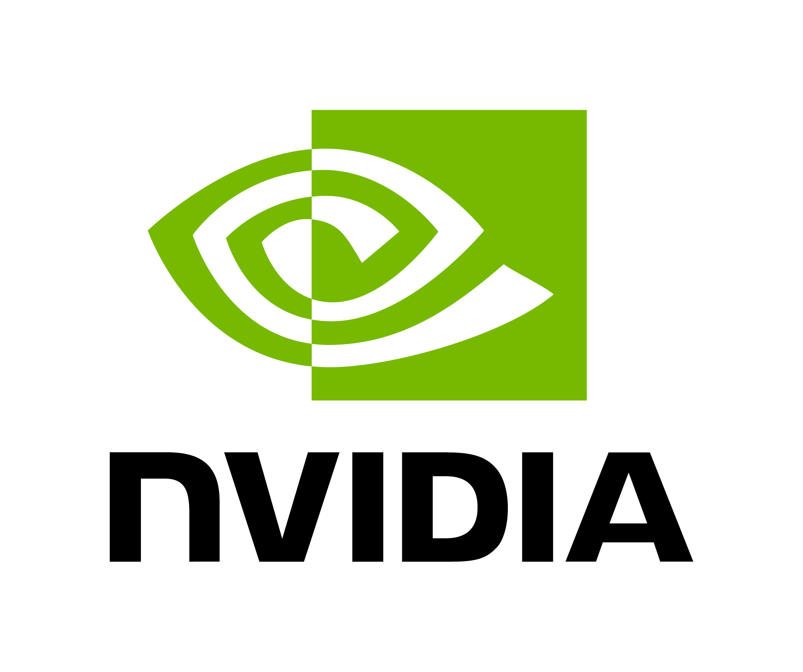
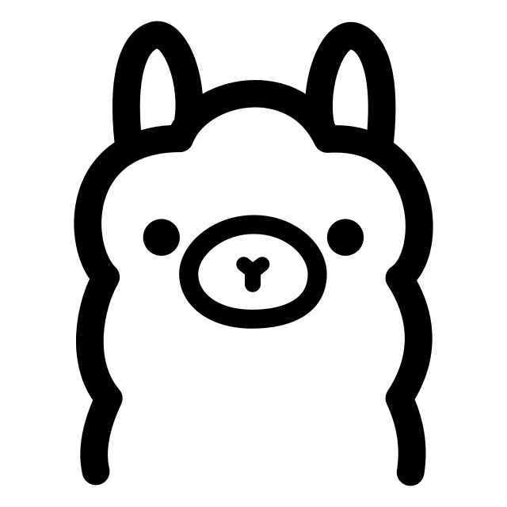
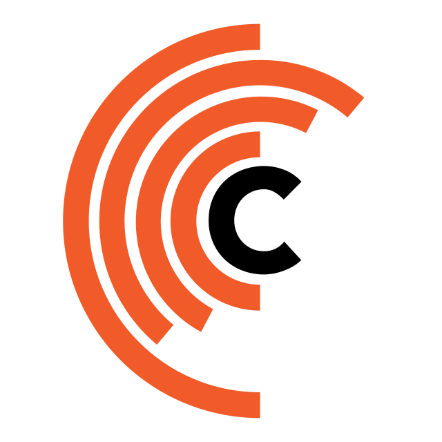
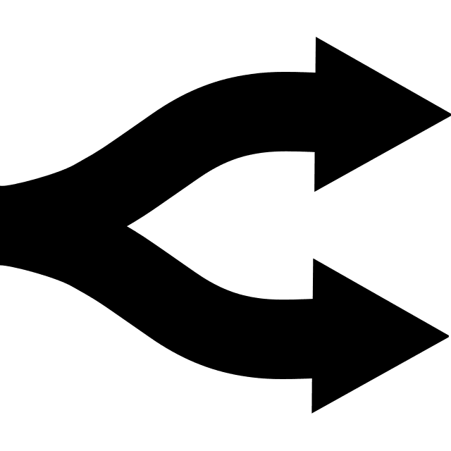
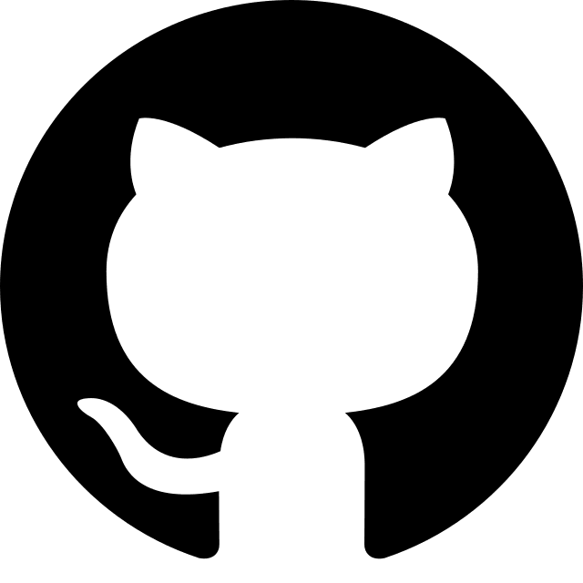
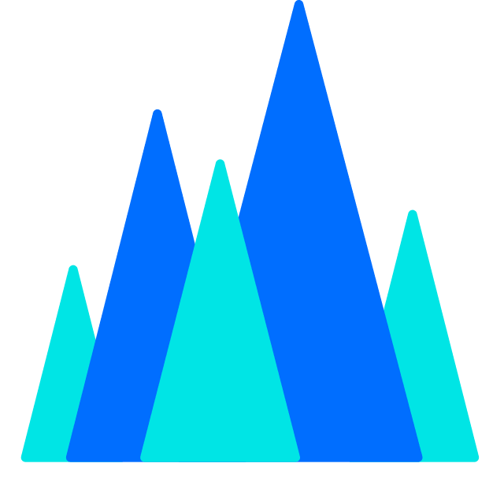

# 免费 LLM API 平台汇总

[**简体中文**](./README.zh-CN.md) | [English](./readme.md)

> **资料最后整理：2026 年 11 月 2 日**。本文以英文 README 的现有内容为基础制作中文版本，额度、模型列表及活动可能随时变化；请以各平台官方页面或账号控制台为准。

这个仓库收集可以免费体验或获得一定免费额度的 **LLM API / 云端模型服务**，包括中国大陆和国际平台，并整理调用限制、可选模型、API 地址和相关资料。

**先分清几个概念：**「模型免费调用」「每天发放免费额度」「注册后一次性赠送体验金」「免订阅费但按 Token 收费」并不是一回事。部分平台虽然有免费额度，但仍可能要求实名认证、绑定付款方式或满足活动条件。

<table align="center">
  <tr>
    <td align="center"></td>
    <td align="center"></td>
    <td align="center"></td>
    <td align="center"></td>
    <td align="center"></td>
    <td align="center"></td>
  </tr>
  <tr>
    <td align="center"></td>
    <td align="center"></td>
    <td align="center"></td>
    <td align="center"></td>
    <td align="center"></td>
    <td align="center"></td>
  </tr>
</table>

你可能也会用到这些项目：[翻译用 LLM 怎么选？](https://github.com/CYBIRD-D/How-to-Choose-your-LLM-Model-for-translation/tree/main) · [本地翻译模型合集](https://github.com/CYBIRD-D/Local-LLMs-Collection-For-Translation) · [LLM 发布时间线](https://github.com/CYBIRD-D/AI-Model-LLM-Timeline) · [官方 API 价格对比](https://github.com/CYBIRD-D/LLM-API-Official-Pricing-Tracker)

**API 基本使用方法：** 在平台注册并开通对应服务，获取 API Key 和接口地址，然后在支持该接口的软件中填入相关信息。使用前注意密钥有效期、免费额度和是否会自动转为付费调用。

## 目录

### 中国大陆平台
- [AMD Radeon Cloud Token Factory（中国站）](#amd-radeon-cloud-token-factory中国站)
- [魔搭社区（ModelScope）](#魔搭社区modelscope)
- [硅基流动（SiliconFlow）](#硅基流动siliconflow)
- [腾讯云 TokenHub](#腾讯云-tokenhub)
- [火山方舟（Volcengine Ark）](#火山方舟volcengine-ark)
- [扣子（Coze）](#扣子coze)
- [快手万擎（StreamLake Vanchin）](#快手万擎streamlake-vanchin)
- [讯飞星火（iFLYTEK Spark）](#讯飞星火iflytek-spark)
- [心流（iFlow，已停止服务）](#心流iflow已停止服务)

### 国际平台
- [AMD AI Developer Program](#amd-ai-developer-program)
- [Google Gemini / Gemma 4](#google-gemini--gemma-4)
- [NVIDIA NIM](#nvidia-nim)
- [Ollama](#ollama)
- [Groq](#groq)
- [Cerebras（已划出推荐）](#cerebras已划出推荐)
- [OpenRouter](#openrouter)
- [Cloudflare Workers AI](#cloudflare-workers-ai)
- [Cohere](#cohere)
- [Z.ai](#zai)
- [GitHub Models（已停止服务）](#github-models已停止服务)
- [Mistral](#mistral)
- [SambaNova](#sambanova)
- [AionLabs](#aionlabs)
- [SKT](#skt)
- [IBM watsonx.ai](#ibm-watsonxai)
- [Scaleway](#scaleway)
- [Together AI（已取消免费层）](#together-ai已取消免费层)
- [LLM API 价格表](#llm-api-价格表)

---

## 中国大陆平台

> 本节包含真正的免费推理服务，也包含**有次数或有效期限制的试用额度**。注意活动政策会变动；下面的使用说明不能代替你自己账号的当前配额。

### AMD Radeon Cloud Token Factory（中国站）
> 最后核查：**2026 年 11 月 2 日**

**免费方式：** 每日重置的共享模型推理 API 额度，以 **pts** 计量；**不是一次性体验金**，也不是 GPU 算力券。

**官方资料：** [Token Factory 控制台](https://developer.amd.com.cn/radeon/tokenfactory) · [中文使用文档](https://amd-aim.github.io/radeon-cloud-docs/zh-cn/guides/shared-models/) · [用量及额度](https://amd-aim.github.io/radeon-cloud-docs/api/usage/) · [限流规则](https://amd-aim.github.io/radeon-cloud-docs/api/rate-limits/) · [API 使用条款](https://amd-aim.github.io/radeon-cloud-docs/zh-cn/api/terms/)

**API 地址（兼容 OpenAI）：** `https://developer.amd.com.cn/radeon/api/v1`；亦支持兼容 Anthropic Messages 的接口，无需自行创建 GPU 云实例。

- **每天多少额度：** 每日北京时间 **00:00（UTC+8）** 重置。**不同账号的 pts/天额度可能不同，也可能调整**；
- 官方文档中的 **10 pts/天只是示例**，不能当作统一赠送额度。(一般为1pt）
- **pts 代表什么：** 是模型调用的**用量计算单位**，不是现金、开发者积分、GPU 算力券，也不等于固定数量的 tokens；具体模型按每百万输入/输出 tokens 等分别计量，以模型卡显示的 pts 单价为准。
- **限流参考：** 网关通常 **20 RPM/账号**，接入层通常 **30 RPM/API Key**，每个 API Key 通常最多 **8 个并发请求**；实际还受模型后端共享容量限制。

  
模型及额度换算（展开查看）

| 模型                           |  输入价格 | 输出价格 | **1 pt 可用总 Tokens（输入:输出 = 1:1）** |
| ---------------------------- | ----: | ---: | -------------------------------: |
| DeepSeek-V4-Flash            |  0.14 | 0.28 |                        **4.76M** |
| DeepSeek-V4-Flash-Vision-Exp |  0.14 | 0.28 |                        **4.76M** |
| DeepSeek-V4.1-Flash          |  0.28 | 0.56 |                        **2.38M** |
| Qwen3.8-Flash-Next           |  0.14 | 0.28 |                        **4.76M** |
| Qwen3.8-27B                  | 0.035 | 0.07 |                       **19.05M** |
| GLM-5.3-Flash                |  0.28 | 0.56 |                        **2.38M** |
| MiMo-V2.6-Flash              |  0.14 | 0.28 |                        **4.76M** |
| MiniCPM5-2B                  | 0.035 | 0.07 |                       **19.05M** |
| MiniCPM-V-4.7-1B             | 0.035 | 0.07 |                       **19.05M** |
| MiniCPM-V-4.7-35B-A3B        | 0.035 | 0.07 |                       **19.05M** |
| Gemma-4-31B-IT               | 0.035 | 0.07 |                       **19.05M** |

---

### 魔搭社区（ModelScope）

**免费方式：** 每日魔粒积分，可用于模型推理；并非无限次免费 API。

**官方资料：** [API-Inference 调用限制](https://modelscope.cn/docs/model-service/API-Inference/limits) · [魔粒体系公告（2026-08-10）](https://www.modelscope.cn/posts/435591) · [魔粒使用说明](https://www.modelscope.cn/magicube/usage)

**API 地址（兼容 OpenAI）：** `https://api-inference.modelscope.cn/v1`

- 使用 API-Inference 需要绑定**已完成实名认证的阿里云账号**。
- 根据现行魔粒体系，每日登录可领取 **200 魔粒**，绑定阿里云账号可额外获得 **50 魔粒/天**；参与社区活动还可能获得额外积分。
- 模型推理消耗参考：轻量模型约 **0.5 魔粒/次**，主流模型约 **1 魔粒/次**，旗舰模型约 **2 魔粒/次**。实际以具体模型的计费规则为准。
- 旧版规则列有**所有模型合计 2,000 次/天、单模型最多 500 次/天**，部分大型模型限制更严格。这些数字不能直接当作当前账号每天可获得的免费调用次数；还需考虑魔粒余额、模型限额及并发限制。
- 免费共享推理资源主要用于体验和开发测试，不保证生产环境服务等级；使用前请查看账号剩余积分及模型限制。

---

### 硅基流动（SiliconFlow）

**免费方式：** 部分模型长期标价为 0 元；另有活动代金券，两者应分开计算。

**官方资料：** [免费模型及限流规则](https://docs.siliconflow.cn/docs/userguide/faqs/rate-limit-and-upgradation) · [免费与 Pro 模型说明](https://docs.siliconflow.cn/docs/userguide/faqs/misc) · [2026 年代金券活动公告](https://www.siliconflow.cn/developer-talk/od7wj9rr23p95uhihmhrombp)

**API 地址（兼容 OpenAI）：** `https://api.siliconflow.cn/v1`

- 完成**实名认证**后，可调用模型列表中当前明确标注为**免费**的模型，相关推理费用为 **0 元**。
- 免费模型有**按模型区分的调用速率限制**。部分付费版本带有 `Pro/` 前缀，但不能仅凭模型大小或是否带有该前缀判断是否免费，应以模型详情页的实际价格为准。
- **活动代金券：** 官方 2026 年「推荐官」活动（**2026-01-15 至 2026-12-31**）提供实名认证后领取的 **16 元通用代金券**，须在活动中心**主动领取**，领取后 **180 天内有效**；邀请奖励另行计算。
- 仓库此前所写「中国手机号新用户注册即送 **2,000 万 tokens**」未能确认仍为当前普遍适用的注册权益，因此不再作为确定额度展示。

---

### 腾讯云 TokenHub

**免费方式：** 新用户一次性试用 Token；**不属于持续免费的模型 API**。

**官方资料：** [TokenHub 中国站新用户免费体验](https://cloud.tencent.com/document/product/1823/130053) · [TokenHub API 快速入门](https://cloud.tencent.com/document/product/1823/130058) · [旧混元平台停服公告](https://cloud.tencent.com/announce/detail/2287)

- **腾讯混元旧 API 平台已停止服务：** 旧平台于 **2026-06-30** 停止新购和创建密钥，于 **2026-09-30** 关闭原控制台及 API 服务。新的模型接入应使用 **TokenHub**，其提供混元及第三方模型。
- **中国大陆站：** 官方新用户活动说明列出语言模型 **100 万 tokens** 的试用额度，**领取后一年内有效**；活动公布的结束日期为 **2026-12-31**。这属于**一次性试用权益**，部分模型或账号可能有单独限制。
- 需要完成腾讯云**实名认证**。免费资源包可通过模型列表或开通页面领取，部分权益可能在首次调用时自动发放；最终以控制台显示为准。
- **避免意外扣费：** 如不希望试用额度耗尽后产生费用，请关闭后付费模式。未开启后付费时，免费额度用尽后调用将停止。
- **中国站与国际站不可混用：** 腾讯云国际站 TokenHub 的试用有效期为 **90 天**，部分模型开通还可能要求 **1 美元余额预授权**，与中国站的规则不同。
- 此前的旧版「Hunyuan-lite 免费」和旧混元平台 **100 万 tokens / 一年**资源包属于历史权益，不能作为已经停服的旧 API 仍可使用的依据。

---

### 火山方舟（Volcengine Ark）

**免费方式：** 模型推理 API 一次性体验额度；与扣子的积分体系不同。

**官方资料：** [安心体验模式](https://docs.volcengine.com/docs/ark/free-tokens-only-mode?lang=zh) · [模型开通与免费额度管理](https://docs.volcengine.com/docs/ark/activation-management?lang=zh)

- **安心体验模式：** 符合条件的**新用户**可通过该模式使用 **50 万 tokens** 模型推理体验额度；额度用尽后，符合条件的推理服务会**暂停而不是继续扣费**。
- 该模式须在**首次开通模型推理服务时**选择。已通过其他模式开通服务的账号可能不再符合条件；**关闭安心体验模式后不能重新开启**。
- 此模式的免费额度仅覆盖适用范围内的**模型推理 Token**。工具、插件、知识库等其他功能可能单独计费。
- 平台还可能提供其他按模型、活动或账号发放的免费资源包，具体数量与适用条件请查看控制台。
- 旧版「**500 资源点/天**」及豆包模型资源点消耗表属于**扣子（Coze）**的计费体系，**不是火山方舟 API 的免费额度或定价**，因此已从本节移除。

---

### 扣子（Coze）

**免费方式：** AI 应用与智能体平台积分；**不等同于通用模型推理 API 免费额度**。

**官方资料：** [2026 年订阅体系升级公告](https://docs.volcengine.com/docs/coze/button-subscription-package-upgrade?lang=zh) · [现行订阅套餐](https://docs.volcengine.com/docs/coze/Subscriptionpackage?lang=zh) · [积分规则](https://docs.volcengine.com/docs/coze/integral?lang=zh)

- **2026-01-18** 的套餐升级将「资源点」更名为「积分」。升级公告提出个人免费版**每日签到领取 1,500 积分**（**当天有效**），取代此前的 500 资源点/天。
- **现行资料存在口径差异：** 当前套餐表未将每月订阅积分列入个人免费版；积分规则又明确列出**新用户一次性获得 1,500 积分**（**30 天有效**），相关常见问题仍提及每日签到奖励。因此，不能在未查看账号活动页面的情况下保证所有用户每天都能固定领取 1,500 积分。
- 扣子积分主要用于平台产品和功能，**不能直接换算成火山方舟 API 的免费 Token 数量**。
- 原仓库中按旧版扣子资源点计算的豆包、DeepSeek、Kimi 模型消耗表已移除，以免把过期计费规则当作现行价格。

---

### 快手万擎（StreamLake Vanchin）

**免费方式：** 新用户或活动提供的模型在线推理试用资源包。

**官方资料：** [免费推理额度说明（2025-12-12 更新）](https://streamlake.com/document/WANQING/mdsor5767ob7s796sp6) · [模型计费说明](https://streamlake.com/document/WANQING/mdsorb4ejjptsmfyrn)

- 需要完成**注册、认证和服务开通**，方可使用符合条件的免费推理资源包。
- 免费资源包通常按**具体模型**发放，同一主账号下共享；未确认所有新用户均能领取相同数量的 Token，因此不填写统一免费额度。实际余额请在**费用中心 → 资源包**中查看。
- 资源包可抵扣符合条件的**在线推理输入、输出及缓存命中 Token**，但**不能抵扣批量推理**。
- **注意超额费用：** 免费额度过期或用尽后继续调用，可能产生按量计费账单。建议及时查看用量，并在支持的情况下限制或关闭后付费调用。

---

### 讯飞星火（iFLYTEK Spark）

**免费方式：** 部分模型标价为 0 元，另有独立的活动赠送额度。

**官方资料：** [Spark Lite HTTP API 文档](https://www.xfyun.cn/doc/spark/HTTP%E8%B0%83%E7%94%A8%E6%96%87%E6%A1%A3.html) · [Spark-X2.5 模型说明](https://www.xfyun.cn/doc/spark/Spark-X2.5%E6%A8%A1%E5%9E%8B%E4%BB%8B%E7%BB%8D.html) · [星火模型与价格页面](https://spark.xfyun.cn/sparkapi)

- **Spark Lite：** 官方 HTTP API 文档标注支持**免费使用**。
- **Spark Lite 经典 API 地址（兼容 OpenAI）：** `https://spark-api-open.xf-yun.com/v1/`。
- **Spark-X2.5-1.7B**（模型 ID：`spark-x2.5-1.7b`）：现行模型列表标价为 **0 元/百万 tokens**。
- **Spark-X2.5-4B**（模型 ID：`spark-x2.5-4b`）：模型列表出现 **0 元/百万 tokens / 限时免费**标注，**不可视为永久免费**。X2.5 系列属于星火模型平台，调用前需另行确认适用的 API 地址及鉴权方式。
- 旧版「首次开通后，所有模型共享 **20 万免费 tokens，有效期一年**」未能找到明确的现行依据，故不再将其列为确定权益。

---

### 心流（iFlow，已停止服务）

**状态：原免费 LLM API 与托管模型库已于 2026 年 4 月 17 日停止服务，不再属于当前可用的免费模型 API 平台。**

**官方资料：** [2026-03-20 停服公告](https://vibex.iflow.cn/t/topic/4819) · [2026-04-17 停服通知](https://vibex.iflow.cn/t/topic/5753)

- 原有 **iFlow API 服务及托管模型库**于 **2026-04-17** 关闭，相关 iFlow CLI 内置模型访问也随之停止。
- iFlow CLI 仍可配置**其他平台的兼容 API**，但这不代表原心流托管模型服务恢复。
- 本条仅作**历史记录**，不应再列为可用免费 API 推荐项。

---

## 国际平台

### AMD AI Developer Program

> 最近核查：**2026 年 11 月 2 日**。**这是一次性开发者福利，不是每天续送的免费 LLM API。**

**官方资料：** [加入开发者计划](https://developer.amd.com/ai-developer-program/) · [申请要求及福利说明](https://developer.amd.com/resources/)

- 通过审核的开发者可以免费加入 AMD AI Developer Program，并在会员福利中申请以下优惠；按官方说明需在相关权益中**二选一**，不要默认两项都能领取。
- **AMD Developer Cloud：100 美元额度。** 这笔钱用于 AMD 云端 GPU 算力，可自行部署或运行模型；通过兑换链接激活后 **30 天内有效**。
- **Fireworks AI：50 美元额度。** 用于第三方 Fireworks AI 平台的相关服务，兑换码须在发放后 **90 天内使用**；兑换成功后，额度一般可持续使用到耗尽，仍受 Fireworks 条款约束。
- **注意区别：** AMD Developer Cloud 的 GPU 算力券并不是可以直接调用的托管模型 API 额度，也不能与 **AMD Radeon Cloud Token Factory 中国站**每天发放的 pts 混为一谈。

---

### Google Gemini / Gemma 4

> 最近核查：**2026 年 10 月 30 日**

**官方资料：** [各模型免费层与价格](https://ai.google.dev/gemini-api/docs/pricing) · [调用限制](https://ai.google.dev/gemini-api/docs/rate-limits) · [在 AI Studio 查看自己项目的额度](https://aistudio.google.com/rate-limit)

**接口地址：** `https://generativelanguage.googleapis.com`

- 根据英文版整理时的官方价格表，提供免费层的模型包括 **Gemini 3.8 Flash、Gemini 3.5 Flash-Lite 和 Gemma 4**。其他型号请查看价格页的 **Free Tier** 一栏。
- **Gemini 4 Argon、Gemini 3.1 Pro Preview** 不在免费层中，其他 Pro 模型也应单独检查。
- Google **没有对所有免费账号统一保证的 RPM、TPM、RPD 数字**。额度会因项目、账号等级和模型而变化，最可靠的办法是直接查看自己的 AI Studio。
- 限额按**项目**计算，不是每把 API Key 独立计算。每日请求次数在**太平洋时间午夜**重置。
- 免费层提交的内容可能用于改进 Google 产品，请注意数据隐私。
- **非官方替代方案：** [AI Studio to API Adapter](https://github.com/iBUHub/AIStudioToAPI/blob/main/README_EN.md)。使用第三方适配器前需自行评估安全性和服务条款。

英文 README 中保留的旧版额度参考（并非当前统一保证）

| 模型 | 每分钟请求数（RPM） | 每分钟 Token（TPM） | 每天请求数（RPD） |
|---|---:|---:|---:|
| Gemini 2.5～3.8 Flash | 5 | 250K | 20 |
| Gemini 2.5 Flash-Lite | 10 | 250K | 20 |
| Gemini 3.1/3.5 Flash-Lite | 15 | 250K | 500 |
| Gemma 4 26B/31B | 30 | 16K | 14,400 |

上述数值只用于理解曾出现过的额度水平，**不要据此判断你的账号现在能调用多少次**。Gemma 3、Gemini 2 Flash 等历史型号也已从旧表中划除。

---

### NVIDIA NIM

> 最近核查：**2026 年 10 月 30 日**

**官方模型目录：** https://build.nvidia.com/models

**API 地址（兼容 OpenAI）：** `https://integrate.api.nvidia.com/v1`

- 免费体验端点一般允许**最多约 40 RPM**（每分钟请求数），但不同模型、地区和共享负载可能使实际限制不同。
- 免费端点主要用于**试用和评估**；生产部署如需稳定的专用资源，应考虑部署自己的 NVIDIA NIM 实例。
- 下方是英文 README 收录的**部分示例模型**，并非固定、完整的模型总数。是否仍提供免费调用，要以 [NVIDIA 实时目录](https://build.nvidia.com/models) 中的 **Free Endpoint** 标记为准。
- 使用前请查看 NVIDIA 试用条款，避免直接输入机密数据。

展开 NVIDIA 模型列表

 
## 模型列表

#### DeepSeek
deepseek-ai/deepseek-v4-flash  
deepseek-ai/deepseek-v4-flash-0731  
deepseek-ai/deepseek-v4-pro  
deepseek-ai/deepseek-v4.1-flash  

#### Google
google/codegemma-7b  
google/gemma-7b  

#### Meta
meta/llama2-70b  
meta/llama-3.1-8b-instruct  
meta/llama-3.1-70b-instruct  
meta/llama-3.2-1b-instruct  
meta/llama-3.2-3b-instruct  
meta/llama-3.3-70b-instruct  
meta/muse-glimmer-30b  

#### Microsoft
microsoft/phi-4-mini-instruct  
microsoft/phi-4-mini-flash-reasoning  

#### MiniMax
minimaxai/minimax-m2.5  
minimaxai/minimax-m2.7  
minimaxai/minimax-m3.1-flash  

#### Mistral
mistralai/mistral-nemotron  
mistralai/mixtral-8x7b-instruct  
mistralai/mixtral-8x22b-instruct  
mistralai/mistral-large-4-1t-a52b  

#### 月之暗面 / Kimi
moonshotai/kimi-k2-instruct  
moonshotai/kimi-k2-thinking  
moonshotai/kimi-k3  

#### NVIDIA
nvidia/gliner-pii  
nvidia/llama-3.1-nemoguard-8b-content-safety  
nvidia/llama-3.1-nemoguard-8b-topic-control  
nvidia/llama-3.1-nemotron-safety-guard-8b-v3  
nvidia/llama-3.3-nemotron-super-49b-v1  
nvidia/llama-3.3-nemotron-super-49b-v1.5  
nvidia/llama-3.1-nemotron-ultra-253b-v1  
nvidia/nemotron-3-ultra-550b-a55b  
nvidia/nemotron-3.5-lightning-30b-a3b  
nvidia/nemotron-3.5-super-vl-120b-a12b  
nvidia/nemoguard-jailbreak-detect  
nvidia/nemotron-3-nano-30b-a3b  
nvidia/nemotron-3-super-120b-a12b  
nvidia/nemotron-content-safety-reasoning-4b  
nvidia/nvidia-nemotron-nano-9b-v2  
nvidia/riva-translate-4b-instruct-v1.1  
nvidia/riva-translate-4b-instruct-v2  
nvidia/usdcode  

#### OpenAI
openai/gpt-oss-20b  
openai/gpt-oss-120b  

#### Poolside
poolside/laguna-xs-2-1  

#### Qwen
qwen/qwen2.5-coder-32b-instruct  
qwen/qwen3-next-80b-a3b-instruct  
qwen/qwen3-next-80b-a3b-thinking  
qwen/qwq-32b  

#### Sarvam AI
sarvamai/sarvam-m  

#### StepFun
stepfun-ai/step-3.5-flash  
stepfun-ai/step-5-preview  

#### Stockmark
stockmark/stockmark-2-100b-instruct  

#### Thinking Machines
thinking-machines/inkling  

#### Upstage
upstage/solar-10.7b-instruct  

#### 智谱 / GLM
z-ai/glm4.7  
z-ai/glm5.1  
z-ai/glm-5.2  
z-ai/glm-5.3  
z-ai/glm-5.3-flash

---

### Ollama

> 最近核查：**2026 年 10 月 30 日**。**目前的 Ollama 云端推理是按 Token 付费，不应当作持续免费的托管模型 API。**

**官方资料：** [云端套餐与价格](https://ollama.com/pricing) · [云端模型列表](https://ollama.com/search?c=cloud) · [2026 年 8 月 31 日计费变更说明](https://ollama.com/blog/transparent-pricing)

- **Pay as you go（每月订阅费 0 美元）**只表示不收月费，云端推理仍然要购买额度，按用量扣费。
- 旧版的「免费模型列表」「每 3 小时重置会话额度」不再适合作为当前通用免费权益。
- 在自己的电脑上**本地运行模型**，当然不收 Ollama 云端推理费用。
- 云端并发请求：按量付费和 Pro 通常为 **3**；Max、Team 通常为 **10**；历史账号政策可能不同。

| 套餐 | 订阅费 | 包含的云端用量额度 |
|---|---:|---:|
| Pay as you go | 0 美元/月 | 未公布赠送额；需购买用量额度 |
| Pro | 20 美元/月（或 200 美元/年） | 60 美元/月 |
| Max | 100 美元/月 | 300 美元/月 |
| Team | 500 美元/月 | 团队共享 1,000 美元/月 |
| Enterprise | 定制价格 | 定制额度 |

展开 Ollama 云端模型价格（美元/百万 Token）

价格按 **100 万输入 Token + 100 万输出 Token**计算合计，不是每 100 万总 Token 的价格。

| 模型 | 输入 | 输出 | 合计 |
|---|---:|---:|---:|
| deepseek-v4.1-flash （低峰） | $0.15 | $0.60 | $0.75 |
| deepseek-v4.1-flash （标准） | $0.30 | $1.20 | $1.50 |
| deepseek-v4-pro （低峰） | $0.66 | $1.98 | $2.64 |
| deepseek-v4-pro （标准） | $1.32 | $3.96 | $5.28 |
| gemma4 | $0.14 | $0.40 | $0.54 |
| glm-5.3 / glm-5.2 | $1.40 | $4.40 | $5.80 |
| glm-5.3-flash | $0.15 | $0.50 | $0.65 |
| gpt-oss:120b | $0.15 | $0.60 | $0.75 |
| gpt-oss:20b | $0.07 | $0.30 | $0.37 |
| kimi-k3 | $3.00 | $15.00 | $18.00 |
| kimi-k2.7-code / kimi-k2.6 | $0.95 | $4.00 | $4.95 |
| minimax-m3.1-flash | $0.15 | $0.60 | $0.75 |
| minimax-m3 | $0.60 | $2.40 | $3.00 |
| minimax-m2.7 | $0.30 | $1.20 | $1.50 |
| mistral-large-4 | $0.70 | $2.10 | $2.80 |
| mistral-large-3 | $0.50 | $1.50 | $2.00 |
| muse-spark-open | $1.25 | $4.25 | $5.50 |
| nemotron-3-nano | $0.06 | $0.24 | $0.30 |
| nemotron-3-super | $0.015 | $0.60 | $0.615 |
| nemotron-3-ultra | $0.10 | $3.00 | $3.10 |

适用模型在**工作日 UTC 12:00–18:00 之外及整个周末**可使用低峰价。缓存输入如有单独报价，请以官方价格表为准。**以上都是付费云端价格，不是免费模型名单。**

---

### Groq

> 最近核查：**2026 年 10 月 30 日**

**官方限制：** https://console.groq.com/docs/rate-limits

**API 地址（兼容 OpenAI）：** `https://api.groq.com/openai/v1`

Groq 的免费层速率表中包含 **GPT-OSS 20B/120B、Qwen3.8 27B**。不同组织的真实限额可能不同；以下数字仅代表英文 README 当时记录的官方公开额度。

展开免费模型及限额

| 模型 | 每分钟请求数 | 每天请求数 | 每分钟 Token | 每天 Token |
| --- | ---: | ---: | ---: | ---: |
| openai/gpt-oss-120b | 30 | 1K | 8K | 200K |
| openai/gpt-oss-20b | 30 | 1K | 8K | 200K |
| qwen/qwen3.8-27b | 30 | 1K | 8K | 200K |

---

### Cerebras（已划出推荐）

> 最近核查：**2026 年 10 月 30 日**

**官方资料：** https://inference-docs.cerebras.ai/support/rate-limits

**API 地址：** `https://api.cerebras.ai`

英文仓库将 Cerebras 划除常用免费 API 推荐，主要因为**免费额度和限速过于紧张**，实用价值有限；曾记录的账号试用条件为约 **5 美元/账号**，是否仍有该活动须以官方控制台为准。

| 模型 | 每分钟请求数 | 每分钟 Token | 每小时 Token | 每天 Token |
|--------------------------------------|-----------------|---------------|-------------|------------|
| gpt-oss-120b                         | 5               |  30k          | 1M          | 1M         |
| gemma-4-31b                          | 5               |  30k          | 1M          | 1M         |

---

### OpenRouter

> 最近核查：**2026 年 10 月 30 日**

**官方资料：** [免费模型列表](https://openrouter.ai/collections/free-models) · [定价](https://openrouter.ai/pricing) · [用量限制](https://openrouter.ai/docs/api-reference/limits)

**API 地址（兼容 OpenAI）：** `https://openrouter.ai/api/v1`

- 免费模型会随时变化，使用前应查看实时列表。可以通过 `openrouter/free` 自动路由到可用免费模型。
- **模型 ID 以 `:free` 结尾**的免费模型通常最多 **20 RPM**。
- 已购买额度少于 **10 美元**的账号，一般每天最多调用 **50 次**免费模型；累计购买至少 **10 美元**后通常提高到每天 **1,000 次**。
- **失败请求也可能占用免费调用次数**。价格虽然为 0、但 ID 不以 `:free` 结尾的模型，可能另有付款方式要求。

| 模型版本（ID） | 已购买额度 | 每分钟请求上限 | 每天请求上限 |
|

---

### Cloudflare Workers AI

> 官方价格页更新：**2026 年 10 月 20 日**；以下数据整理自英文 README。

**官方资料：** [Workers AI 模型价格](https://developers.cloudflare.com/workers-ai/platform/pricing/#llm-model-pricing) · [Workers 套餐](https://developers.cloudflare.com/workers/platform/pricing/)

- Workers 免费套餐含 **10,000 Neurons/天**，每日 **UTC 00:00** 重置。Neuron 是 Cloudflare 衡量模型推理算力消耗的内部计费单位，**不是 Token，也不是美元**。
- 超过免费额度的付费用量按 **每 1,000 Neurons 0.011 美元**计算。
- **注意：** 部分 Kimi、DeepSeek V4/V4.1、GLM-5.x 模型即使还有免费 Neurons，也需要先开通 Workers Paid 或充值 AI Gateway 才能调用。**在下表出现，不代表不用绑定付款方式就能免费调用**。
- 收录的模型涉及 Llama、Qwen、Mistral、Gemma、DeepSeek、GLM、Nemotron、Kimi、Granite 等多个系列，可选型号和免费权限请以官方页面为准。

展开模型价格及每天大约可用多少 Token

- 价格单位：**美元/百万 Token**，合计 = 输入价 + 输出价。
- 免费量估算假设 **输入:输出 = 1:1.3**。
- 下表的可用 Token 数根据 Neurons/Token 费率计算，并非直接拿美元价格倒推；**已经要求付费的模型，这个数字只是数学估算，不是实得免费额度**。
- 未将缓存输入价格计入估算。
- 只有定价和适用备注相同时才合并同家族模型。

| 排名 | 提供商 | 模型 | 输入 | 输出 | 合计 | 每日 1 万 Neurons 约可用 Token（输入:输出＝1:1.3） | 备注 |
|---:|---|---|---:|---:|---:|---:|---|
| 1 | IBM | Granite 4.0 H Micro | $0.017 | $0.112 | **$0.129** | **~1.560M** | — |
| 2 | Meta | Llama 3.2 1B Instruct | $0.027 | $0.201 | **$0.228** | **~878K** | — |
| 3 | Mistral | Mistral 7B Instruct v0.1 | $0.110 | $0.190 | **$0.300** | **~708K** | — |
| 4 | Meta | Llama 3.2 3B Instruct | $0.051 | $0.335 | **$0.386** | **~520K** | — |
| 5 | Qwen | Qwen3 30B-A3B FP8 | $0.051 | $0.335 | **$0.386** | **~520K** | — |
| 6 | Meta | Llama 3/3.1 8B Instruct AWQ | $0.123 | $0.266 | **$0.389** | **~539K** | 价格相同，合并显示 |
| 7 | Google | Gemma 4 26B-A4B IT | $0.100 | $0.300 | **$0.400** | **~516K** | — |
| 8 | Meta | Llama 3.1 8B Instruct FP8 Fast | $0.045 | $0.384 | **$0.429** | **~465K** | — |
| 9 | Meta | Llama 3.1 8B Instruct FP8 | $0.152 | $0.287 | **$0.439** | **~482K** | — |
| 10 | Z.AI | GLM-4.7 Flash | $0.060 | $0.400 | **$0.460** | **~435K** | — |
| 11 | OpenAI | GPT-OSS 20B | $0.200 | $0.300 | **$0.500** | **~429K** | — |
| 12 | Meta | Llama Guard 3 8B | $0.484 | $0.030 | **$0.514** | **~484K** | 安全分类器，不适合通用聊天 |
| 13 | Meta | Llama 3.2 11B Vision Instruct | $0.049 | $0.676 | **$0.725** | **~273K** | 支持视觉输入 |
| 14 | Google | Gemma 3 12B IT | $0.345 | $0.556 | **$0.901** | **~237K** | — |
| 15 | AI Singapore | Gemma SEA-LION v4 27B IT | $0.351 | $0.555 | **$0.906** | **~236K** | — |
| 16 | Mistral | Mistral Small 3.1 24B Instruct | $0.351 | $0.555 | **$0.906** | **~236K** | — |
| 17 | OpenAI | GPT-OSS 120B | $0.350 | $0.750 | **$1.100** | **~191K** | — |
| 18 | Meta | Llama 3/3.1 8B Instruct | $0.282 | $0.827 | **$1.109** | **~187K** | 价格相同，合并显示 |
| 19 | Meta | Llama 4 Scout 17B-16E Instruct | $0.270 | $0.850 | **$1.120** | **~184K** | — |
| 20 | Qwen | QwQ 32B | $0.660 | $1.000 | **$1.660** | **~129K** | — |
| 21 | Qwen | Qwen2.5 Coder 32B Instruct | $0.660 | $1.000 | **$1.660** | **~129K** | — |
| 22 | DeepSeek | DeepSeek V4 Flash 0731 | $0.440 | $1.320 | **$1.760** | **~117K** | 缓存输入 $0.014; 需开通付费结算 |
| 23 | NVIDIA | Nemotron 3 120B-A12B | $0.500 | $1.500 | **$2.000** | **~103K** | — |
| 24 | Meta | Llama 3.1/3.3 70B Instruct FP8 Fast | $0.293 | $2.253 | **$2.546** | **~78.5K** | 价格相同，合并显示 |
| 25 | Moonshot AI | Kimi K2.5 | $0.600 | $3.000 | **$3.600** | **~56.2K** | 缓存输入 $0.100 |
| 26 | Qwen | Qwen3.8 27B | $0.450 | $3.200 | **$3.650** | **~54.9K** | — |
| 27 | Moonshot AI | Kimi K2.6 | $0.950 | $4.000 | **$4.950** | **~41.1K** | 缓存输入 $0.160; 需开通付费结算 |
| 28 | Moonshot AI | Kimi K2.7 Code | $0.950 | $4.000 | **$4.950** | **~41.1K** | 缓存输入 $0.190; 需开通付费结算 |
| 29 | DeepSeek | DeepSeek V4 Pro 0813 | $1.320 | $3.960 | **$5.280** | **~39.1K** | 缓存输入 $0.044; 需开通付费结算 |
| 30 | DeepSeek | DeepSeek R1 Distill Qwen 32B | $0.497 | $4.881 | **$5.378** | **~37.0K** | — |
| 31 | Z.AI | GLM-5.2 | $1.400 | $4.400 | **$5.800** | **~35.5K** | 缓存输入 $0.260; 需开通付费结算 |
| 32 | Meta | Llama 2 7B Chat FP16 | $0.556 | $6.667 | **$7.223** | **~27.4K** | — |

---

### Cohere

> 最近核查：**2026 年 10 月 30 日**

**官方限制：** https://docs.cohere.com/docs/rate-limits

**API 地址：** `https://api.cohere.ai/compatibility`

试用 Key 的聊天 API 限制为**每个模型约 20 次/分钟、所有接口合计每月 1,000 次调用**，适用于其提供的 Command A+、Command A Reasoning、Command A Translate、Command A Vision、Command A、Command R+、Command R、Command R7B、North Mini Code 等型号（实际可选型号以控制台为准）。

| 接口 | 试用速率限制（请求/分钟） | 试用上限（请求/月） |
|---------------------|----------------------------------|----------------------------------|
| 聊天 API            | 20/min （每个模型）               | 1000/month                       |

---

### Z.ai

> 最近核查：**2026 年 10 月 30 日**

**官方价格页：** https://docs.z.ai/guides/overview/pricing

**API 地址：** `https://api.z.ai/api/paas/v4`

当时在官方价格页面列为**免费**的模型：

- GLM-4.5-Flash
- GLM-4.7-Flash
- GLM-4.6V-Flash

**官方未公开适用于所有账号的统一限速数字**，请在控制台查看实际使用情况。

---

### GitHub Models（已停止服务）

**服务状态：** GitHub Models 已于 **2026 年 7 月 30 日**全面停止服务，原 Playground、模型目录、推理 API 和 BYOK 都不再可用。

此服务与 GitHub Copilot 是两回事，**GitHub Models 停服不代表 Copilot 停服**。

**历史资料：** https://docs.github.com/en/github-models/use-github-models/prototyping-with-ai-models#rate-limits

---

### Mistral

> 最近核查：**2026 年 10 月 30 日**

**官方资料：** [当前用量与限额](https://docs.mistral.ai/admin/billing-usage/usage-limits) · [限流说明](https://help.mistral.ai/en/articles/698531-why-am-i-hitting-api-rate-limits-and-how-do-i-increase-them)

**API 地址：** `https://api.mistral.ai`

- 免费模式用于试用和开发，**实际 RPS、TPM 与月度 Token 限额因组织和模型而异**。请登录后台，在 **Admin Panel → API → Limits** 查看。
- 网上常见的「1 RPS、50 万 TPM、每月 10 亿 Token」属于**历史社区报告**，不是当前所有账号都有的额度保证。

展开旧版社区额度参考（不保证仍适用）

| 套餐 | 请求/秒（RPS） | Token/分钟（TPM） | Token/月 |
|

---

### SambaNova

> 最近核查：**2026 年 10 月 30 日**

**官方免费层限制：** https://docs.sambanova.ai/docs/en/models/rate-limits#free-tier

| 模型 | 每分钟请求数 | 每天请求数 | 每天 Token |
|

---

### AionLabs

> 最近核查：**2026 年 10 月 30 日**

**官方资料：** [调用限制](https://www.aionlabs.ai/docs/rate-limits/) · [模型目录](https://www.aionlabs.ai/docs/models/)

**API 地址：** `https://api.aionlabs.ai/v1`

免费层的共享限额为 **15 RPM、20,000 TPM、20,000 Token/天**。不同模型共享每日配额，而非每个模型独立赠送。

| 模型 | 每分钟请求数 | 每天 Token |
|

---

### SKT

**免费模型：** A.X 4.0（7B、72B，基于 Qwen2.5），主要面向**韩语与英语互译**。

**官方项目说明：** https://github.com/SKT-AI/A.X-4.0/blob/main/apis/README.md

---

### IBM watsonx.ai

> 最近核查：**2026 年 10 月 8 日**

**官方价格说明：** https://www.ibm.com/products/watsonx-ai/pricing

watsonx.ai 基础模型免费层的参考限额为 **2 RPS，每月 300,000 Token**。以账号控制台当前权益为准。

| 套餐 | 每秒请求数（RPS） | 每月 Token |
|

---

### Scaleway

**免费方式：** 新账号提供**一次性 100 万 Token**免费体验，用完不自动续送。

**官方说明：** https://www.scaleway.com/en/docs/generative-apis/faq/#how-does-the-free-tier-work

---

### Together AI（已取消免费层）

**状态：** 不再提供原有的免费模型 API 层。旧的 Llama 3.3 70B 和 DeepSeek R1 Distill Llama 70B 免费端点不能作为现行可用选项。

**官方通知：** https://support.together.ai/articles/1862638756-changes-to-free-tier-and-billing-july-2025

---

## LLM API 价格表

> **数据日期：2026 年 10 月 30 日。** 本节同步自 [LLM API Official Pricing Tracker](https://github.com/CYBIRD-D/LLM-API-Official-Pricing-Tracker)，不是实时价格接口。使用前请查看每行的「价格来源」，确认优惠是否仍然有效。

**怎么看价格：** 单位为 **美元/百万 Token**。输入价指 100 万输入 Token 的价格，输出价指 100 万输出 Token 的价格；**合计 = 输入价 + 输出价**，也就是「100 万输入 + 100 万输出」的总费用，并不是每 100 万总 Token 的费用。

缓存输入价格显示为 `—` 代表**未知或未单列**，不代表免费。表格按合计从低到高排序；相同合计时，优先排缓存输入确认更便宜的模型。不同的促销价/原价、高峰/低峰价格，以及来源仓库独立列出的加速档位，分别列示。

对分段计价的模型，排名使用最低或默认上下文区间，其他价格写在备注中。Qwen 采用阿里云百炼国际站（新加坡）价格。此处保留原仓库的**九列结构**；需要开源情况、参数规模等信息可查看[完整价格仓库](https://github.com/CYBIRD-D/LLM-API-Official-Pricing-Tracker#price-leaderboard)。

| 排名 | 提供商 | 模型 | 输入 | 缓存输入 | 输出 | 合计 | 备注 | 价格来源 |
|---:|---|---|---:|---:|---:|---:|---|---|
| 1 | Qwen | Qwen3.7 Flash | $0.03 | — | $0.13 | **$0.16** | 默认价格适用于输入不超过 32K；32K–256K：输入 $0.10、输出 $0.40；256K–1M：输入 $0.20、输出 $0.80 | [来源](https://www.alibabacloud.com/help/en/model-studio/model-pricing) |
| 2 | Meta / OpenRouter | Muse Spark 1.2/1.3 Contributor | $0.10 | $0.002 | $0.20 | **$0.30** | 100 万 Token 上下文；提示词及生成内容可能用于改进 Meta 产品 | [来源](https://openrouter.ai/meta/muse-spark-1.3-contributor) |
| 3 | Qwen | Qwen3.5 Flash | $0.10 | — | $0.40 | **$0.50** | 国际站价格 | [来源](https://www.alibabacloud.com/help/en/model-studio/model-pricing) |
| 4 | Anthropic | Claude Haiku 5.5 | $0.10 | $0.01 | $0.50 | **$0.60** | 输入不超过 100K；超过 100K 时，输入 $0.50、缓存读取 $0.05、输出 $2.50 | [来源](https://platform.claude.com/docs/en/models/haiku-5-5/overview) |
| 5 | OpenAI | GPT-6 Luna | $0.10 | $0.01 | $0.50 | **$0.60** | 105 万 Token 上下文；输入超过 272K 时，输入 $0.20、输出 $0.75 | [来源](https://developers.openai.com/api/docs/pricing) |
| 6 | Qwen | Qwen3.8 Flash | $0.15 | — | $0.47 | **$0.62** | 国际站；100 万 Token 上下文 | [来源](https://www.alibabacloud.com/help/en/model-studio/model-pricing) |
| 7 | GLM / Z.AI | GLM-5.3-Flash | $0.15 | $0.03 | $0.50 | **$0.65** | 标准价格 | [来源](https://docs.z.ai/guides/overview/pricing) |
| 8 | DeepSeek | DeepSeek V4.1 Flash 1017 — 低峰 | $0.15 | $0.003 | $0.60 | **$0.75** | 100 万 Token 上下文；1017 版本更新，API 费率不变；低峰时段价格 | [来源](https://api-docs.deepseek.com/quick_start/pricing/) |
| 9 | MiniMax | MiniMax M3.1 Flash | $0.15 | $0.015 | $0.60 | **$0.75** | 100 万 Token 上下文；模型权重已公开；支持多模态输入 | [来源](https://www.minimax.io/blog/minimax-m31f) |
| 10 | Mistral | Mistral Small 4 | $0.15 | $0.015 | $0.60 | **$0.75** | 25.6 万 Token 上下文 | [来源](https://docs.mistral.ai/models/mistral-small-4-0-26-03) |
| 11 | OpenAI | GPT-5.6 Luna | $0.20 | $0.02 | $1.20 | **$1.40** | 输入超过 272K 时，输入 $0.40、输出 $1.80 | [来源](https://developers.openai.com/api/docs/pricing) |
| 12 | Meta / OpenRouter | Muse Glimmer 30B | $0.30 | $0.04 | $1.10 | **$1.40** | 13.1 万 Token 上下文 | [来源](https://openrouter.ai/meta/muse-glimmer-30b) |
| 13 | OpenAI | GPT-5.4 nano | $0.20 | $0.02 | $1.25 | **$1.45** | — | [来源](https://developers.openai.com/api/docs/pricing) |
| 14 | DeepSeek | DeepSeek V4.1 Flash 1017 — 高峰 | $0.30 | $0.006 | $1.20 | **$1.50** | 100 万 Token 上下文；1017 版本更新，API 费率不变；高峰时段价格 | [来源](https://api-docs.deepseek.com/quick_start/pricing/) |
| 15 | MiniMax | MiniMax M2.7 | $0.30 | $0.06 | $1.20 | **$1.50** | 约 20.5 万 Token 上下文；缓存写入 $0.375/百万 Token | [来源](https://platform.minimax.io/docs/guides/pricing-paygo) |
| 16 | MiniMax | MiniMax M3 | $0.30 | $0.06 | $1.20 | **$1.50** | 提示词不超过 512K；超过 512K 时，输入 $0.60、缓存读取 $0.12、输出 $2.40；长期五折价格 | [来源](https://platform.minimax.io/docs/guides/pricing-paygo) |
| 17 | Qwen | Qwen3.7 Plus（优惠价） | $0.32 | — | $1.28 | **$1.60** | 国际站别名；当前八折，原价为输入 $0.40、输出 $1.60 | [来源](https://www.alibabacloud.com/help/en/model-studio/model-pricing) |
| 18 | Google | Gemini 3.1 Flash-Lite | $0.25 | $0.025 | $1.50 | **$1.75** | — | [来源](https://ai.google.dev/gemini-api/docs/pricing) |
| 19 | Qwen | Qwen3.6 Flash | $0.25 | — | $1.50 | **$1.75** | 输入不超过 256K；国际站 | [来源](https://www.alibabacloud.com/help/en/model-studio/model-pricing) |
| 20 | Qwen | Qwen3.7 Plus（原价） | $0.40 | — | $1.60 | **$2.00** | 输入不超过 256K | [来源](https://www.alibabacloud.com/help/en/model-studio/model-pricing) |
| 21 | MiniMax | MiniMax M3 — Priority | $0.45 | $0.09 | $1.80 | **$2.25** | 提示词不超过 512K；优先服务，响应更快；超过 512K 时，输入 $0.90、缓存读取 $0.18、输出 $3.60；长期五折价格 | [来源](https://platform.minimax.io/docs/guides/pricing-paygo) |
| 22 | DeepSeek | DeepSeek V4 Pro — 低峰 | $0.66 | $0.022 | $1.98 | **$2.64** | 低峰时段价格 | [来源](https://api-docs.deepseek.com/quick_start/pricing/) |
| 23 | Google | Gemini 3.5 Flash-Lite | $0.30 | $0.03 | $2.50 | **$2.80** | — | [来源](https://ai.google.dev/gemini-api/docs/pricing) |
| 24 | Mistral | Mistral Large 4 | $0.70 | $0.07 | $2.10 | **$2.80** | 100 万 Token 上下文；10 月 29 日开放权重；当前官方标准 API 价格 | [来源](https://docs.mistral.ai/models/mistral-large-4-0) |
| 25 | Qwen | Qwen3.5 Plus | $0.40 | — | $2.40 | **$2.80** | 输入不超过 256K；国际站 | [来源](https://www.alibabacloud.com/help/en/model-studio/model-pricing) |
| 26 | MiniMax | MiniMax M2.7 Highspeed | $0.60 | $0.06 | $2.40 | **$3.00** | 与开源权重版 M2.7 为同一模型，但提供更快的服务；约 20.5 万 Token 上下文；缓存写入 $0.375/百万 Token | [来源](https://platform.minimax.io/docs/guides/pricing-paygo) |
| 27 | xAI | Grok Build 0.1 | $1.00 | $0.20 | $2.00 | **$3.00** | 输入少于 200K；达到 200K 及以上时，输入 $2、输出 $4 | [来源](https://docs.x.ai/developers/pricing) |
| 28 | Qwen | Qwen3.6 Plus | $0.50 | — | $3.00 | **$3.50** | 输入不超过 256K；国际站 | [来源](https://www.alibabacloud.com/help/en/model-studio/model-pricing) |
| 29 | xAI | Grok 4.20/4.3 | $1.25 | $0.20 | $2.50 | **$3.75** | 输入少于 200K；达到 200K 及以上时，输入 $2.50、输出 $5 | [来源](https://docs.x.ai/developers/pricing) |
| 30 | GLM / Z.AI | GLM-5 | $1.00 | $0.20 | $3.20 | **$4.20** | — | [来源](https://docs.z.ai/guides/overview/pricing) |
| 31 | Google | Gemini 3.6/3.8 Flash（优惠价） | $0.75 | $0.075 | $3.75 | **$4.50** | 优惠价格截至 2026 年 12 月 31 日；3.7 已退役，相关请求转至 3.8 | [来源](https://ai.google.dev/gemini-api/docs/pricing) |
| 32 | Kimi | Kimi K2.6 | $0.95 | $0.16 | $4.00 | **$4.95** | 约 26.2 万 Token 上下文 | [来源](https://www.kimi.com/) |
| 33 | Kimi | Kimi K2.7 Code | $0.95 | $0.19 | $4.00 | **$4.95** | 约 26.2 万 Token 上下文 | [来源](https://www.kimi.com/) |
| 34 | GLM / Z.AI | GLM-5-Turbo | $1.20 | $0.24 | $4.00 | **$5.20** | 20 万 Token 上下文；为智能体任务专门优化的 Turbo 版本 | [来源](https://docs.z.ai/guides/overview/pricing) |
| 35 | OpenAI | GPT-5.4 mini | $0.75 | $0.075 | $4.50 | **$5.25** | — | [来源](https://developers.openai.com/api/docs/pricing) |
| 36 | DeepSeek | DeepSeek V4 Pro — 高峰 | $1.32 | $0.044 | $3.96 | **$5.28** | 高峰时段价格 | [来源](https://api-docs.deepseek.com/quick_start/pricing/) |
| 37 | Meta / OpenRouter | Muse Spark 1.1/1.2/1.3 | $1.25 | $0.15 | $4.25 | **$5.50** | 100 万 Token 上下文；采用标准数据使用政策 | [来源](https://openrouter.ai/meta/muse-spark-1.3) |
| 38 | Meta / OpenRouter | Muse Spark Open | $1.25 | $0.15 | $4.25 | **$5.50** | 100 万 Token 上下文；10 月 15 日发布开放权重版本；与 Muse Spark 1.3 使用相同基础模型，经过额外安全后训练 | [来源](https://openrouter.ai/meta/muse-spark-open) |
| 39 | GLM / Z.AI | GLM-5.1 | $1.40 | $0.26 | $4.40 | **$5.80** | 20 万 Token 上下文 | [来源](https://docs.z.ai/guides/overview/pricing) |
| 40 | GLM / Z.AI | GLM-5.2/5.3 | $1.40 | $0.26 | $4.40 | **$5.80** | 100 万 Token 上下文 | [来源](https://docs.z.ai/guides/overview/pricing) |
| 41 | OpenAI | GPT-6.1 Terra | $1.00 | $0.05 | $5.00 | **$6.00** | 105 万 Token 上下文；输入超过 272K 时，输入 $2、缓存读取 $0.10、输出 $7.50；30 分钟缓存写入 $1.25/百万 Token | [来源](https://developers.openai.com/api/docs/models/gpt-6.1-terra) |
| 42 | xAI | Grok 4.5 | $2.00 | $0.30 | $6.00 | **$8.00** | 输入少于 200K；达到 200K 及以上时，输入 $4、输出 $12 | [来源](https://docs.x.ai/developers/pricing) |
| 43 | xAI | Grok 4.6 | $2.00 | $0.50 | $6.00 | **$8.00** | 输入少于 200K；达到 200K 及以上时，输入 $4、输出 $12 | [来源](https://docs.x.ai/developers/pricing) |
| 44 | xAI | Grok 4.7 | $2.00 | $0.50 | $6.00 | **$8.00** | 50 万 Token 上下文；输入达到 200K 及以上时，输入 $4、输出 $12 | [来源](https://docs.x.ai/developers/pricing) |
| 45 | Qwen | Qwen3.8 Max | $2.00 | — | $6.00 | **$8.00** | 国际站；100 万 Token 上下文 | [来源](https://www.alibabacloud.com/help/en/model-studio/model-pricing) |
| 46 | Google | Gemini 3.6/3.8 Flash（原价） | $1.50 | $0.15 | $7.50 | **$9.00** | 2027 年 1 月 1 日起的标准价格；3.7 已退役，相关请求转至 3.8 | [来源](https://ai.google.dev/gemini-api/docs/pricing) |
| 47 | Mistral | Mistral Medium 3.5 | $1.50 | $0.15 | $7.50 | **$9.00** | 25.6 万 Token 上下文 | [来源](https://docs.mistral.ai/models/) |
| 48 | Kimi | Kimi K2.7 Code Highspeed | $1.90 | $0.38 | $8.00 | **$9.90** | 约 26.2 万 Token 上下文；与 K2.7 Code 为同一模型，仅提高输出速度 | [来源](https://www.kimi.com/) |
| 49 | Qwen | Qwen3.7 Max | $2.50 | — | $7.50 | **$10.00** | 国际站；100 万 Token 上下文 | [来源](https://www.alibabacloud.com/help/en/model-studio/model-pricing) |
| 50 | Anthropic | Claude Sonnet 5.5 | $2.00 | $0.10 | $10.00 | **$12.00** | 10 月 7 日起，缓存读取价降至 $0.10 | [来源](https://platform.claude.com/docs/en/about-claude/pricing) |
| 51 | Google | Gemini 4 Argon（优惠价） | $2.00 | $0.10 | $10.00 | **$12.00** | 100 万 Token 上下文；仅支持隐式缓存；优惠期至 2026 年 11 月 30 日 | [来源](https://cloud.google.com/blog/products/ai-machine-learning/gemini-4-argon-available-on-google-cloud) |
| 52 | OpenAI | GPT-6.1 Sol | $2.00 | $0.10 | $10.00 | **$12.00** | 105 万 Token 上下文；输入超过 272K 时，输入 $4、缓存读取 $0.20、输出 $15 | [来源](https://developers.openai.com/api/docs/pricing) |
| 53 | Anthropic | Claude Sonnet 5 | $2.00 | $0.20 | $10.00 | **$12.00** | — | [来源](https://platform.claude.com/docs/en/about-claude/pricing) |
| 54 | OpenAI | GPT-6 Sol | $2.00 | $0.20 | $10.00 | **$12.00** | 105 万 Token 上下文；输入超过 272K 时，输入 $4、缓存读取 $0.40、输出 $15 | [来源](https://developers.openai.com/api/docs/pricing) |
| 55 | Kimi | Kimi K3.1 Pro | $2.00 | $0.20 | $10.00 | **$12.00** | 100 万 Token 上下文；5 分钟缓存写入 $2/百万 Token；截至源表 10 月 30 日更新时，开放权重版本原计划于 11 月 4 日发布，当时尚未发布 | [来源](https://platform.kimi.ai/) |
| 56 | Google | Gemini 3.1 Pro Preview | $2.00 | $0.20 | $12.00 | **$14.00** | 输入不超过 200K；超过 200K 时，输入 $4、输出 $18 | [来源](https://ai.google.dev/gemini-api/docs/pricing) |
| 57 | OpenAI | GPT-5.6 Terra | $2.00 | $0.20 | $12.00 | **$14.00** | 输入超过 272K 时，输入 $4、输出 $18 | [来源](https://developers.openai.com/api/docs/pricing) |
| 58 | OpenAI | GPT-5.4 | $2.50 | $0.25 | $15.00 | **$17.50** | 输入超过 272K 时，会加收长上下文费用 | [来源](https://developers.openai.com/api/docs/pricing) |
| 59 | Anthropic | Claude Sonnet 4.6 | $3.00 | $0.30 | $15.00 | **$18.00** | — | [来源](https://platform.claude.com/docs/en/about-claude/pricing) |
| 60 | Kimi | Kimi K3 | $3.00 | $0.30 | $15.00 | **$18.00** | 100 万 Token 上下文 | [来源](https://www.kimi.com/) |
| 61 | Anthropic | Claude Opus 5.5 | $4.00 | $0.20 | $20.00 | **$24.00** | 100 万 Token 上下文 | [来源](https://platform.claude.com/docs/en/about-claude/pricing) |
| 62 | Google | Gemini 4 Argon（原价） | $4.00 | $0.20 | $20.00 | **$24.00** | 100 万 Token 上下文；仅支持隐式缓存；标准价自 2026 年 12 月 1 日起生效 | [来源](https://cloud.google.com/blog/products/ai-machine-learning/gemini-4-argon-available-on-google-cloud) |
| 63 | Kimi | Kimi K3.1 Pro Highspeed | $4.00 | $0.20 | $20.00 | **$24.00** | 与 K3.1 Pro 为同一模型，但推理服务速度约快 2–3 倍；100 万 Token 上下文；5 分钟缓存写入 $4/百万 Token | [来源](https://platform.kimi.ai/) |
| 64 | Meta | Muse Wonder | $4.00 | $0.20 | $20.00 | **$24.00** | 100 万 Token 上下文；Meta Model API / OpenRouter 提供；Wonder Full 仅能通过订阅使用 | [来源](https://dev.meta.ai/models/muse-wonder) |
| 65 | OpenAI | GPT-5.6 Sol（优惠价） | $4.00 | $0.40 | $20.00 | **$24.00** | 优惠价格至少持续至 2026 年 11 月 21 日；原价为输入 $5、输出 $30 | [来源](https://developers.openai.com/api/docs/pricing) |
| 66 | Anthropic | Claude Opus 4.7/4.8/5 | $5.00 | $0.50 | $25.00 | **$30.00** | — | [来源](https://platform.claude.com/docs/en/about-claude/pricing) |
| 67 | OpenAI | GPT-5.5 | $5.00 | $0.50 | $30.00 | **$35.00** | — | [来源](https://developers.openai.com/api/docs/pricing) |
| 68 | OpenAI | GPT-5.6 Sol（原价） | $5.00 | $0.50 | $30.00 | **$35.00** | 标准原价；当前促销价格为输入 $4、输出 $20 | [来源](https://developers.openai.com/api/docs/pricing) |
| 69 | Anthropic | Claude Fable 5.1 | $10.00 | $0.25 | $50.00 | **$60.00** | 100 万 Token 上下文；缓存读取费率仅为常规输入价的 2.5% | [来源](https://platform.claude.com/docs/en/about-claude/pricing) |
| 70 | Anthropic | Claude Fable 5 | $10.00 | $1.00 | $50.00 | **$60.00** | — | [来源](https://platform.claude.com/docs/en/about-claude/pricing) |
| 71 | OpenAI | GPT-6 Astra | $10.00 | $1.00 | $50.00 | **$60.00** | 105 万 Token 上下文；输入超过 272K 时，输入 $20、缓存读取 $2、输出 $75 | [来源](https://developers.openai.com/api/docs/pricing) |
| 72 | OpenAI | GPT-5.4/5.5 Pro | $30.00 | — | $180.00 | **$210.00** | 最高算力档位 | [来源](https://developers.openai.com/api/docs/pricing) |

> **DeepSeek 峰谷价格：** 高峰时段为 UTC **01:00–04:00** 和 **06:00–10:00**，其他时段为低峰。DeepSeek V4.1 Flash 1017 的低峰价为输入 **$0.15** / 缓存输入 **$0.003** / 输出 **$0.60**；高峰价分别为 **$0.30 / $0.006 / $1.20**（单位均为美元/百万 Token）。V4 Pro 的峰谷价格见上表。

---

[返回顶部](#免费-llm-api-平台汇总) · [English README](./readme.md)
