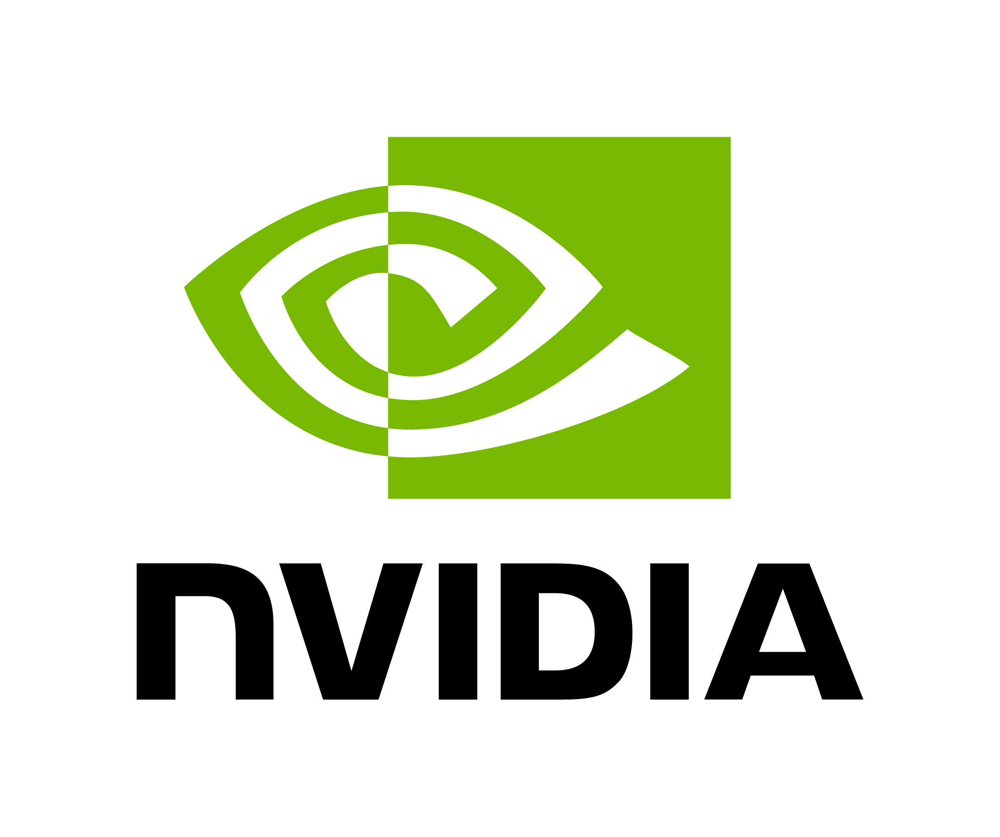
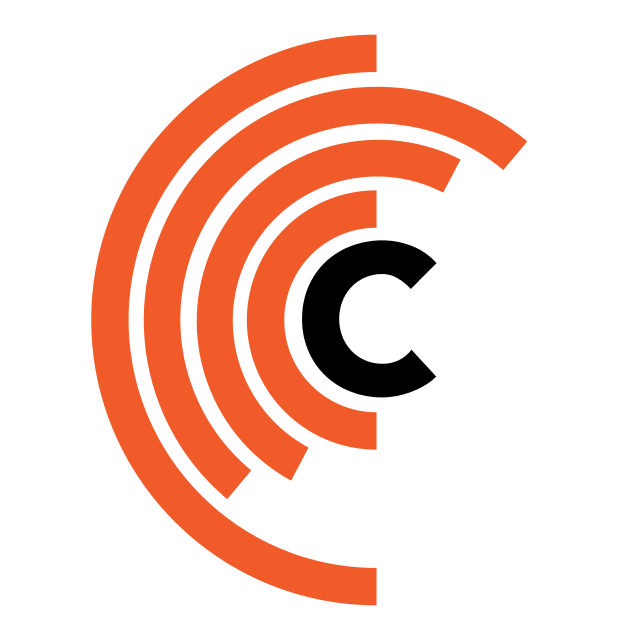
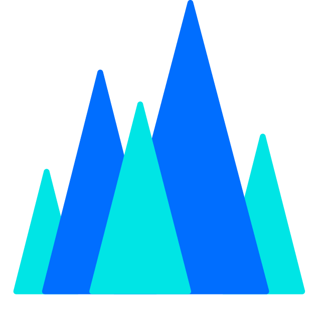

# Free LLM API Provider
> Last reviewed: **2026-10-30** 

This directory tracks **free LLM inference APIs**, their account requirements and rate limits (including CN providers).   
**Free inference**, **one-time trial credits** and **$0/month subscriptions with paid token usage** are not the same thing. Free quotas and model catalogs can change.

免费 LLM API 平台汇总（包括中国大陆平台）。**免费调用、一次性试用额度和按量付费（免月费）应分别判断**。

> **Review status (2026-10-30)**
> Google, NVIDIA, Ollama, Groq, OpenRouter, Cloudflare, Cohere, Z.ai, Mistral, SambaNova, Aion Labs and Tencent Hunyuan were checked against provider documentation. Other sections and the embedded price list are dated snapshots, not fully re-audited.

<table align="center">
  <tr>
    <td align="center"></td>
    <td align="center"></td>
    <td align="center"></td>
    <td align="center"></td>
    <td align="center"></td>
    <td align="center"></td>
  </tr>
  <tr>
    <td align="center"></td>
    <td align="center"></td>
    <td align="center"></td>
    <td align="center"></td>
    <td align="center"></td>
    <td align="center"></td>
    </td>
  </tr>
</table>

You may also want to read my other posts: 
- [**How to Choose Your LLM For Translation?**](https://github.com/CYBIRD-D/How-to-Choose-your-LLM-Model-for-translation/tree/main)
- [**Local LLMs Collection For Translation**](https://github.com/CYBIRD-D/Local-LLMs-Collection-For-Translation/tree/main)
- [**LLM Timeline**](https://github.com/CYBIRD-D/AI-Model-LLM-Timeline)
- [**LLM API Official Pricing Tracker**](https://github.com/CYBIRD-D/LLM-API-Official-Pricing-Tracker)
---------

**Easy guide** to deploy online LLM api（luna）:
  - Sign up/register in certain platform;
  - Get **this** platform's **Api Key** and **Endpoint Address**
    - Check if there's an available date for the key
  - Put it in the softwares that support it.

## Content/目录
- [Global Platform](#global-platform)
  - [★Google/Gemini & Gemma 4](#google-gemini-googlegemma-4)
  - [★Nvidia(40RPM)](#nvidia)
  - [Ollama](#ollama)
  - [★Groq](#groq)
  - [~~Cerebras~~](#cerebras)
  - [OpenRouter](#openrouter)
  - [Cloudflare](#cloudflare)
  - [Cohere](#cohere)
  - [★Z.ai (GLM-4.5/4.7-Flash)](#zai-glm-4547-flash)
  - [~~GitHub Models~~](#github)
  - [★Mistral](#mistral)
  - [SambaNova](#sambanova)
  - [AionLabs](#aionlabs)
  - [SKT](#skt)
  - [IBM](#ibm)
  - [Scaleway (1M free token/per account)](#scaleway-1m-free-tokenper-account-no-refresh)
- [CN Platform](#cn-platform)
  - [ModelScope 魔搭社区](#modelscope-魔搭社区)
  - [SiliconFlow 硅基流动](#siliconflow-硅基流动)
  - [Tencent Cloud TokenHub 腾讯云](#tencent-cloud-tokenhub-腾讯云)
  - [Volcengine Ark 火山方舟](#volcengine-ark-火山方舟)
  - [Coze 扣子 (separate from Ark)](#coze-扣子-separate-from-ark)
  - [StreamLake Vanchin 快手万擎](#streamlake-vanchin-快手万擎)
  - [iFLYTEK Spark 讯飞星火](#iflytek-spark-讯飞星火)
  - [iFlow 心流 (retired)](#iflow-心流-retired)
- [LLM PRICE LIST](#llm-price-list)

-----------

## Global Platform

### Google Gemini / Gemma 4
> Last checked: **2026-10-30**

- [Free-tier model pricing](https://ai.google.dev/gemini-api/docs/pricing) · [Rate limits](https://ai.google.dev/gemini-api/docs/rate-limits) · [Your project's limits in AI Studio](https://aistudio.google.com/rate-limit)
- Endpoint: `https://generativelanguage.googleapis.com`
- **Free-tier examples confirmed on Google's pricing page:** `gemini-3.8-flash`, `gemini-3.5-flash-lite` and **Gemma 4**. Check the Free Tier column for other models.
- **Not free-tier eligible:** `gemini-4-argon`, `gemini-3.1-pro-preview` (other Pro models require individual checks).
- Google does **not** publish a single guaranteed RPM / TPM / RPD quota that applies to every free project. Limits depend on model, project and account tier and are shown in AI Studio. Previously observed numbers (e.g. 5 RPM/20 RPD) are **not universal guarantees**.
- Limits apply **per project** (not per key); RPD quotas reset at **midnight Pacific time**. Free-tier prompts may be used to improve Google products.
- **Alternative, unofficial:** [AI Studio to API Adapter](https://github.com/iBUHub/AIStudioToAPI/blob/main/README_EN.md). Review its security and terms before use.

| Model                     | Requests/minute (RPM) | Tokens/minute (TPM) | Requests/day (RPD) |
|---------------------------|---------------------------|--------------------------|-----------------|
| Gemini 2.5~3.8   Flash    | 5             | 250k                     | 20              |
| Gemini 2.5 Flash Lite     | 10                        | 250k                     | 20              |
| Gemini 3.1/3.5 Flash Lite     | 15                        | 250k                     | 500             |
| **Gemma 4 26B/31B**           | **30**                        | **16k**             | **14.4K**            |
| ~~Gemma 3 (1B/2B/4B/12B/27B)~~  | ~~30~~                  | ~~15k~~                      | ~~14.4k~~           |
~~gemini 2 Flash/Lite~~
~~gemini 2.5/3.1 Pro~~

-------

### Nvidia
> Last checked: **2026-10-30**  

https://build.nvidia.com/models  
Endpoint (OpenAI-compatible): https://integrate.api.nvidia.com/v1

**Rate limit**: Usually up to **`40`** Requests per minute(RPM) 
> Nvidia: Maximum API requests accepted in a given timeframe.  
Rate limits may vary by model and traffic from other users may cause throttling.  
> For dedicated availability, deploy models as a dedicated endpoint with NVIDIA NIM.

- **Representative catalog below, not a fixed or exhaustive 55-model list.** Verify the **Free Endpoint** label for each model in the [live NVIDIA catalog](https://build.nvidia.com/models).
  - OpenAI/Google/Meta/Microsoft/NVIDIA/Mistral AI/DeepSeek/Moonshot AI/Z.ai/MiniMax etc.
- Free endpoints are for **trial/evaluation**, not guaranteed dedicated production hosting. Check NVIDIA trial privacy terms before submitting sensitive data.

 
  
  ## Model List 

#### DeepSeek
deepseek-ai/deepseek-v4-flash  
deepseek-ai/deepseek-v4-flash-0731  
deepseek-ai/deepseek-v4-pro  
deepseek-ai/deepseek-v4.1-flash  

#### Google
google/codegemma-7b  
google/gemma-7b  

#### Meta
meta/llama2-70b  
meta/llama-3.1-8b-instruct  
meta/llama-3.1-70b-instruct  
meta/llama-3.2-1b-instruct  
meta/llama-3.2-3b-instruct  
meta/llama-3.3-70b-instruct  
meta/muse-glimmer-30b  

#### Microsoft
microsoft/phi-4-mini-instruct  
microsoft/phi-4-mini-flash-reasoning  

#### MiniMax
minimaxai/minimax-m2.5  
minimaxai/minimax-m2.7  
minimaxai/minimax-m3.1-flash  

#### Mistral
mistralai/mistral-nemotron  
mistralai/mixtral-8x7b-instruct  
mistralai/mixtral-8x22b-instruct  
mistralai/mistral-large-4-1t-a52b  

#### Moonshot / Kimi
moonshotai/kimi-k2-instruct  
moonshotai/kimi-k2-thinking  
moonshotai/kimi-k3  

#### NVIDIA
nvidia/gliner-pii  
nvidia/llama-3.1-nemoguard-8b-content-safety  
nvidia/llama-3.1-nemoguard-8b-topic-control  
nvidia/llama-3.1-nemotron-safety-guard-8b-v3  
nvidia/llama-3.3-nemotron-super-49b-v1  
nvidia/llama-3.3-nemotron-super-49b-v1.5  
nvidia/llama-3.1-nemotron-ultra-253b-v1  
nvidia/nemotron-3-ultra-550b-a55b  
nvidia/nemotron-3.5-lightning-30b-a3b  
nvidia/nemotron-3.5-super-vl-120b-a12b  
nvidia/nemoguard-jailbreak-detect  
nvidia/nemotron-3-nano-30b-a3b  
nvidia/nemotron-3-super-120b-a12b  
nvidia/nemotron-content-safety-reasoning-4b  
nvidia/nvidia-nemotron-nano-9b-v2  
nvidia/riva-translate-4b-instruct-v1.1  
nvidia/riva-translate-4b-instruct-v2  
nvidia/usdcode  

#### OpenAI
openai/gpt-oss-20b  
openai/gpt-oss-120b  

#### Poolside
poolside/laguna-xs-2-1  

#### Qwen
qwen/qwen2.5-coder-32b-instruct  
qwen/qwen3-next-80b-a3b-instruct  
qwen/qwen3-next-80b-a3b-thinking  
qwen/qwq-32b  

#### Sarvam AI
sarvamai/sarvam-m  

#### StepFun
stepfun-ai/step-3.5-flash  
stepfun-ai/step-5-preview  

#### Stockmark
stockmark/stockmark-2-100b-instruct  

#### Thinking Machines
thinking-machines/inkling  

#### Upstage
upstage/solar-10.7b-instruct  

#### Z.ai / GLM
z-ai/glm4.7  
z-ai/glm5.1  
z-ai/glm-5.2  
z-ai/glm-5.3  
z-ai/glm-5.3-flash  

 

--------

### Ollama
> Last checked: **2026-10-30**

- [Official pricing and cloud plans](https://ollama.com/pricing) · [Cloud models](https://ollama.com/search?c=cloud) · [2026-08-31 pricing transition](https://ollama.com/blog/transparent-pricing)
- **Pay as you go ($0/month)** means **no subscription**, not free inference: cloud token usage consumes purchased credits. The old blanket list of “free models” and **3-hour session resets** no longer describes the current published plans.
- Running local models on your own hardware incurs no Ollama cloud token charges.
- Cloud concurrency: **3** for Pay as you go and Pro; **10** for Max and Team. Some legacy accounts may have different conditions.

> **Free** model list

- Gemma4: 31b
- gpt-oss 20b/120b
- nemotron-3-nano 30B/super 120B-A12B/ultra 550B-A55B
- Reflection Beam 501B （limit time)

> **Session usage** reset in 3hours

| Plan | Subscription | Included cloud usage |
|---|---:|---:|
| Pay as you go | $0/month | None advertised; purchase usage credits |
| Pro | $20/month ($200/year) | $60/month |
| Max | $100/month | $300/month |
| Team | $500/month | $1,000/month shared |
| Enterprise | Custom | Custom |

Current cloud model pricing (USD per 1M input / 1M output tokens)

| Model | Input | Output | Combined |
|---|---:|---:|---:|
| deepseek-v4.1-flash (off-peak) | $0.15 | $0.60 | $0.75 |
| deepseek-v4.1-flash (standard) | $0.30 | $1.20 | $1.50 |
| deepseek-v4-pro (off-peak) | $0.66 | $1.98 | $2.64 |
| deepseek-v4-pro (standard) | $1.32 | $3.96 | $5.28 |
| gemma4 | $0.14 | $0.40 | $0.54 |
| glm-5.3 / glm-5.2 | $1.40 | $4.40 | $5.80 |
| glm-5.3-flash | $0.15 | $0.50 | $0.65 |
| gpt-oss:120b | $0.15 | $0.60 | $0.75 |
| gpt-oss:20b | $0.07 | $0.30 | $0.37 |
| kimi-k3 | $3.00 | $15.00 | $18.00 |
| kimi-k2.7-code / kimi-k2.6 | $0.95 | $4.00 | $4.95 |
| minimax-m3.1-flash | $0.15 | $0.60 | $0.75 |
| minimax-m3 | $0.60 | $2.40 | $3.00 |
| minimax-m2.7 | $0.30 | $1.20 | $1.50 |
| mistral-large-4 | $0.70 | $2.10 | $2.80 |
| mistral-large-3 | $0.50 | $1.50 | $2.00 |
| muse-spark-open | $1.25 | $4.25 | $5.50 |
| nemotron-3-nano | $0.06 | $0.24 | $0.30 |
| nemotron-3-super | $0.015 | $0.60 | $0.615 |
| nemotron-3-ultra | $0.10 | $3.00 | $3.10 |

Off-peak pricing applies to eligible models outside **12:00–18:00 UTC on weekdays**, and throughout weekends. See the official table for cached-input prices. This table is **paid cloud pricing**, not a free-tier model listing.

-------

### Groq
> Last checked: **2026-10-30**

The published free rate-limits table includes GPT-OSS 20B/120B and Qwen3.8 27B. Your account may have different limits.

https://console.groq.com/docs/rate-limits 
Endpoint (OpenAI-compatible): https://api.groq.com/openai/v1

#### Model list

| Model | Request/Minute | Request/Day | Token/Minute | Token/Day |
| --- | ---: | ---: | ---: | ---: |
| openai/gpt-oss-120b | 30 | 1K | 8K | 200K |
| openai/gpt-oss-20b | 30 | 1K | 8K | 200K |
| qwen/qwen3.8-27b | 30 | 1K | 8K | 200K |

---------

### ~~Cerebras~~
~~> Last checked: **2026-10-30**~~

**Unusable rate limit** 5$ per account

https://inference-docs.cerebras.ai/support/rate-limits 
Endpoint: https://api.cerebras.ai

| Model                                | Requests/Minute |   Tokens/Minute | Tokens/Hour | Tokens/Day |
|--------------------------------------|-----------------|---------------|-------------|------------|
| gpt-oss-120b                         | 5               |  30k          | 1M          | 1M         |
| gemma-4-31b                          | 5               |  30k          | 1M          | 1M         |

 

---------

### OpenRouter
> Last checked: **2026-10-30**  

https://openrouter.ai/collections/free-models  
https://openrouter.ai/pricing  

Endpoint (OpenAI-compatible): https://openrouter.ai/api/v1

**Models**: Check the live collection. `openrouter/free` can route to a free model; $0-priced models without `:free` can follow different eligibility rules.
- **Free usage limits**: If you’re using a free model variant (with an ID ending in **`:free`**/ **`(free)`** )  
  you can make up to **`20`** requests/minute. 
  - If you have purchased less than **`$10 credits`**, you’re limited to **`50`** `free` model **requests/Day**.
  - If you purchase at least **`$10 credits`**, the daily limit increases to **`1000`** free model requests/day. Failed requests also count. See [official limits](https://openrouter.ai/docs/api-reference/limits) for purchase thresholds.

| Model variant (ID) | Credits purchased        | Rate limit (requests/min) | Daily limit (requests/day) |
|--------------------|--------------------------|---------------------------|----------------------------|
| *:free             | < $10 credits             | 20                        | 50                         |
| *:free             | ≥ $10 credits             | 20                        | 1000                       |

--------

### Cloudflare
> Official pricing page last updated: **2026-10-20**  
> Last Check: **2026-09-23**  

https://developers.cloudflare.com/workers-ai/platform/pricing/#llm-model-pricing  
https://developers.cloudflare.com/workers/platform/pricing/  
- Workers Free: **10,000 Neurons/day** (resets 00:00 UTC); paid overage **$0.011 per 1,000 Neurons**.  
> "Neurons are our way of measuring AI outputs across different models, representing the GPU compute needed to perform your request. Our serverless model allows you to pay only for what you use without having to worry about renting, managing, or scaling GPUs."

**Billing requirement:** Certain Kimi, DeepSeek V4/V4.1 and GLM-5.x APIs require Workers Paid or prepaid AI Gateway credits **even with unused free Neurons**. Listed models are not all available without a billing method.

Models list  
- Llama
    - Llama2-7b
    - Llama3.1-8b/70b
    - Llama3.2-1b/3b/11b(vision)
    - Llama4-scout-17b-16e
- Qwen
    - qwq-32b
    - qwen2.5-coder-32b
    - **qwen3-30b-a3b**
    - **qwen3.8-27b**
- Mistral
    - Mistral-7b-intruct-v0.1
    - Mistral-small-3.1b-24b
- deepseek-r1-distill-qwen-32b
- deepseek V4 flash/pro and V4.1 flash 1017 
- Gemma
  - gemma-3-12b
  - **gemma-4-26B-A4B**
  - gemma-sea-lion-v4-27b-it
- granite-4.0-h-micro
- **glm-4.7-flash**
- **glm-5.2 / glm-5.3 / glm-5.3-flash**
- **nemotron-3-120b-a12b**
- **kimi-k2.5/k2.6/k2.7-code**
    
 

  
Full list with token cost
  
   
> Pricing page updated October 20, 2026 (reviewed October 30)
>
> Unit: USD per 1M tokens
>
> Ranking method: `Combined = Input + Output`
>
> Free allocation: 10,000 Neurons per day
>
> Free Tokens/day assumes an Input : Output token ratio of `1 : 1.3`.
>
> Free-token estimates use Neurons-per-token rates rather than rounded USD prices; for billing-gated models these are **illustrative, not free account entitlements**.
>
> Cached input is excluded from the free-token calculation.
>
> Identical models from the same family are merged only when their pricing and relevant notes are identical.

| Rank | Provider | Model | Input | Output | Combined | 10K Neurons ≈ Tokens/day (I:O = 1:1.3) | Notes |
|---:|---|---|---:|---:|---:|---:|---|
| 1 | IBM | Granite 4.0 H Micro | $0.017 | $0.112 | **$0.129** | **~1.560M** | — |
| 2 | Meta | Llama 3.2 1B Instruct | $0.027 | $0.201 | **$0.228** | **~878K** | — |
| 3 | Mistral | Mistral 7B Instruct v0.1 | $0.110 | $0.190 | **$0.300** | **~708K** | — |
| 4 | Meta | Llama 3.2 3B Instruct | $0.051 | $0.335 | **$0.386** | **~520K** | — |
| 5 | Qwen | Qwen3 30B-A3B FP8 | $0.051 | $0.335 | **$0.386** | **~520K** | — |
| 6 | Meta | Llama 3/3.1 8B Instruct AWQ | $0.123 | $0.266 | **$0.389** | **~539K** | Identical pricing; merged |
| 7 | Google | Gemma 4 26B-A4B IT | $0.100 | $0.300 | **$0.400** | **~516K** | — |
| 8 | Meta | Llama 3.1 8B Instruct FP8 Fast | $0.045 | $0.384 | **$0.429** | **~465K** | — |
| 9 | Meta | Llama 3.1 8B Instruct FP8 | $0.152 | $0.287 | **$0.439** | **~482K** | — |
| 10 | Z.AI | GLM-4.7 Flash | $0.060 | $0.400 | **$0.460** | **~435K** | — |
| 11 | OpenAI | GPT-OSS 20B | $0.200 | $0.300 | **$0.500** | **~429K** | — |
| 12 | Meta | Llama Guard 3 8B | $0.484 | $0.030 | **$0.514** | **~484K** | Safety classifier; not a general-purpose chat LLM |
| 13 | Meta | Llama 3.2 11B Vision Instruct | $0.049 | $0.676 | **$0.725** | **~273K** | Vision-capable |
| 14 | Google | Gemma 3 12B IT | $0.345 | $0.556 | **$0.901** | **~237K** | — |
| 15 | AI Singapore | Gemma SEA-LION v4 27B IT | $0.351 | $0.555 | **$0.906** | **~236K** | — |
| 16 | Mistral | Mistral Small 3.1 24B Instruct | $0.351 | $0.555 | **$0.906** | **~236K** | — |
| 17 | OpenAI | GPT-OSS 120B | $0.350 | $0.750 | **$1.100** | **~191K** | — |
| 18 | Meta | Llama 3/3.1 8B Instruct | $0.282 | $0.827 | **$1.109** | **~187K** | Identical pricing; merged |
| 19 | Meta | Llama 4 Scout 17B-16E Instruct | $0.270 | $0.850 | **$1.120** | **~184K** | — |
| 20 | Qwen | QwQ 32B | $0.660 | $1.000 | **$1.660** | **~129K** | — |
| 21 | Qwen | Qwen2.5 Coder 32B Instruct | $0.660 | $1.000 | **$1.660** | **~129K** | — |
| 22 | DeepSeek | DeepSeek V4 Flash 0731 | $0.440 | $1.320 | **$1.760** | **~117K** | Cached input $0.014; paid billing method required |
| 23 | NVIDIA | Nemotron 3 120B-A12B | $0.500 | $1.500 | **$2.000** | **~103K** | — |
| 24 | Meta | Llama 3.1/3.3 70B Instruct FP8 Fast | $0.293 | $2.253 | **$2.546** | **~78.5K** | Identical pricing; merged |
| 25 | Moonshot AI | Kimi K2.5 | $0.600 | $3.000 | **$3.600** | **~56.2K** | Cached input $0.100 |
| 26 | Qwen | Qwen3.8 27B | $0.450 | $3.200 | **$3.650** | **~54.9K** | — |
| 27 | Moonshot AI | Kimi K2.6 | $0.950 | $4.000 | **$4.950** | **~41.1K** | Cached input $0.160; paid billing method required |
| 28 | Moonshot AI | Kimi K2.7 Code | $0.950 | $4.000 | **$4.950** | **~41.1K** | Cached input $0.190; paid billing method required |
| 29 | DeepSeek | DeepSeek V4 Pro 0813 | $1.320 | $3.960 | **$5.280** | **~39.1K** | Cached input $0.044; paid billing method required |
| 30 | DeepSeek | DeepSeek R1 Distill Qwen 32B | $0.497 | $4.881 | **$5.378** | **~37.0K** | — |
| 31 | Z.AI | GLM-5.2 | $1.400 | $4.400 | **$5.800** | **~35.5K** | Cached input $0.260; paid billing method required |
| 32 | Meta | Llama 2 7B Chat FP16 | $0.556 | $6.667 | **$7.223** | **~27.4K** | — |

 

---------

### Cohere
> Last web updated: **2026-06-09** 
> Last Check: **2026-10-30**  

https://docs.cohere.com/docs/rate-limits

Endpoint: https://api.cohere.ai/compatibility

| Endpoint            | Trial rate limit (requests/min)  | Trial monthly cap (calls/month)   |
|---------------------|----------------------------------|----------------------------------|
| Chat API            | 20/min (per model)               | 1000/month                       |

- Chat model includes
  - Command A+
  - Command A Reasoning
  - Command A Translate
  - Command A Vision
  - Command A
  - Command R+
  - Command R
  - Command R7B
  - North Mini Code

> All endpoints are limited to 1,000 calls per month with a trial key

--------

### Z.ai (GLM-4.5/4.7-Flash)

> Last Check: **2026-10-30**  

https://docs.z.ai/guides/overview/pricing  

Endpoint: https://api.z.ai/api/paas/v4

**Free Models :**
- GLM-4.5-Flash
- GLM-4.7-Flash
- GLM-4.6V-Flash

> No offical rate usage limits

-------

### ~~Github~~

~~https://docs.github.com/en/github-models/use-github-models/prototyping-with-ai-models#rate-limits~~

> GitHub Models has been retired.  
> As of July 30, 2026, GitHub Models has been fully retired. The playground, model catalog, inference API, and bring your own key (BYOK) are no longer available to any customer.  
> GitHub Models was a separate service from GitHub Copilot and is unrelated to GitHub Copilot services.  

---------

### Mistral
> Last checked: **2026-10-30**

[Official rate-limit guide](https://docs.mistral.ai/admin/billing-usage/usage-limits) · [Explanation](https://help.mistral.ai/en/articles/698531-why-am-i-hitting-api-rate-limits-and-how-do-i-increase-them)

Free-mode limits depend on the **organization and model**. The old numeric cap below is a historical community report, **not a guaranteed free-tier entitlement**. Check **Admin Panel → API → Limits**.

Endpoint: https://api.mistral.ai

- From community&reports; **No offcial list**

| Plan / Tier         | Requests/second (RPS) | Tokens/minute (TPM) | Tokens/month      |
|---------------------|---------------------------|--------------------------|------------------------|
| Mistral API Free    | 1/sec                         | 500k                 | 1 billion     |

----------

### SambaNova

> Last checked: **2026-10-30**

https://docs.sambanova.ai/docs/en/models/rate-limits#free-tier

| Model                                | Requests/Minute |  Requests/Day | Tokens/Day |
|--------------------------------------|-----------------|---------------|------------|
| DeepSeek-V3.1                        | 20               |  20          |  200k        |
| Meta-Llama-3.3-70B-Instruct          | 20               |  20          |  200k        |
| gpt-oss-120b                         | 20               |  20          |  200k        |
| DeepSeek-V3.2                        | 20               |  20          |  200k        |
| gemma-4-31B-it                       | 20               |  20          |  200k        |

-----------

### AionLabs

> Last checked: **2026-10-30**

https://www.aionlabs.ai/docs/rate-limits/

https://www.aionlabs.ai/docs/models/

Endpoint: https://api.aionlabs.ai/v1

**Shared free-tier caps:** 15 RPM, 20K TPM, 20K tokens/day ([official rate limits](https://www.aionlabs.ai/docs/rate-limits/)).

| Model                                | Requests/Minute | Tokens/Day |
|--------------------------------------|----------------- |------------|
| Aion-2.0 (DeepSeek V3.2 finetune)                     | 15               |  20k        |
| Aion-2.5 (Improve of Aion-2.0)                        | 15               |  20k        |
| Aion-3.0 (GLM)                                        | 15               |  20k        |
| Aion-3.0 Mini (Deepseek)                              | 15               |  20k        |
| Aion-3.5 (GLM)                                        | 15               |  20k        |
| Aion-3.5 Mini (GLM)                                   | 15               |  20k        |
| Aion-RP 1.0 (8B) (llama-3.1-8b fineune/openweight)    | 15               |  20k        |

------

### SKT 
Free Api for **A.X 4.0** (7B/72B, based on Qwen2.5)  
**Korean⇌EN**  
https://github.com/SKT-AI/A.X-4.0/blob/main/apis/README.md

### IBM
> Last Check: **2026-10-08**  

https://www.ibm.com/products/watsonx-ai/pricing

| Plan / Tier         | Requests/second (RPS) |  Tokens/month      |
|---------------------|---------------------------|------------------------|
| watsonx.ai Free tier   (Foundation Models)| 2/sec                        | 300k     |

-----------

### Scaleway (1M free token/per account-no refresh)
https://www.scaleway.com/en/docs/generative-apis/faq/#how-does-the-free-tier-work

--------

### ~~Together AI (certain free-endpoint:no text models now)~~ 
~~> Last updated: **2025-11-17**~~

~~https://www.together.ai/models~~
~~- Llama3-70b  ~~
~~https://www.together.ai/models/llama-3-3-70b-free  ~~
~~https://www.together.ai/models/deepseek-r1-distilled-llama-70b-free   ~~

**NO FREE TIER** Now  
https://support.together.ai/articles/1862638756-changes-to-free-tier-and-billing-july-2025

-----------

 

## CN Platform

> **Last reviewed: 2026-10-30.** This section distinguishes **recurring free inference**, **one-time trial tokens/vouchers**, and **non-API product credits**. Rate limits, eligible models, campaigns and geographic access may change; the logged-in console takes precedence. No account-level API calls were performed during this documentation review.
>
> 本节区分**持续免费推理**、**一次性试用额度/代金券**与**非 API 的产品积分**。具体权限、模型和额度以账号控制台为准。

### ModelScope 魔搭社区
**Type:** Magicube-supported inference (renewable daily points; not an unlimited free API).
> Last checked: **2026-10-30**

- [API-Inference usage limits](https://modelscope.cn/docs/model-service/API-Inference/limits) · [Magicube announcement (2026-08-10)](https://www.modelscope.cn/posts/435591) · [Magicube usage](https://www.modelscope.cn/magicube/usage)
- OpenAI-compatible base URL: `https://api-inference.modelscope.cn/v1`.
- An Alibaba Cloud account **linked to ModelScope and real-name verified** is required for API-Inference.
- The current **Magicube (魔粒)** system grants **200 points/day** for logging in and **50 additional points/day** for linking Alibaba Cloud; community participation can earn more.
- Indicative API costs: **0.5 points/request** (light), **1 point/request** (mainstream) or **2 points/request** (flagship). Actual points consumed depend on the selected model.
- Earlier documentation stated **2,000 calls/day across models**, **up to 500/model/day**, with lower limits for some large models. These figures should **not** be treated as an unconditional current allowance or as a substitute for Magicube balances; model-specific quotas and concurrency may still apply.
- Free shared capacity is for exploration and has no production SLA; check remaining points and per-model restrictions before use.

**中文：** 2026 年 8 月起 API-Inference 已纳入魔粒体系；每日登录 200 魔粒、绑定阿里云额外 50，模型通常按每次 0.5 / 1 / 2 魔粒扣减。原「每天 2000 次」口径不再适合单独代表当前可用额度。

---

### SiliconFlow 硅基流动
**Type:** Selected zero-priced models + limited-time voucher (not a blanket free-token grant).
> Last checked: **2026-10-30**

- [Official free-model rate limits](https://docs.siliconflow.cn/docs/userguide/faqs/rate-limit-and-upgradation) · [Free vs. Pro models](https://docs.siliconflow.cn/docs/userguide/faqs/misc) · [Official 2026 voucher campaign](https://www.siliconflow.cn/developer-talk/od7wj9rr23p95uhihmhrombp)
- OpenAI-compatible base URL: `https://api.siliconflow.cn/v1` (Mainland China service).
- After **real-name verification**, users can access models currently identified as **free** in the model catalog at **0 inference charge**. Free models have **fixed, model-specific rate limits**; paid variants may carry a `Pro/` prefix. Check a model's actual pricing rather than assuming all small or non-`Pro/` models are free.
- **Promotional voucher:** the official “推荐官” campaign (**2026-01-15 to 2026-12-31**) offers a **¥16 general-use voucher** after real-name verification, **manually claimed** from the event centre; valid for **180 days from receipt**. Referral vouchers are a **separate** reward. Historic referral gifts are converted to voucher equivalents.
- The older “**20M free tokens upon CN-phone registration**” claim is **not verified as a universally current registration entitlement**; do not rely on it.

**中文：** 免费模型本身的 0 元调用与实名认证领取的 **16 元代金券**是两种权益。代金券需要在活动中心领取，并非每人固定赠送 2000 万 tokens。

---

### Tencent Cloud TokenHub 腾讯云
**Type:** One-time new-user trial tokens (not an indefinitely free API).
> Last checked: **2026-10-30**

- [TokenHub new-user free trial (Mainland China, updated 2026-09-04)](https://cloud.tencent.com/document/product/1823/130053) · [TokenHub API quick start](https://cloud.tencent.com/document/product/1823/130058) · [Legacy platform shutdown announcement](https://cloud.tencent.com/announce/detail/2287)
- **The legacy Tencent Hunyuan API platform is retired:** new purchases/key creation stopped **2026-06-30**, with the legacy console and API service fully shut down on **2026-09-30**. New integration should use **TokenHub**, which offers Hunyuan and third-party models.
- On the **Mainland China TokenHub** new-user promotion (currently stated to run until **2026-12-31**), the official trial document lists **1 million tokens for language models**, valid for **one year** from receipt. This applies as **one-time trial entitlement**, with account/model package restrictions; see the console.
- Complete Tencent Cloud **real-name verification**. Free packages can be claimed from the model catalog or activation page, and some are automatically issued on first call. **Turn off postpaid billing** if you do not want charges after the free package is depleted; without postpaid billing, inference stops when free tokens run out.
- **Regional distinction:** the Tencent Cloud **international** TokenHub documentation specifies a different validity period (**90 days**) and may require a **US$1 balance hold per model activation**. Do not combine Mainland China and international terms.
- Old “Hunyuan-lite free” and legacy **1M tokens / 1-year** API offers are historical and **not a current route through the retired API**.

**中文：** 腾讯混元旧 API 已于 **2026-09-30 停服**；应改用 **TokenHub**。中国站新人语言模型试用为 **100 万 tokens、有效期一年**（一次性，活动至 2026-12-31），不要混用国际站的 90 天规则。

---

### Volcengine Ark 火山方舟
**Type:** Model inference API with one-time trials; **not** the same as Coze points.
> Last checked: **2026-10-30**

- [Ark safe-experience mode](https://docs.volcengine.com/docs/ark/free-tokens-only-mode?lang=zh) · [Model activation and free quotas](https://docs.volcengine.com/docs/ark/activation-management?lang=zh)
- **Safe-experience mode (安心体验模式):** eligible **new accounts** can use the platform's **500,000-token trial allowance** for model inference; when that trial allowance is exhausted, eligible inference is **paused rather than billed**.
- The safeguard must be enabled **when first activating model service**; an account that has already activated inference outside this mode may not be eligible. Once switched off, safe-experience mode **cannot be re-enabled**.
- The allowance only covers eligible **inference tokens**: tools/plugins, knowledge bases and other products can still incur charges. Other free model packages may exist, but amounts and eligibility vary by model/campaign and are shown in the console.
- The older **500 points/day** and per-model **Coze point-cost table** were **not Ark API pricing** and have been removed from this section.

**中文：** 方舟提供真正的模型推理 API 试用。符合条件的新账号可在首次开通时开启**安心体验模式**，试用的 50 万 tokens 用完后自动暂停推理；插件、知识库等不一定免费。

---

### Coze 扣子 (separate from Ark)
**Type:** Agent/AI application platform credits; **not a general-purpose free model inference API**.
> Last checked: **2026-10-30**

- [2026 subscription upgrade announcement](https://docs.volcengine.com/docs/coze/button-subscription-package-upgrade?lang=zh) · [Current subscription plans](https://docs.volcengine.com/docs/coze/Subscriptionpackage?lang=zh) · [Credit rules](https://docs.volcengine.com/docs/coze/integral?lang=zh)
- The **2026-01-18** upgrade renamed **资源点** to **积分**. Its announcement introduced **1,500 points for daily sign-in** on the personal Free plan (**one-day validity**), replacing the earlier 500/day.
- **Important documentation difference:** the current subscription table does **not** include monthly subscription points in the personal Free plan, while the current credit rules explicitly list a **one-time 1,500-point new-user grant** (**30-day validity**) and the FAQ also mentions daily sign-in rewards. Accordingly, **do not guarantee 1,500 recurring points/day for every account** without checking its actual event/credit balance.
- Coze points may pay for platform features, but must **not** be represented as Volcengine Ark API token quotas. The prior detailed Coze 2025 model-point table was removed because it belonged to an older billing scheme.

**中文：** 扣子和火山方舟分开记录。旧的「500 资源点/天」已经过时；2026 年初公告提到每日签到 1500 积分，但现行页面还明确列出新用户**一次性** 1500 积分（30 天），应以账号活动界面为准。

---

### StreamLake Vanchin 快手万擎
**Type:** One-time/campaign-specific free inference trial.
> Last checked: **2026-10-30**

- [Official free inference quota (updated 2025-12-12)](https://streamlake.com/document/WANQING/mdsor5767ob7s796sp6) · [Model billing](https://streamlake.com/document/WANQING/mdsorb4ejjptsmfyrn)
- **Registration, verification and service activation** are required. Free online-inference allocations are provided in campaign/resource packages, with **no universal token amount confirmed**; check **Billing Centre → Resource Packages**.
- Free credits apply to online inference **input, output and cache-hit tokens**, but **not batch inference**. Quotas are **model-specific** and shared within the main account.
- **Postpaid billing warning:** usage after free credits expire or run out **can create a bill**; monitor usage or disable/limit postpaid access where supported.

**中文：** 注册并认证后可领取活动试用包；不应填写未经证实的固定免费额度。免费额度耗尽后继续调用，可能按量收费。

---

### iFLYTEK Spark 讯飞星火
**Type:** Zero-priced models + separate promotional free packages.
> Last checked: **2026-10-30**

- [Spark Lite HTTP API documentation](https://www.xfyun.cn/doc/spark/HTTP%E8%B0%83%E7%94%A8%E6%96%87%E6%A1%A3.html) · [Spark-X2.5 model IDs](https://www.xfyun.cn/doc/spark/Spark-X2.5%E6%A8%A1%E5%9E%8B%E4%BB%8B%E7%BB%8D.html) · [Official model pricing/catalog](https://spark.xfyun.cn/sparkapi)
- **Spark Lite:** official HTTP API documentation marks Lite as supporting **free use**. OpenAI-compatible base URL for the classic Spark HTTP API: `https://spark-api-open.xf-yun.com/v1/`.
- **Spark-X2.5-1.7B** (model ID `spark-x2.5-1.7b`): listed as **free** (0 yuan/1M tokens) in the current model catalog.
- **Spark-X2.5-4B** (`spark-x2.5-4b`): listed at **0 yuan/1M tokens / limited-time free** in model listings; **do not assume permanent pricing**. The X2.5 models are listed in the Spark model marketplace; confirm endpoint/API credentials for that platform separately.
- The former blanket statement “**200K free tokens for all models, valid one year**” could **not** be reconfirmed and should not be treated as current.

**中文：** 保留 Spark Lite 免费；增加 **X2.5-1.7B 免费**和 **X2.5-4B 限时免费**，不再使用缺少现行依据的「所有模型共享 20 万 tokens」口径。

---

### iFlow 心流 (retired)
**Status: API and model catalog closed on 2026-04-17. Not a currently usable free LLM API provider.**

- [Official closure announcement (2026-03-20)](https://vibex.iflow.cn/t/topic/4819) · [Closure-day notice (2026-04-17)](https://vibex.iflow.cn/t/topic/5753)
- The original **iFlow API service and hosted model catalog** were shut down on **2026-04-17**, along with the bundled iFlow CLI model access. The CLI can still be configured with **other providers'** compatible APIs; that does **not** restore the retired iFlow-hosted model service.
- Retained for historical reference only; excluded from active-provider recommendations.

---

## [LLM PRICE LIST](https://github.com/CYBIRD-D/LLM-API-Official-Pricing-Tracker)

### LLM API Pricing — historical snapshot (October 14, 2026)

> **Not re-audited on October 30.** See [dedicated pricing tracker](https://github.com/CYBIRD-D/LLM-API-Official-Pricing-Tracker) for current pricing.

> Unit: USD per 1M tokens
>
> Primary ranking: `Combined = Input + Output`
>
> Combined represents the cost of 1M uncached input tokens + 1M output tokens.
>
> Tie-breaker: when Combined prices are identical, the model with the lower directly comparable Cached Input price is ranked first.
>
> Standard real-time API pricing is used.
>
> Temporary promotional prices and normal/list prices are shown separately when the promotion is still active.
>
> Expired promotional prices are not included in the current ranking.
>
> Batch, Flex, Priority/Fast and other alternative processing modes are excluded.
>
> For context-tiered models, the lowest/default context tier is used for ranking.
>
> Same-family models are merged only when their main pricing and relevant pricing conditions are sufficiently equivalent.
>
> Qwen prices use Alibaba Cloud Model Studio Singapore / International pricing.

| Rank | Provider | Model | Input | Cached Input | Output | Combined | Notes | Pricing Source |
|---:|---|---|---:|---:|---:|---:|---|---|
| 1 | Qwen | Qwen3.7 Flash | $0.03 | — | $0.13 | **$0.16** | ≤32K; 32K–256K: $0.10/$0.40; 256K–1M: $0.20/$0.80 | [Source](https://www.alibabacloud.com/help/en/model-studio/model-pricing) |
| 2 | Meta / OpenRouter | Muse Spark 1.2/1.3 Contributor | $0.10 | $0.002 | $0.20 | **$0.30** | 1M context; prompts/outputs may be used to improve Meta products | [Source](https://openrouter.ai/meta/muse-spark-1.3-contributor) |
| 3 | Qwen | Qwen3.5 Flash | $0.10 | — | $0.40 | **$0.50** | International | [Source](https://www.alibabacloud.com/help/en/model-studio/model-pricing) |
| 4 | Anthropic | Claude Haiku 5.5 | $0.10 | $0.01 | $0.50 | **$0.60** | ≤100K; >100K: $0.50 input / $0.05 cache / $2.50 output | [Source](https://platform.claude.com/docs/en/models/haiku-5-5/overview) |
| 5 | OpenAI | GPT-6 Luna | $0.10 | $0.01 | $0.50 | **$0.60** | 1.05M context; >272K: $0.20/$0.75 | [Source](https://developers.openai.com/api/docs/pricing) |
| 6 | Qwen | Qwen3.8 Flash | $0.15 | — | $0.47 | **$0.62** | International; 1M context | [Source](https://www.alibabacloud.com/help/en/model-studio/model-pricing) |
| 7 | GLM / Z.AI | GLM-5.3-Flash | $0.15 | $0.03 | $0.50 | **$0.65** | Standard price | [Source](https://docs.z.ai/guides/overview/pricing) |
| 8 | DeepSeek | DeepSeek V4.1 Flash — Off-peak | $0.15 | $0.003 | $0.60 | **$0.75** | 1M context; off-peak pricing | [Source](https://api-docs.deepseek.com/quick_start/pricing/) |
| 9 | Mistral | Mistral Small 4 | $0.15 | $0.015 | $0.60 | **$0.75** | 256K context | [Source](https://docs.mistral.ai/models/mistral-small-4-0-26-03) |
| 10 | OpenAI | GPT-5.6 Luna | $0.20 | $0.02 | $1.20 | **$1.40** | >272K: $0.40/$1.80 | [Source](https://developers.openai.com/api/docs/pricing) |
| 11 | Meta / OpenRouter | Muse Glimmer 30B | $0.30 | $0.04 | $1.10 | **$1.40** | 131K context | [Source](https://openrouter.ai/meta/muse-glimmer-30b) |
| 12 | OpenAI | GPT-5.4 nano | $0.20 | $0.02 | $1.25 | **$1.45** | — | [Source](https://developers.openai.com/api/docs/pricing) |
| 13 | DeepSeek | DeepSeek V4.1 Flash — Peak | $0.30 | $0.006 | $1.20 | **$1.50** | 1M context; peak pricing | [Source](https://api-docs.deepseek.com/quick_start/pricing/) |
| 14 | Qwen | Qwen3.7 Plus — Promo | $0.32 | — | $1.28 | **$1.60** | International alias; 20% off; regular $0.40/$1.60 | [Source](https://www.alibabacloud.com/help/en/model-studio/model-pricing) |
| 15 | Google | Gemini 3.1 Flash-Lite | $0.25 | $0.025 | $1.50 | **$1.75** | — | [Source](https://ai.google.dev/gemini-api/docs/pricing) |
| 16 | Qwen | Qwen3.6 Flash | $0.25 | — | $1.50 | **$1.75** | ≤256K; International | [Source](https://www.alibabacloud.com/help/en/model-studio/model-pricing) |
| 17 | Qwen | Qwen3.7 Plus — Regular Price | $0.40 | — | $1.60 | **$2.00** | ≤256K | [Source](https://www.alibabacloud.com/help/en/model-studio/model-pricing) |
| 18 | DeepSeek | DeepSeek V4 Pro — Off-peak | $0.66 | $0.022 | $1.98 | **$2.64** | Off-peak pricing | [Source](https://api-docs.deepseek.com/quick_start/pricing/) |
| 19 | Google | Gemini 3.5 Flash-Lite | $0.30 | $0.03 | $2.50 | **$2.80** | — | [Source](https://ai.google.dev/gemini-api/docs/pricing) |
| 20 | Qwen | Qwen3.5 Plus | $0.40 | — | $2.40 | **$2.80** | ≤256K; International | [Source](https://www.alibabacloud.com/help/en/model-studio/model-pricing) |
| 21 | xAI | Grok Build 0.1 | $1.00 | $0.20 | $2.00 | **$3.00** | <200K; ≥200K: $2/$4 | [Source](https://docs.x.ai/developers/pricing) |
| 22 | Qwen | Qwen3.6 Plus | $0.50 | — | $3.00 | **$3.50** | ≤256K; International | [Source](https://www.alibabacloud.com/help/en/model-studio/model-pricing) |
| 23 | xAI | Grok 4.20/4.3 | $1.25 | $0.20 | $2.50 | **$3.75** | <200K; ≥200K: $2.50/$5 | [Source](https://docs.x.ai/developers/pricing) |
| 24 | GLM / Z.AI | GLM-5 | $1.00 | $0.20 | $3.20 | **$4.20** | — | [Source](https://docs.z.ai/guides/overview/pricing) |
| 25 | Google | Gemini 3.6/3.8 Flash — Promo | $0.75 | $0.075 | $3.75 | **$4.50** | Introductory price through Dec 31, 2026; 3.7 retired (redirects to 3.8) | [Source](https://ai.google.dev/gemini-api/docs/pricing) |
| 26 | Kimi | Kimi K2.6 | $0.95 | $0.16 | $4.00 | **$4.95** | ~262K context | [Source](https://www.kimi.com/) |
| 27 | Kimi | Kimi K2.7 Code | $0.95 | $0.19 | $4.00 | **$4.95** | ~262K context | [Source](https://www.kimi.com/) |
| 28 | GLM / Z.AI | GLM-5-Turbo | $1.20 | $0.24 | $4.00 | **$5.20** | 200K context; agent-tuned Turbo variant | [Source](https://docs.z.ai/guides/overview/pricing) |
| 29 | OpenAI | GPT-5.4 mini | $0.75 | $0.075 | $4.50 | **$5.25** | — | [Source](https://developers.openai.com/api/docs/pricing) |
| 30 | DeepSeek | DeepSeek V4 Pro — Peak | $1.32 | $0.044 | $3.96 | **$5.28** | Peak pricing | [Source](https://api-docs.deepseek.com/quick_start/pricing/) |
| 31 | Meta / OpenRouter | Muse Spark 1.1/1.2/1.3 | $1.25 | $0.15 | $4.25 | **$5.50** | 1M context; standard data policy | [Source](https://openrouter.ai/meta/muse-spark-1.3) |
| 32 | Mistral | Mistral Large 4 | $1.36 | $0.14 | $4.18 | **$5.54** | 1M context; public preview; regular published price | [Source](https://docs.mistral.ai/models/mistral-large-4-0) |
| 33 | GLM / Z.AI | GLM-5.1 | $1.40 | $0.26 | $4.40 | **$5.80** | 200K context | [Source](https://docs.z.ai/guides/overview/pricing) |
| 34 | GLM / Z.AI | GLM-5.2/5.3 | $1.40 | $0.26 | $4.40 | **$5.80** | 1M context | [Source](https://docs.z.ai/guides/overview/pricing) |
| 35 | xAI | Grok 4.5 | $2.00 | $0.30 | $6.00 | **$8.00** | <200K; ≥200K: $4/$12 | [Source](https://docs.x.ai/developers/pricing) |
| 36 | xAI | Grok 4.6 | $2.00 | $0.50 | $6.00 | **$8.00** | <200K; ≥200K: $4/$12 | [Source](https://docs.x.ai/developers/pricing) |
| 37 | xAI | Grok 4.7 | $2.00 | $0.50 | $6.00 | **$8.00** | 500K context; ≥200K: $4/$12 | [Source](https://docs.x.ai/developers/pricing) |
| 38 | Qwen | Qwen3.8 Max | $2.00 | — | $6.00 | **$8.00** | International; 1M context | [Source](https://www.alibabacloud.com/help/en/model-studio/model-pricing) |
| 39 | Google | Gemini 3.6/3.8 Flash — Regular Price | $1.50 | $0.15 | $7.50 | **$9.00** | Standard price from Jan 1, 2027; 3.7 retired (redirects to 3.8) | [Source](https://ai.google.dev/gemini-api/docs/pricing) |
| 40 | Mistral | Mistral Medium 3.5 | $1.50 | $0.15 | $7.50 | **$9.00** | 256K context | [Source](https://docs.mistral.ai/models/) |
| 41 | Kimi | Kimi K2.7 Code Highspeed | $1.90 | $0.38 | $8.00 | **$9.90** | ~262K; same K2.7 Code model, faster output | [Source](https://www.kimi.com/) |
| 42 | Qwen | Qwen3.7 Max | $2.50 | — | $7.50 | **$10.00** | International; 1M context | [Source](https://www.alibabacloud.com/help/en/model-studio/model-pricing) |
| 43 | Anthropic | Claude Sonnet 5.5 | $2.00 | $0.10 | $10.00 | **$12.00** | Cache read reduced to $0.10 on Oct 7 | [Source](https://platform.claude.com/docs/en/about-claude/pricing) |
| 44 | Google | Gemini 4 Argon — Promo | $2.00 | $0.10 | $10.00 | **$12.00** | 1M context; implicit caching only; offer through Nov 30, 2026 | [Source](https://cloud.google.com/blog/products/ai-machine-learning/gemini-4-argon-available-on-google-cloud) |
| 45 | OpenAI | GPT-6.1 Sol | $2.00 | $0.10 | $10.00 | **$12.00** | 1.05M context; >272K: $4/$0.20/$15 | [Source](https://developers.openai.com/api/docs/pricing) |
| 46 | Anthropic | Claude Sonnet 5 | $2.00 | $0.20 | $10.00 | **$12.00** | — | [Source](https://platform.claude.com/docs/en/about-claude/pricing) |
| 47 | OpenAI | GPT-6 Sol | $2.00 | $0.20 | $10.00 | **$12.00** | 1.05M context; >272K: $4/$0.40/$15 | [Source](https://developers.openai.com/api/docs/pricing) |
| 48 | Google | Gemini 3.1 Pro Preview | $2.00 | $0.20 | $12.00 | **$14.00** | ≤200K; >200K: $4/$18 | [Source](https://ai.google.dev/gemini-api/docs/pricing) |
| 49 | OpenAI | GPT-5.6 Terra | $2.00 | $0.20 | $12.00 | **$14.00** | >272K: $4/$18 | [Source](https://developers.openai.com/api/docs/pricing) |
| 50 | OpenAI | GPT-5.4 | $2.50 | $0.25 | $15.00 | **$17.50** | >272K long-context surcharge | [Source](https://developers.openai.com/api/docs/pricing) |
| 51 | Anthropic | Claude Sonnet 4.6 | $3.00 | $0.30 | $15.00 | **$18.00** | — | [Source](https://platform.claude.com/docs/en/about-claude/pricing) |
| 52 | Kimi | Kimi K3 | $3.00 | $0.30 | $15.00 | **$18.00** | 1M context | [Source](https://www.kimi.com/) |
| 53 | Anthropic | Claude Opus 5.5 | $4.00 | $0.20 | $20.00 | **$24.00** | 1M context | [Source](https://platform.claude.com/docs/en/about-claude/pricing) |
| 54 | Google | Gemini 4 Argon — Regular Price | $4.00 | $0.20 | $20.00 | **$24.00** | 1M context; implicit caching only; from Dec 1, 2026 | [Source](https://cloud.google.com/blog/products/ai-machine-learning/gemini-4-argon-available-on-google-cloud) |
| 55 | Meta | Muse Wonder | $4.00 | $0.20 | $20.00 | **$24.00** | 1M context; Meta Model API / OpenRouter; Wonder Full is subscription-only | [Source](https://dev.meta.ai/models/muse-wonder) |
| 56 | OpenAI | GPT-5.6 Sol — Promo | $4.00 | $0.40 | $20.00 | **$24.00** | Promo available at least through Nov 21, 2026; regular $5/$30 | [Source](https://developers.openai.com/api/docs/pricing) |
| 57 | Anthropic | Claude Opus 4.7/4.8/5 | $5.00 | $0.50 | $25.00 | **$30.00** | — | [Source](https://platform.claude.com/docs/en/about-claude/pricing) |
| 58 | OpenAI | GPT-5.5 | $5.00 | $0.50 | $30.00 | **$35.00** | — | [Source](https://developers.openai.com/api/docs/pricing) |
| 59 | OpenAI | GPT-5.6 Sol — Regular Price | $5.00 | $0.50 | $30.00 | **$35.00** | Original price; currently $4/$20 promo | [Source](https://developers.openai.com/api/docs/pricing) |
| 60 | Anthropic | Claude Fable 5.1 | $10.00 | $0.25 | $50.00 | **$60.00** | 1M context; low 0.025x cache-read multiplier | [Source](https://platform.claude.com/docs/en/about-claude/pricing) |
| 61 | Anthropic | Claude Fable 5 | $10.00 | $1.00 | $50.00 | **$60.00** | — | [Source](https://platform.claude.com/docs/en/about-claude/pricing) |
| 62 | OpenAI | GPT-6 Astra | $10.00 | $1.00 | $50.00 | **$60.00** | 1.05M context; >272K: $20/$2/$75 | [Source](https://developers.openai.com/api/docs/pricing) |
| 63 | OpenAI | GPT-5.4/5.5 Pro | $30.00 | — | $180.00 | **$210.00** | Maximum-compute tier | [Source](https://developers.openai.com/api/docs/pricing) |

> DeepSeek introduced Peak / Off-peak pricing on August 16, 2026.
>
> Peak hours:
> - 01:00–04:00 UTC
> - 06:00–10:00 UTC
>
> All other hours are Off-peak.

> DeepSeek V4 Flash:
> - Off-peak: $0.22 Input / $0.66 Output
> - Peak: $0.44 Input / $1.32 Output
> - Cached Input: $0.007 Off-peak / $0.014 Peak

> DeepSeek V4 Pro:
> - Off-peak: $0.66 Input / $1.98 Output
> - Peak: $1.32 Input / $3.96 Output
> - Cached Input: $0.022 Off-peak / $0.044 Peak

